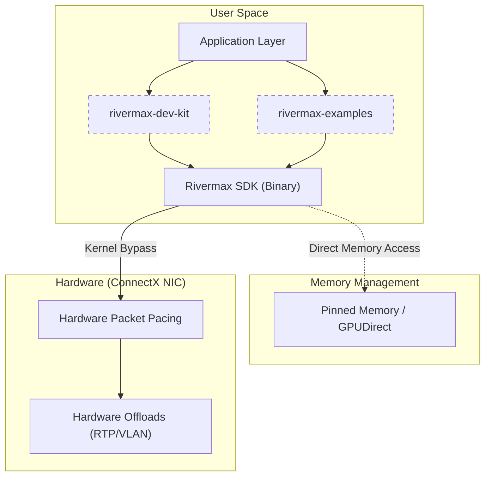
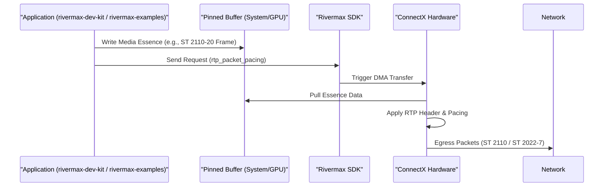

<!-- source: DeepWiki mcp.deepwiki.com · repo NVIDIA/Rivermax · page 3.1 SDK Architecture and Data Path · fetched 2026-10-26 -->

# SDK Architecture and Data Path

Relevant source files

The following files were used as context for generating this wiki page:

- [README.md](README.md)
- [resources/Rivermax_SDK.jpg](resources/Rivermax_SDK.jpg)

The NVIDIA Rivermax SDK is designed to provide a high-performance, kernel-bypass data path for media and data streaming. By leveraging NVIDIA ConnectX network interface cards (NICs), Rivermax offloads intensive networking tasks—such as packet pacing, timing, and memory management—from the CPU to the hardware. This architecture ensures deterministic performance required for professional media standards like SMPTE ST 2110.

## Internal Architecture Overview

The Rivermax architecture consists of a layered approach that bridges user-space applications directly to the hardware. This bypasses the standard OS networking stack, eliminating kernel overhead and context switching.

### System Components and Code Entities

The following diagram illustrates the relationship between the high-level architectural components and the specific code entities found in the Rivermax ecosystem.

**Architecture to Code Mapping**

**Sources:** [README.md:13-28](), [README.md:34-35]()

## Key Architectural Pillars

### 1. Kernel-Bypass Networking
Rivermax utilizes a kernel-bypass mechanism to allow applications to interact directly with the NIC. This is critical for achieving the high throughput and low latency required for 4K/8K video streams. By avoiding the Linux or Windows networking stack, Rivermax reduces CPU utilization and jitter.

### 2. Hardware Packet Pacing
One of the most significant features of the Rivermax architecture is its reliance on NIC hardware for traffic shaping. 
*   **SMPTE ST 2110-21 compliance:** The NIC handles the precise timing of packet transmission to meet the Narrow (N) or Wide (W) sender types defined by the standard.
*   **Implementation:** The application provides a sequence of packets to the SDK, and the ConnectX hardware ensures they are released onto the wire at the exact nanosecond intervals required.

### 3. Memory Management: Pinned Memory and GPUDirect
To facilitate high-speed data transfers, Rivermax manages memory buffers using specialized techniques:
*   **Pinned Memory:** Buffers are "locked" in physical memory so the NIC can access them directly via DMA (Direct Memory Access) without CPU intervention.
*   **GPUDirect:** For workloads involving video processing, Rivermax can stream data directly between the NIC and NVIDIA GPU memory. This avoids the "double-copy" penalty where data would otherwise travel from NIC to System RAM and then to GPU RAM.

## Media Essence Data Flow

The flow of media essence (Video, Audio, or Metadata) from an application to the network follows a strictly optimized path.

**Data Path: Essence to Network**

**Sources:** [README.md:13-16](), [README.md:24-28]()

## Implementation Layers

The Rivermax ecosystem provides different levels of abstraction for developers to interact with this architecture:

| Layer | Repository | Purpose |
| :--- | :--- | :--- |
| **Abstraction Layer** | `rivermax-dev-kit` | Provides high-level C++ classes and "IO Nodes" to simplify session management and buffer handling. |
| **Reference Layer** | `rivermax-examples` | Direct C API usage examples demonstrating raw buffer registration and packet transmission. |
| **Utility Layer** | `rivermax-utils` | Scripts for tuning the OS (e.g., interrupt affinity, huge pages) to support the high-speed data path. |

**Sources:** [README.md:24-28]()

## Hardware Offloads and Standards Support
The architecture is purpose-built to support industry-standard protocols directly in the hardware path:
*   **SMPTE ST 2110:** Individual essence flows (Video -20, Audio -30, Ancillary -40).
*   **SMPTE ST 2022-7:** Seamless Protection Switching, where the SDK manages dual-path redundancy at the hardware level.
*   **PTP (IEEE 1588):** Hardware-based time-stamping to ensure all packets are synchronized to a Grandmaster clock.

**Sources:** [README.md:13-16](), [README.md:34-35]()

---

