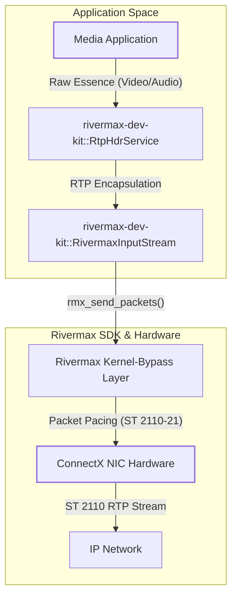
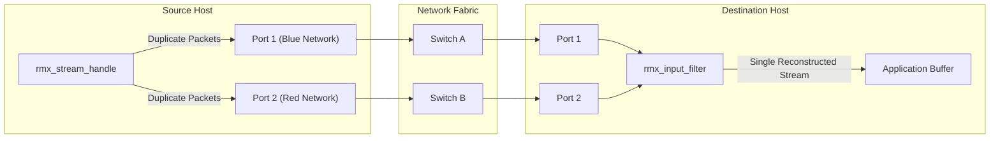
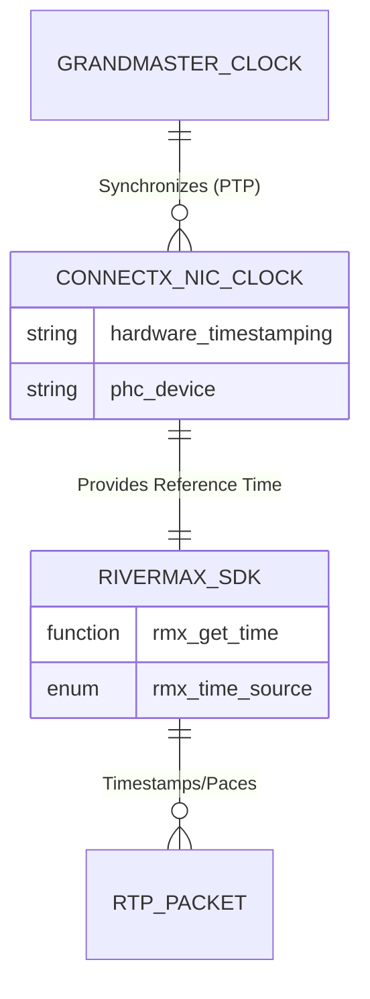

<!-- source: DeepWiki mcp.deepwiki.com · repo NVIDIA/Rivermax · page 3.2 Media Streaming Standards · fetched 2026-10-26 -->

# Media Streaming Standards

Relevant source files

The following files were used as context for generating this wiki page:

- [README.md](README.md)
- [resources/Rivermax_SDK.jpg](resources/Rivermax_SDK.jpg)

NVIDIA Rivermax is engineered to meet the rigorous requirements of professional media-over-IP environments. It provides high-performance implementations of the industry standards necessary for uncompressed video, audio, and ancillary data transmission over standard Ethernet networks. This page details the implementation and data flow for SMPTE ST 2110, SMPTE ST 2022-7, and the synchronization protocols that underpin them.

## SMPTE ST 2110: Professional Media Over IP Networks

The SMPTE ST 2110 suite of standards specifies the carriage, synchronization, and description of separate elementary essence streams over IP for real-time professional media applications. Unlike older standards that multiplexed signals into a single stream, ST 2110 treats Video, Audio, and Ancillary data as independent flows [README.md:13-16]().

### Core Essence Standards
*   **ST 2110-20 (Uncompressed Video):** Rivermax facilitates the transmission of raw video frames by offloading the packetization and pacing to the ConnectX NIC hardware.
*   **ST 2110-30 (PCM Digital Audio):** Supports high-fidelity audio streams with sub-millisecond latency.
*   **ST 2110-40 (Ancillary Data):** Handles metadata such as closed captions, timecodes, and HDR descriptors.

### Traffic Shaping (ST 2110-21)
Rivermax utilizes hardware-based packet pacing to comply with ST 2110-21. This ensures that IP traffic is distributed evenly over time, preventing "bursty" traffic that could overwhelm network switch buffers.

#### Data Flow: Essence to Network
The following diagram illustrates how media essence flows through the Rivermax SDK and interacts with the hardware for ST 2110 compliance.

**Title: ST 2110 Essence Data Path**

Sources: [README.md:13-16](), [README.md:24-28]()

---

## SMPTE ST 2022-7: Seamless Protection Switching

To ensure high availability in broadcast environments, Rivermax supports SMPTE ST 2022-7. This standard provides "hitless" redundancy by transmitting two identical copies of a stream over two independent network paths.

### Implementation Logic
1.  **Transmission:** The application sends a single essence stream to the Rivermax SDK. The SDK/NIC duplicates the packets and sends them via two different physical ports (Path A and Path B).
2.  **Reception:** The receiver listens to both paths. The Rivermax SDK performs "Seamless Protection Switching" by examining the RTP sequence numbers. If a packet is lost on Path A but arrives on Path B, the SDK delivers the Path B packet to the application, ensuring no data loss occurs.

**Title: ST 2022-7 Redundancy Mapping**

Sources: [README.md:13-16](), [README.md:34-36]()

---

## PTP (IEEE 1588): Precision Time Protocol

Synchronization is the backbone of ST 2110. Rivermax relies on the Precision Time Protocol (PTP) to ensure that all devices on the network share a common "Grandmaster" clock with nanosecond-level accuracy.

### Role in Rivermax
*   **Alignment:** PTP allows Rivermax to align disparate video and audio streams at the receiver.
*   **Hardware Timestamping:** ConnectX NICs provide hardware-level timestamping for every incoming and outgoing packet, which is critical for maintaining PTP accuracy and meeting ST 2110-21 pacing requirements.
*   **System Tuning:** The `rivermax-utils` repository provides scripts to validate PTP synchronization status on the host OS [README.md:28-29]().

### Synchronization Hierarchy
| Component | Responsibility |
| :--- | :--- |
| **Grandmaster Clock** | The absolute time source for the entire network. |
| **PTP Stack (Linux/Windows)** | Manages the synchronization between the NIC hardware clock and the OS system clock. |
| **Rivermax SDK** | Uses the NIC hardware clock to schedule packet transmission and timestamp packet arrival. |

**Title: Synchronization and Pacing Entity Relationship**

Sources: [README.md:13-16](), [README.md:28-29](), [README.md:34-36]()

---

## Summary of Standards Support

| Standard | Purpose | Rivermax Implementation |
| :--- | :--- | :--- |
| **ST 2110-20/30/40** | Media Essence | Direct API support for uncompressed buffers [README.md:13-16](). |
| **ST 2110-21** | Traffic Shaping | Hardware-based packet pacing on ConnectX NICs. |
| **ST 2022-7** | Redundancy | Multi-path seamless switching for RX and TX. |
| **IEEE 1588 (PTP)** | Synchronization | Hardware timestamping and clock integration [README.md:13-16](). |

Sources: [README.md:13-16](), [README.md:34-36]()

---

