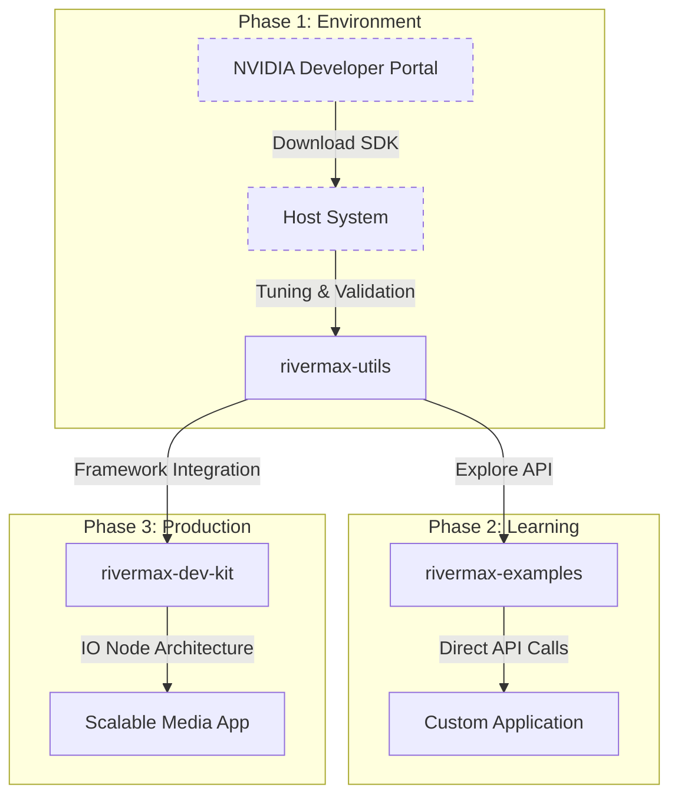

<!-- source: DeepWiki mcp.deepwiki.com · repo NVIDIA/Rivermax · page 4 Getting Started · fetched 2026-10-26 -->

# Getting Started

Relevant source files

The following files were used as context for generating this wiki page:

- [README.md](README.md)

This page provides a practical onboarding guide for developers new to the NVIDIA Rivermax ecosystem. It outlines the necessary prerequisites, the workflow for acquiring the SDK, and the recommended path for navigating the three primary open-source repositories to move from environment setup to application deployment.

### Onboarding Workflow Overview

The transition from a clean system to a functional Rivermax application follows a structured path involving hardware verification, SDK installation, host tuning, and finally, code implementation using either the low-level examples or the high-level development kit.

#### System Preparation and SDK Acquisition
Before interacting with the codebase, developers must ensure their hardware environment meets the requirements for kernel-bypass networking. This involves utilizing NVIDIA ConnectX network interface cards (NICs) and obtaining the Rivermax SDK, which is distributed via the NVIDIA Developer Portal rather than GitHub [README.md:3-5]().

For detailed hardware requirements and installation steps, see [Prerequisites and SDK Installation](#4.1).

#### Navigating the Repositories
Once the SDK is installed, developers should interact with the three specialized repositories based on their current stage in the development lifecycle:

| Repository | Purpose | Use Case |
| :--- | :--- | :--- |
| `rivermax-utils` | Environment Validation | Host OS tuning, performance benchmarking, and PTP synchronization checks [README.md:28-28](). |
| `rivermax-examples` | Reference Implementation | Understanding direct `Rivermax API` usage for custom integrations [README.md:26-26](). |
| `rivermax-dev-kit` | Application Framework | Rapid development using high-level C++ abstractions and `IO nodes` [README.md:24-24](). |

#### Developer Journey Map

The following diagram maps the conceptual "Getting Started" stages to the specific repositories and resources within the Rivermax ecosystem.

**Rivermax Onboarding Path**

**Sources:** [README.md:22-28](), [README.md:34-35]()

---

### Prerequisites and SDK Installation

Development with Rivermax requires specific hardware and software configurations to achieve high-throughput, low-latency media streaming. 

*   **Hardware:** Requires NVIDIA ConnectX-5 or newer NICs to support hardware-based packet pacing and kernel-bypass.
*   **Software:** Supports both Linux and Windows operating systems.
*   **SDK Access:** The core Rivermax SDK is proprietary and must be downloaded from the official NVIDIA networking pages [README.md:34-35](). 
*   **Environment Tuning:** After SDK installation, the `rivermax-utils` repository provides the necessary scripts to configure the host for optimal performance, including CPU pinning and memory management [README.md:28-28]().

For a complete list of supported platforms and step-by-step setup instructions, see [Prerequisites and SDK Installation](#4.1).

**Sources:** [README.md:13-16](), [README.md:34-35]()

---

### Support and Community Resources

NVIDIA provides multiple channels for support depending on the nature of the inquiry. Because the code in the GitHub repositories is provided "As Is" [README.md:20-20](), it is important to direct questions to the appropriate venue:

*   **SDK & Licensing:** Managed through the NVIDIA Developer Portal [README.md:39-39]().
*   **Bug Reports:** Technical issues related to the examples or dev-kit should be filed as "Issues" within their respective GitHub repositories [README.md:40-40]().
*   **Community Discussion:** General architectural questions and best practices are hosted on the NVIDIA Developer Forums [README.md:41-41]().

For more information on how to engage with the Rivermax team and community, see [Support and Community Resources](#4.2).

**Sources:** [README.md:37-41]()

---

