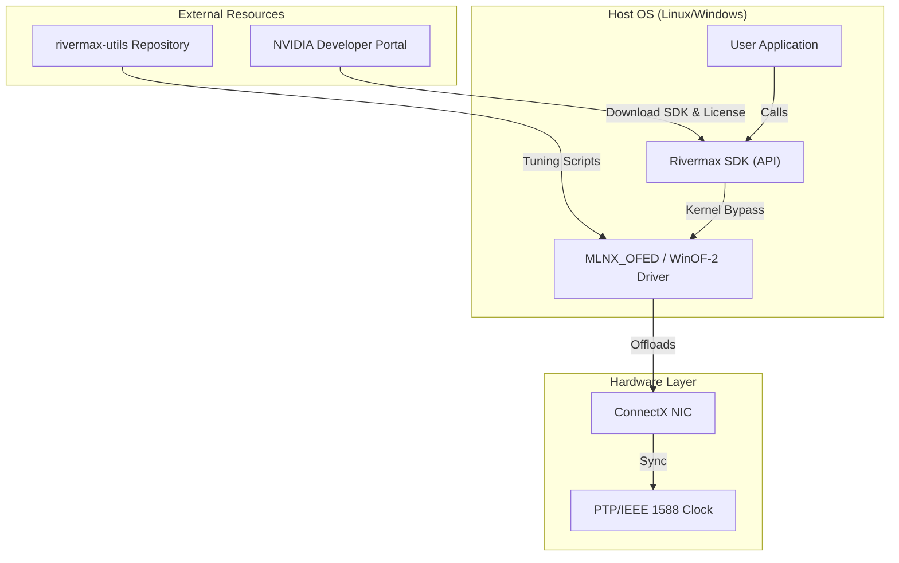
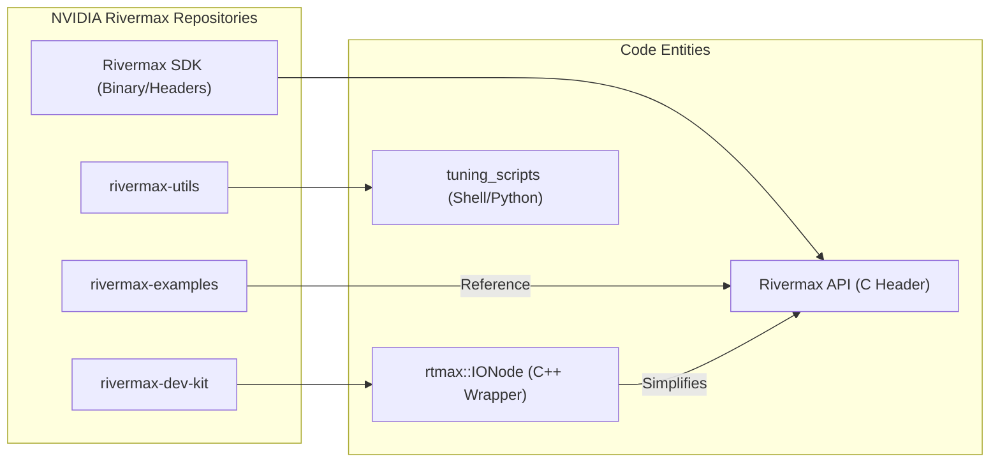

<!-- source: DeepWiki mcp.deepwiki.com · repo NVIDIA/Rivermax · page 4.1 Prerequisites and SDK Installation · fetched 2026-10-26 -->

# Prerequisites and SDK Installation

Relevant source files

The following files were used as context for generating this wiki page:

- [README.md](README.md)
- [resources/Rivermax_SDK.jpg](resources/Rivermax_SDK.jpg)

This page details the hardware and software requirements for deploying NVIDIA Rivermax, the process for acquiring the SDK, and the initial steps for platform-specific installation. NVIDIA Rivermax is a high-performance networking SDK designed for media and data streaming, leveraging kernel-bypass and NIC hardware offloads [README.md:11-16]().

## Hardware Requirements

The primary requirement for Rivermax is a compatible NVIDIA network interface card (NIC). The SDK is optimized to work with the **ConnectX** family of adapters to provide hardware-level features such as packet pacing, precise timing, and GPUDirect [README.md:13-16]().

| Component | Requirement |
| :--- | :--- |
| **Network Interface Card** | NVIDIA ConnectX-5, ConnectX-6, ConnectX-7 (or newer) |
| **Processor** | x86_64 or ARM64 (platform dependent) |
| **Acceleration** | NVIDIA GPU (Optional, for GPUDirect technologies) |

## Operating System Support

Rivermax supports both Linux and Windows environments, though specific installation steps and tuning requirements vary by platform [README.md:35-35]().

*   **Linux:** Various distributions including Ubuntu, CentOS, and RHEL.
*   **Windows:** Windows 10/11 and Windows Server versions.

## SDK Acquisition and Licensing

The Rivermax SDK is not hosted directly on GitHub. It must be downloaded from the NVIDIA Developer Portal.

1.  **Download:** Access the [NVIDIA Rivermax Getting Started](https://developer.nvidia.com/networking/rivermax-getting-started) page [README.md:3-5]().
2.  **Licensing:** Rivermax requires a valid license to operate. Licensing information and SDK support can be requested through the [NVIDIA Developer Portal](https://developer.nvidia.com/networking/rivermax) [README.md:39-39]().

## Installation Workflow

The installation process involves setting up the driver, installing the Rivermax SDK, and tuning the host environment for high-throughput, low-latency media streaming.

### System Components Overview

The following diagram illustrates the relationship between the SDK, the hardware, and the external utilities used for installation and configuration.

**Rivermax Environment Architecture**

Sources: [README.md:11-16](), [README.md:28-28](), [README.md:34-35]()

### Platform-Specific Steps

#### 1. Driver Installation
Before installing the SDK, the appropriate NVIDIA networking drivers must be installed:
*   **Linux:** MLNX_OFED or NVIDIA-Networking-Stack.
*   **Windows:** WinOF-2.

#### 2. SDK Installation
After downloading the SDK package (e.g., `.deb`, `.rpm`, or `.msi`):
*   **Linux:** Use the package manager (e.g., `sudo dpkg -i rivermax-sdk.deb`).
*   **Windows:** Run the installer executable and follow the wizard.

#### 3. Environment Preparation
High-bandwidth media streaming (e.g., SMPTE ST 2110) requires specific host tuning, such as configuring hugepages, CPU pinning, and interrupt moderation.

NVIDIA provides the `rivermax-utils` repository specifically for these tasks [README.md:28-28]().

**Rivermax Setup Utilities**

| Tool Category | Purpose | Repository Link |
| :--- | :--- | :--- |
| **Host Tuning** | OS optimization for Linux/Windows | [rivermax-utils](https://github.com/NVIDIA/rivermax-utils) |
| **Validation** | Environment and performance verification | [rivermax-utils](https://github.com/NVIDIA/rivermax-utils) |
| **Benchmarking** | Throughput and latency testing | [rivermax-utils](https://github.com/NVIDIA/rivermax-utils) |

Sources: [README.md:28-28](), [README.md:34-35]()

## Mapping Code Entities to Installation

When moving from installation to development, the following code entities represent the primary entry points for the SDK and its associated wrappers.

**SDK to Code Entity Mapping**

Sources: [README.md:22-29]()

## Support and Maintenance

*   **SDK Support:** For issues regarding the binary SDK or licensing, use the [NVIDIA Developer Portal](https://developer.nvidia.com/networking/rivermax) [README.md:39-39]().
*   **Code Issues:** For issues with the example code or the development kit, file an issue in the respective GitHub repository (e.g., `rivermax-examples` or `rivermax-dev-kit`) [README.md:40-40]().
*   **Community:** General questions can be directed to the [NVIDIA Developer Forums](https://forums.developer.nvidia.com/) [README.md:41-41]().

Sources: [README.md:37-42]()

---

