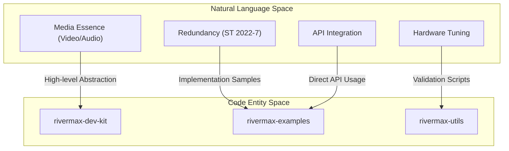
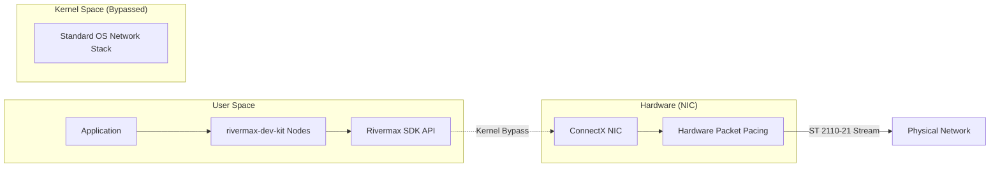

<!-- source: DeepWiki mcp.deepwiki.com · repo NVIDIA/Rivermax · page 5 Glossary · fetched 2026-10-26 -->

# Glossary

Relevant source files

The following files were used as context for generating this wiki page:

- [README.md](README.md)
- [resources/Rivermax_SDK.jpg](resources/Rivermax_SDK.jpg)

This page provides technical definitions for codebase-specific terms, industry standards, and architectural concepts essential for working with the NVIDIA Rivermax SDK. It serves as a bridge between high-level domain concepts and the specific implementations found across the Rivermax ecosystem repositories.

## Domain Concepts and Standards

### SMPTE ST 2110
A suite of standards from the Society of Motion Picture and Television Engineers (SMPTE) that describes how to send digital media over IP networks. Rivermax is specifically optimized to handle the high-bandwidth requirements of these standards [README.md:13-16]().
*   **ST 2110-20**: Uncompressed active video.
*   **ST 2110-30**: PCM Digital Audio.
*   **ST 2110-40**: Ancillary data (closed captions, timecodes).
*   **ST 2110-21**: Traffic shaping and delivery timing for video, which Rivermax handles via hardware-compliant packet pacing.

### SMPTE ST 2022-7 (Seamless Protection Switching)
A standard for redundant hitless switching. It involves sending two identical streams of packets over two different network paths. The receiver merges these streams, discarding duplicates, to ensure uninterrupted playback even if one network path fails.

### PTP (Precision Time Protocol / IEEE 1588)
A protocol used to synchronize clocks throughout a computer network. In professional media, PTP is the "digital genlock" that ensures all senders and receivers are synchronized to a grandmaster clock with sub-microsecond precision.

### GPUDirect
An NVIDIA technology that enables a direct path for data exchange between the GPU and third-party devices (like a ConnectX NIC). In Rivermax, this allows video frames to be transferred directly from the NIC to GPU memory (or vice versa) without CPU intervention or intermediate system memory copies [README.md:15-16]().

---

## Codebase and SDK Entities

### Rivermax SDK
The core library provided by NVIDIA for optimized networking. It utilizes kernel-bypass techniques to achieve high throughput and low latency [README.md:13-14]().

### rivermax-dev-kit
A high-level C++ software kit designed to simplify application development. It provides an abstraction layer over the raw Rivermax API using a node-based architecture [README.md:24-24]().

### rivermax-examples
A collection of reference implementations showing how to use the Rivermax API directly for various media streaming use cases [README.md:26-27]().

### rivermax-utils
A set of operational tools and scripts used for environment validation, performance tuning (e.g., setting CPU affinity, configuring hugepages), and NIC configuration [README.md:28-28]().

---

## Architectural Mapping

The following diagram illustrates how the conceptual components of a media stream map to the software entities within the Rivermax ecosystem.

### Logic to Code Entity Mapping
This diagram bridges the gap between the "Natural Language Space" of media streaming and the "Code Entity Space" of the repositories.

**Sources:** [README.md:22-29]()

### Data Flow and SDK Architecture
This diagram represents the internal data path from the application layer down to the hardware, as supported by the SDK architecture.

**Sources:** [README.md:1-16](), [resources/Rivermax_SDK.jpg:1-10]()

---

## Technical Terminology Table

| Term | Definition | Code/Reference Pointer |
| :--- | :--- | :--- |
| **Kernel Bypass** | A technique where the network card communicates directly with user-space memory, skipping the OS kernel to reduce latency and CPU overhead. | [README.md:13-14]() |
| **IO Node** | An abstraction in the `rivermax-dev-kit` representing a source or destination of a media stream. | [README.md:24-24]() |
| **Packet Pacing** | The process of sending packets at a constant, calculated rate to avoid network congestion and comply with ST 2110-21. | [README.md:13-16]() |
| **As Is** | The licensing/support status of the GitHub examples; they are tested for specific configurations but provided without formal warranty. | [README.md:20-20]() |
| **ConnectX** | The family of NVIDIA Network Interface Cards (NICs) required to run Rivermax. | [README.md:34-35]() |

**Sources:** [README.md:1-42](), [resources/Rivermax_SDK.jpg:1-10]()