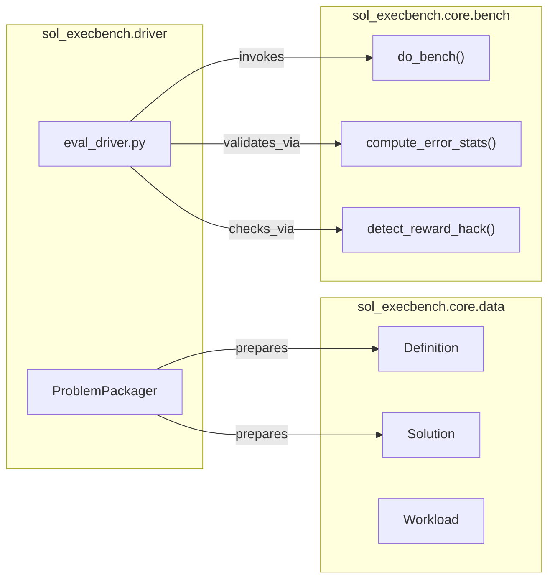

<!-- source: DeepWiki mcp.deepwiki.com · repo NVIDIA/SOL-ExecBench · page 1 SOL-ExecBench Overview · fetched 2026-10-26 -->

# SOL-ExecBench Overview

<details>
<summary>Relevant source files</summary>

The following files were used as context for generating this wiki page:

- [README.md](README.md)
- [pyproject.toml](pyproject.toml)

</details>


**Speed-Of-Light ExecBench** is a rigorous GPU kernel evaluation and benchmarking framework designed to evaluate custom GPU kernel solutions for correctness and performance [README.md:11-12](). It serves as a benchmarking platform for AI-generated kernels across a wide variety of Domain Specific Languages (DSLs) supported by NVIDIA hardware [README.md:11-12]().

The framework compares candidate solutions against reference implementations to ensure numerical correctness, identifies "reward hacking" (cheating) attempts, and measures performance under reproducible conditions using locked GPU clocks [README.md:13-16]().

### System Architecture and Flow

The system is organized into three distinct layers that manage the lifecycle of a benchmark from CLI invocation to result reporting. The orchestration logic is centered around the `sol-execbench` CLI entrypoint and the `ProblemPackager`.

**High-Level Execution Flow:**
1.  The **CLI** parses user input and identifies the problem/solution [README.md:48-56]().
2.  The **ProblemPackager** stages all necessary files (definitions, workloads, source code) into a temporary directory.
3.  A **Subprocess** is spawned to compile C++/CUDA code if required (using `build_ext.py`).
4.  The **Evaluation Driver** (`eval_driver.py`) runs as a self-contained subprocess to execute the kernel, check correctness, and measure timing.
5.  **JSONL Traces** are streamed back to the CLI for display and logging [README.md:77-78]().

**System Component Diagram**
```mermaid
graph TD
    subgraph "User_Space"
        ["sol-execbench CLI"]
    end

    subgraph "Orchestration_Layer"
        Packager["sol_execbench.driver.packager:ProblemPackager"]
        BatchRunner["scripts/run_dataset.py"]
    end

    subgraph "Execution_Subprocess"
        Driver["sol_execbench/driver/templates/eval_driver.py"]
        Timing["sol_execbench.core.bench.timing:time_runnable"]
        Correctness["sol_execbench.core.bench.correctness:compute_error_stats"]
        RewardHack["sol_execbench.core.bench.reward_hack:detect_reward_hack"]
    end

    subgraph "Data_Layer"
        Definition["definition.json"]
        Workload["workload.jsonl"]
        Solution["solution.json"]
        Trace["Trace (output JSONL)"]
    end

    ["sol-execbench CLI"] --> Packager
    BatchRunner --> ["sol-execbench CLI"]
    Packager --> Driver
    Driver --> Timing
    Driver --> Correctness
    Driver --> RewardHack
    Definition -.-> Packager
    Workload -.-> Packager
    Solution -.-> Packager
    Driver -.-> Trace
```
Sources: [README.md:48-118](), [pyproject.toml:27-28]()

### Key Concepts

#### 1. Supported DSLs and Languages
SOL-ExecBench supports a diverse set of GPU programming models, including specialized libraries like `cuda-tile` and `nvidia-cudnn-frontend` [README.md:20](), [pyproject.toml:14-15]():
*   **Python-based:** PyTorch, Triton, CuTe DSL, cuTile, cuDNN Frontend.
*   **C++-based:** CUDA C++, CUTLASS, cuDNN, cuBLAS.

#### 2. SOL-Score
The framework uses **SOL-Score** as its primary metric [README.md:18](). This metric grades kernel performance based on the theoretical hardware roofline of an NVIDIA B200 GPU, derived from **SOLAR** (Speed-Of-Light Analytical Report) estimates [README.md:18]().

#### 3. Anti-Cheating (Reward Hack Detection)
To ensure the integrity of benchmarks, the framework includes defense mechanisms to detect timing manipulation, stream injection, and monkey-patching of measurement utilities. This is handled by the `sol_execbench.core.bench.reward_hack` module.

#### 4. Calling Conventions
The framework supports two primary ways for kernels to handle data:
*   **Destination-Passing Style (DPS):** The kernel modifies pre-allocated output tensors in-place.
*   **Return-Value Style:** The kernel returns new tensors directly.

**Code Entity Relationship Diagram**

Sources: [README.md:104-118](), [pyproject.toml:11-26]()

### Subsystem Overviews

#### Getting Started
New users should begin by setting up the Docker environment, which includes the NVIDIA Container Toolkit and necessary drivers (version 580+) [README.md:22-28](). The setup involves downloading benchmark data via `scripts/download_data.sh` and building the container using `scripts/run_docker.sh` [README.md:30-45]().
For details, see [Getting Started](#1.1).

#### Project Structure and Configuration
The repository uses `uv` for dependency management and `Ruff` for linting [pyproject.toml:43-72](). The core logic is split between `sol_execbench.core` (data models and benchmarking logic) and `sol_execbench.driver` (execution orchestration). Build requirements are managed via `hatchling` [pyproject.toml:1-3]().
For details, see [Project Structure and Configuration](#1.2).

#### Data Schemas
The framework is built on four core JSON schemas:
*   **Definition:** Kernel signatures and reference code [README.md:128]().
*   **Workload:** Specific input shapes and tolerances [README.md:129]().
*   **Solution:** Source code and build instructions for the candidate [README.md:131]().
*   **Trace:** The final performance and correctness results [README.md:133]().

#### Evaluation Pipeline
The pipeline manages the lifecycle of an evaluation, from staging files in a temporary directory to executing the `eval_driver.py` template in a controlled subprocess. It can be invoked for single problems via the CLI or for entire datasets via `scripts/run_dataset.py` [README.md:83-122]().

#### Core Benchmarking Engine
The `sol_execbench.core.bench` package contains the "source of truth" for measurement, including CUDA event timing, L2 cache clearing, and numerical error calculation.

#### Docker Environment
The provided Docker setup ensures a reproducible environment with CUDA 13.1, CUTLASS 4.4.1, and all necessary DSL dependencies like `cuda-tile` and `nvidia-cudnn-frontend` pre-installed [pyproject.toml:11-26](), [README.md:38-45]().

---

