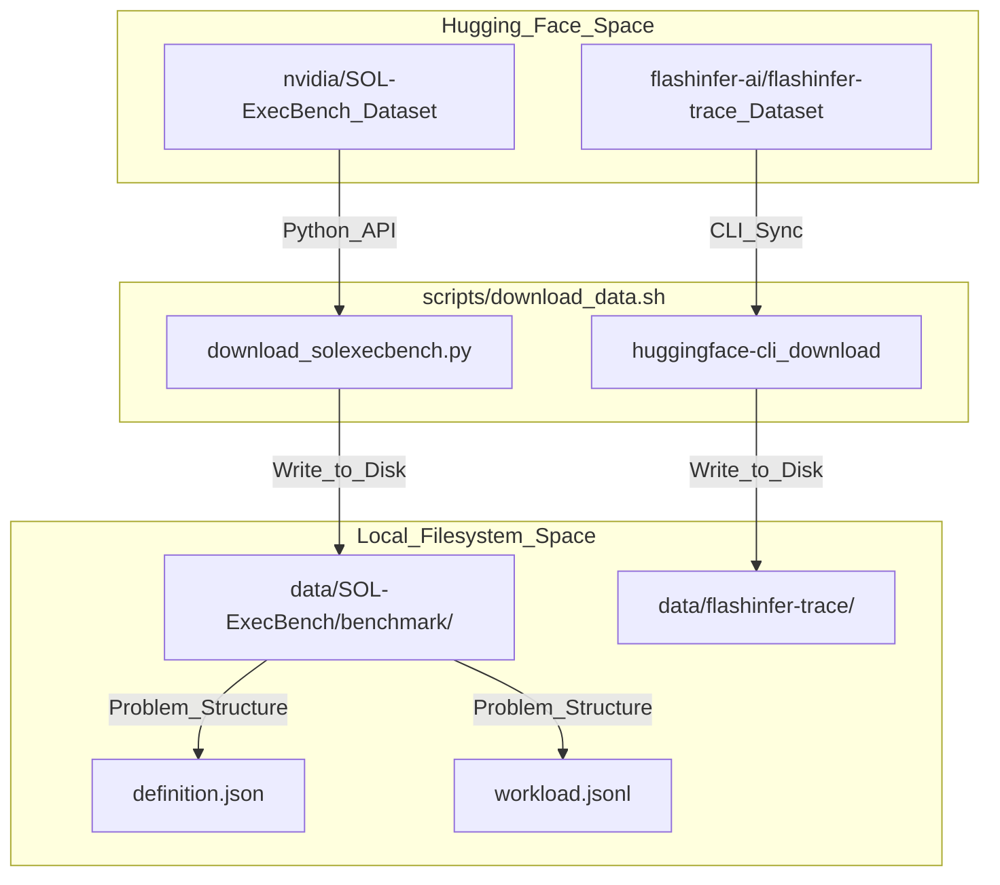
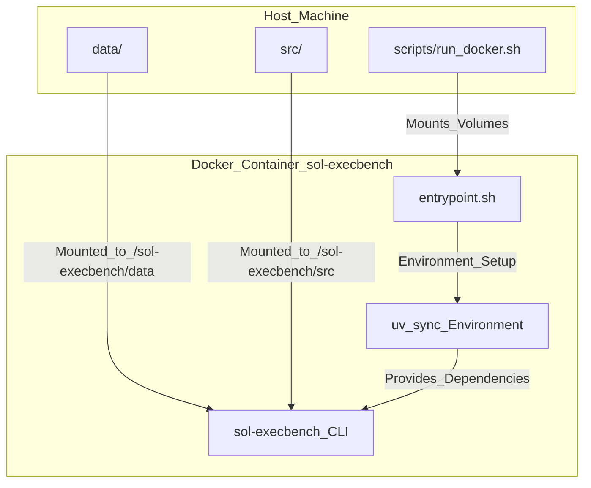

<!-- source: DeepWiki mcp.deepwiki.com · repo NVIDIA/SOL-ExecBench · page 1.1 Getting Started · fetched 2026-10-26 -->

# Getting Started

<details>
<summary>Relevant source files</summary>

The following files were used as context for generating this wiki page:

- [README.md](README.md)
- [docker/Dockerfile](docker/Dockerfile)
- [uv.lock](uv.lock)

</details>


This page provides a step-by-step guide for setting up the **SOL-ExecBench** environment, downloading the required datasets, and running your first kernel evaluation. SOL-ExecBench is a rigorous GPU kernel evaluation framework designed to benchmark AI-generated kernel solutions across various DSLs (PyTorch, Triton, CUTLASS, etc.) with automated checks for correctness, performance, and reward hacking [README.md:11-20]().

## Prerequisites

Before starting, ensure your host machine meets the following requirements:

*   **NVIDIA Driver**: Version 580 or higher [README.md:26-26]().
*   **Docker**: Installed with the [NVIDIA Container Toolkit](https://docs.nvidia.com/datacenter/cloud-native/container-toolkit/latest/install-guide.html) [README.md:24-24]().
*   **Hugging Face CLI**: Required for dataset downloads (`pip install huggingface-hub[cli]`) [README.md:25-25]().
*   **Python**: Version 3.12 or higher is required for the host and environment [uv.lock:3-3]().

## 1. Download Benchmark Data

The benchmark requires two primary datasets: the core SOL-ExecBench problems and the FlashInfer traces. Use the provided script to fetch these:

```bash
./scripts/download_data.sh
```
[README.md:32-34]()

This script orchestrates the download of:
1.  **SOL-ExecBench**: Downloads the `nvidia/SOL-ExecBench` dataset into `data/SOL-ExecBench/` [README.md:36-36]().
2.  **FlashInfer Trace**: Downloads the `flashinfer-ai/flashinfer-trace` dataset into `data/flashinfer-trace` [README.md:36-36]().

### Data Flow: From Hugging Face to Local Filesystem

The following diagram illustrates how the download process transforms remote dataset assets into the local directory structure required by the CLI.

**Dataset Ingestion Flow**

Sources: [README.md:30-36](), [scripts/run_dataset.py:110-113]()

## 2. Environment Setup (Docker)

SOL-ExecBench uses a Docker-based environment to ensure all CUDA toolchains and DSL dependencies (like CUTLASS and cuDNN) are correctly configured.

### Build and Launch
Run the helper script to build the image and enter an interactive shell:
```bash
./scripts/run_docker.sh --build
```
[README.md:40-42]()

### Docker Environment Implementation
The Dockerfile uses `nvidia/cuda:13.1.1-cudnn-devel-ubuntu24.04` as a base [docker/Dockerfile:5-5](). It installs several key components:
*   **CUTLASS**: Cloned to `/usr/local/cutlass` and exported via `CUTLASS_DIR` [docker/Dockerfile:21-22]().
*   **uv**: Used for fast Python dependency management, installing from `uv.lock` to ensure reproducible environments [docker/Dockerfile:30-30](), [docker/Dockerfile:67-68]().
*   **Clock Locking**: The container user is granted `NOPASSWD` access to `nvidia-smi` to allow the benchmark engine to lock GPU clocks for reproducible timing [docker/Dockerfile:46-46]().

**Environment Architecture**

Sources: [docker/Dockerfile:5-84](), [README.md:40-44]()

## 3. Running Your First Evaluation

Once inside the container, you can evaluate a kernel solution using the `sol-execbench` CLI. The CLI is registered as a console script via `uv sync` during the build [docker/Dockerfile:76-78]().

### Single Problem Evaluation
To evaluate one of the provided examples (e.g., a CuTe DSL kernel):
```bash
sol-execbench examples/cute_dsl/jamba_attn_proj \
  --solution examples/cute_dsl/jamba_attn_proj/solution_cute_dsl.json
```
[README.md:66-68]()

### Batch Dataset Evaluation
To run an entire subset of the downloaded benchmark data, use the `run_dataset.py` script. This script can auto-build a `solution.json` from a single code file if provided via `--solution-name` [README.md:109-110]().

```bash
uv run scripts/run_dataset.py data/SOL-ExecBench/benchmark/L1 --solution-name reference.py
```
[README.md:116-116]()

## Key Configuration & Dependencies

The project's dependencies and build system are managed by `uv` and defined in `pyproject.toml` and `uv.lock` [uv.lock:1-9]().

| Dependency | Purpose |
| :--- | :--- |
| `aiohttp` | Async HTTP requests for dataset management [uv.lock:21-22]() |
| `CUTLASS` | C++ template library for high-performance GEMM [docker/Dockerfile:21-23]() |
| `uv` | High-performance Python package and project manager [docker/Dockerfile:30-30]() |
| `nvidia-smi` | GPU management for clock locking [docker/Dockerfile:46-46]() |

### GPU Clock Locking
For stable benchmarking, the `--lock-clocks` flag (or `lock_clocks` in `BenchmarkConfig`) triggers the system to lock GPU and DRAM clocks [README.md:80-80](), [README.md:92-92](). This behavior is critical for preventing performance variance due to thermal throttling or power management.

Sources: [docker/Dockerfile:1-85](), [uv.lock:1-52](), [README.md:1-122]()

---

