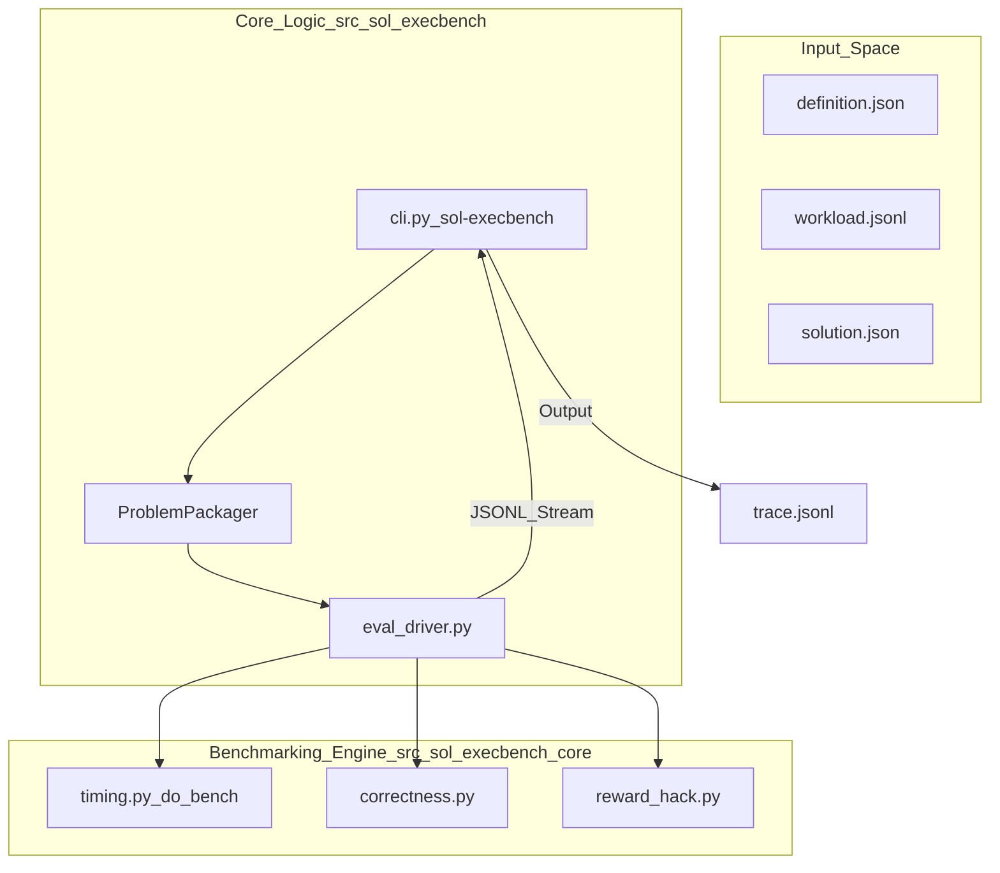
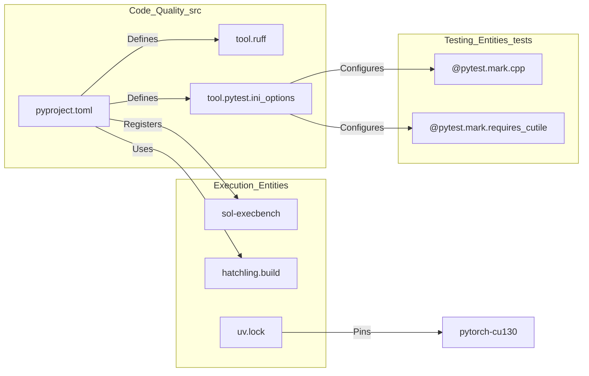

<!-- source: DeepWiki mcp.deepwiki.com · repo NVIDIA/SOL-ExecBench · page 1.2 Project Structure and Configuration · fetched 2026-10-26 -->

# Project Structure and Configuration

Relevant source files

The following files were used as context for generating this wiki page:

- [pyproject.toml](pyproject.toml)
- [uv.lock](uv.lock)

This page details the organizational layout of the `SOL-ExecBench` repository, its build configuration via `pyproject.toml`, and the developer tooling required to maintain code quality and compliance.

## Repository Layout

The repository is organized to separate core benchmarking logic from dataset definitions, examples, and infrastructure.

| Directory | Purpose |
| :--- | :--- |
| `src/sol_execbench/` | Primary source code containing the CLI, evaluation driver, and core benchmarking engine. |
| `tests/` | Unit and end-to-end tests, including hardware-gated tests for specific GPU architectures. |
| `examples/` | Sample kernel implementations across various DSLs (Triton, CUDA, etc.) used for demonstration and testing. |
| `scripts/` | Utility scripts for batch evaluation (`run_dataset.py`) and environment management. |
| `docker/` | Dockerfiles and entrypoint scripts to ensure a reproducible benchmarking environment. |
| `docs/` | Documentation source files. |

### Source Code Organization (`src/sol_execbench/`)

The internal structure of the source directory follows a modular design:
*   **`cli.py`**: The entry point for the `sol-execbench` command-line tool [pyproject.toml:28-28]().
*   **`core/`**: Contains the fundamental logic for timing, correctness checking, and anti-cheating measures.
*   **`schemas/`**: Pydantic models defining the data contract for Definitions, Workloads, Solutions, and Traces.

### High-Level Data Flow Diagram

The following diagram illustrates how the project structure facilitates the flow from a problem definition to a performance trace.

**Kernel Evaluation Data Flow**

Sources: [pyproject.toml:28-28]()

## Build Configuration (`pyproject.toml`)

The project uses `hatchling` as the build backend [pyproject.toml:1-3]() and `uv` for dependency management, utilizing a `uv.lock` file for reproducible environments [uv.lock:1-9]().

### Key Dependencies
The project requires Python 3.12+ [pyproject.toml:10-10]() and relies on several NVIDIA-specific libraries for kernel development:
*   **Deep Learning**: `torch==2.9.0` [pyproject.toml:12-12]().
*   **DSLs**: `cuda-tile==1.1.0`, `nvidia-cudnn-frontend==1.18.0`, and `nvidia-cutlass-dsl[cu13]==4.4.1` [pyproject.toml:14-16]().
*   **Infrastructure**: `pydantic>=2.12.5` for schema validation [pyproject.toml:17-17](), `click>=8.0` and `rich>=13.0` for the CLI interface [pyproject.toml:19-20](), and `safetensors>=0.7.0` for efficient tensor I/O [pyproject.toml:18-18]().
*   **Specialized Extensions**: `torch-c-dlpack-ext`, `apache-tvm-ffi`, and `cupti-python` [pyproject.toml:22-24]().

### Python Package Entry Points
The main CLI tool is registered via the `project.scripts` table:
*   `sol-execbench`: Points to the `cli` function in `sol_execbench.cli` [pyproject.toml:28-28]().

### Test Configuration
Pytest is configured to run in parallel by default using `pytest-xdist` [pyproject.toml:33-34]() with the `-n auto` flag [pyproject.toml:37-37](). Custom markers are defined to gate tests that require specific hardware or toolchains:
*   `cpp`: For tests requiring a C++/CUDA compiler toolchain [pyproject.toml:39-39]().
*   `requires_cutile`: For tests requiring cuTile, which is restricted to Blackwell (SM100+) architecture [pyproject.toml:40-40]().

Sources: [pyproject.toml:1-41](), [uv.lock:1-52]()

## Developer Tooling and Compliance

To maintain high code quality and adhere to NVIDIA's standards, several tools are integrated into the workflow.

### Linting and Formatting
The project uses **Ruff** for both linting and code formatting. The configuration excludes generated files and specific directories from strict linting to allow for diverse kernel implementation styles:
*   **Exclusions**: `.git`, `.venv`, `__pycache__`, `build`, `dist`, `data`, and `examples` are excluded [pyproject.toml:45-55]().
*   **Linting Rules**: The `E741` rule (ambiguous variable name) is specifically ignored [pyproject.toml:58-58]().

### Package Management with uv
The project uses `uv` with a specific index for PyTorch to ensure CUDA 13.0 compatibility on Linux and Windows platforms [pyproject.toml:60-71]().

### Developer Tooling Integration
The following diagram maps the developer tools to their respective roles in the codebase.

**Developer Tooling and Entity Mapping**

Sources: [pyproject.toml:1-72](), [uv.lock:1-10]()

---

