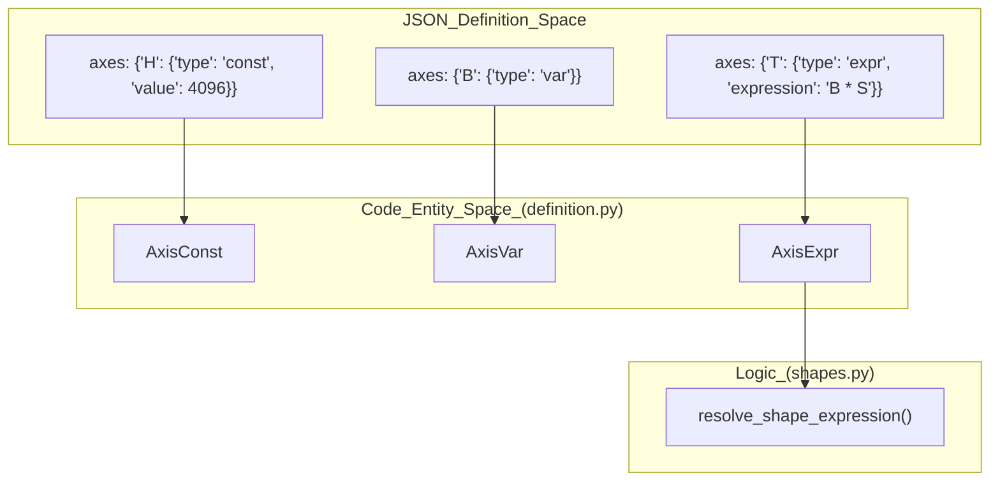
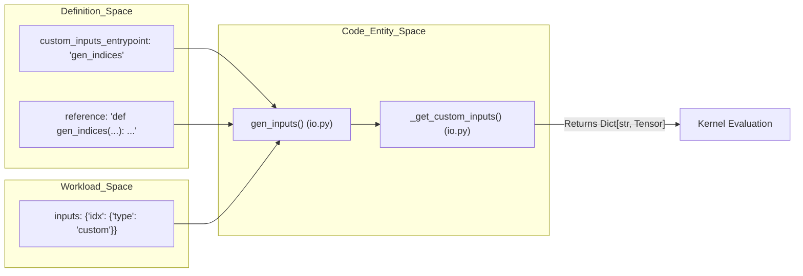

<!-- source: DeepWiki mcp.deepwiki.com · repo NVIDIA/SOL-ExecBench · page 2.1 Definition Schema · fetched 2026-10-26 -->

# Definition Schema

Relevant source files

The following files were used as context for generating this wiki page:

- [README.md](README.md)
- [docs/solution.md](docs/solution.md)

The **Definition Schema** provides the formal specification for a computational workload in SOL-ExecBench. It acts as the operator's contract, defining the symbolic axes, tensor shapes, data types, and a correct PyTorch reference implementation. A `definition.json` file is the single source of truth used to validate solutions and generate workloads.

## Top-Level Schema

The `Definition` class is a Pydantic model that enforces the structure of the `definition.json` file. It inherits from `BaseModelWithDocstrings` to ensure metadata is preserved in the JSON schema [src/sol_execbench/core/data/definition.py:136-143]().

| Field | Type | Required | Description |
| :--- | :--- | :--- | :--- |
| `name` | `NonEmptyString` | Yes | Unique human-readable name for the kernel. |
| `op_type` | `str` | No | Compute category (e.g., `gemm`, `rmsnorm`). |
| `axes` | `dict[str, AxisSpec]` | Yes | Map of symbolic names to `AxisConst`, `AxisVar`, or `AxisExpr`. |
| `inputs` | `dict[str, TensorSpec]` | Yes | Named input tensors/scalars. |
| `outputs` | `dict[str, TensorSpec]` | Yes | Named output tensors. |
| `reference` | `str` | Yes | Python source code containing a `run` function. |
| `custom_inputs_entrypoint`| `str` | No | Function name in `reference` for structured input generation. |

Sources: [src/sol_execbench/core/data/definition.py:136-168](), [docs/definition.md:21-31]()

## Axes: Dimension Definitions

Axes define the symbolic dimensions used by tensors. There are three types of axes:

1.  **`AxisConst`**: Fixed at definition time. Used for dimensions that do not change across workloads (e.g., a model's hidden size) [src/sol_execbench/core/data/definition.py:35-49]().
2.  **`AxisVar`**: Determined at runtime by the `Workload`. These represent dynamic dimensions like batch size or sequence length [src/sol_execbench/core/data/definition.py:51-63]().
3.  **`AxisExpr`**: Computed from other axes using mathematical expressions [src/sol_execbench/core/data/definition.py:65-79]().

### Expression Evaluation
`AxisExpr` supports basic arithmetic via `resolve_shape_expression`. Supported operators include `+`, `-`, `*`, `/`, `//`, `%`, `**`, and unary `+/-` [src/sol_execbench/core/data/shapes.py:19-32](). The evaluator uses Python's `ast` module to safely parse these expressions [src/sol_execbench/core/data/shapes.py:73-82]().

### Axis to Code Mapping
The following diagram shows how the `Definition` axes map to the internal Pydantic classes and the evaluation logic.

**Axis Entity Mapping**

Sources: [src/sol_execbench/core/data/definition.py:35-79](), [src/sol_execbench/core/data/shapes.py:35-82]()

## Tensor Specifications

The `TensorSpec` class defines the requirements for each input and output [src/sol_execbench/core/data/definition.py:117-131]().

*   **`shape`**: A list of axis names. If `null`, the input is treated as a Python scalar (`int`, `float`, or `bool`). If `[]`, it is a 0-D `torch.Tensor` [docs/definition.md:103-108]().
*   **`dtype`**: Must be one of the supported strings in the `DType` enum [src/sol_execbench/core/data/definition.py:81-115]().

### Supported Data Types
SOL-ExecBench supports a wide range of types, including standard IEEE floats, Brain Floats, and low-precision formats like FP8 and FP4 [src/sol_execbench/core/data/dtypes.py:57-75]().

| Category | DType Strings |
| :--- | :--- |
| **Floating Point** | `float64`, `float32`, `float16`, `bfloat16` |
| **Quantized/Low-bit** | `float8_e4m3fn`, `float8_e5m2`, `float4_e2m1`, `float4_e2m1fn_x2` |
| **Integer/Bool** | `int64`, `int32`, `int16`, `int8`, `bool` |

Sources: [src/sol_execbench/core/data/definition.py:81-115](), [src/sol_execbench/core/data/dtypes.py:57-75]()

## Reference Implementation

The `reference` field contains Python code that serves as the "ground truth" for correctness [src/sol_execbench/core/data/definition.py:160-163]().

### Requirements
1.  **Entrypoint**: Must define a function `def run(...)` [docs/definition.md:114]().
2.  **Signature**: The `run` function arguments must match the keys defined in the `inputs` dictionary.
3.  **Returns**: Must return the tensors specified in the `outputs` dictionary [docs/definition.md:116]().
4.  **Validation**: The Pydantic model uses `_validate_reference_code` to ensure the code is syntactically valid and contains the required `run` function [src/sol_execbench/core/data/definition.py:169-171]().

### Custom Inputs Entrypoint
For workloads requiring structured data (e.g., valid indices for a Router or non-decreasing ragged offsets), the `custom_inputs_entrypoint` field identifies a second function within the `reference` code [docs/definition.md:125-132]().

**Signature**: `def custom_fn(axes_and_scalars: dict[str, int], device: torch.device) -> dict[str, torch.Tensor]` [src/sol_execbench/core/data/definition.py:153]().

**Data Flow for Custom Inputs**

Sources: [src/sol_execbench/core/data/definition.py:152-153](), [docs/definition.md:139-150](), [src/sol_execbench/core/bench/io.py:344-383]()

## Validation Rules

The `Definition` model performs several automated checks during instantiation:
*   **Reference Validity**: Uses `ast.parse` to ensure the Python code is valid and contains a `run` function [src/sol_execbench/core/data/definition.py:169-171]().
*   **Axis Integrity**: Ensures `AxisExpr` only references axes that are defined in the `axes` dictionary.
*   **Tensor-Axis Alignment**: Validates that every axis name used in `TensorSpec.shape` exists in the `axes` dictionary.
*   **Name Collision**: Ensures input and output names do not overlap [src/sol_execbench/core/data/definition.py:158-159]().

Sources: [src/sol_execbench/core/data/definition.py:145-171]()

---

