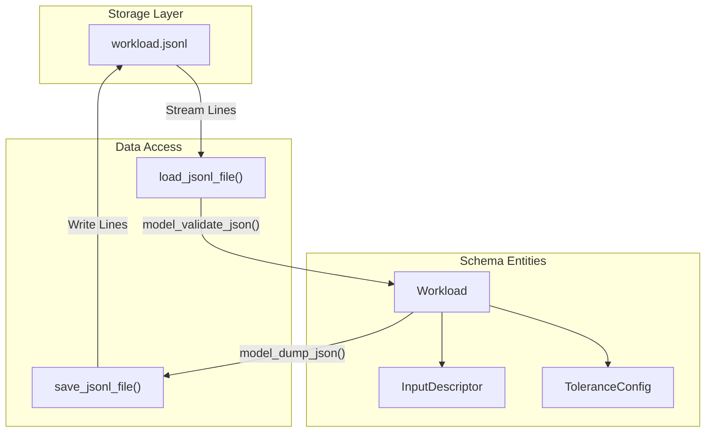
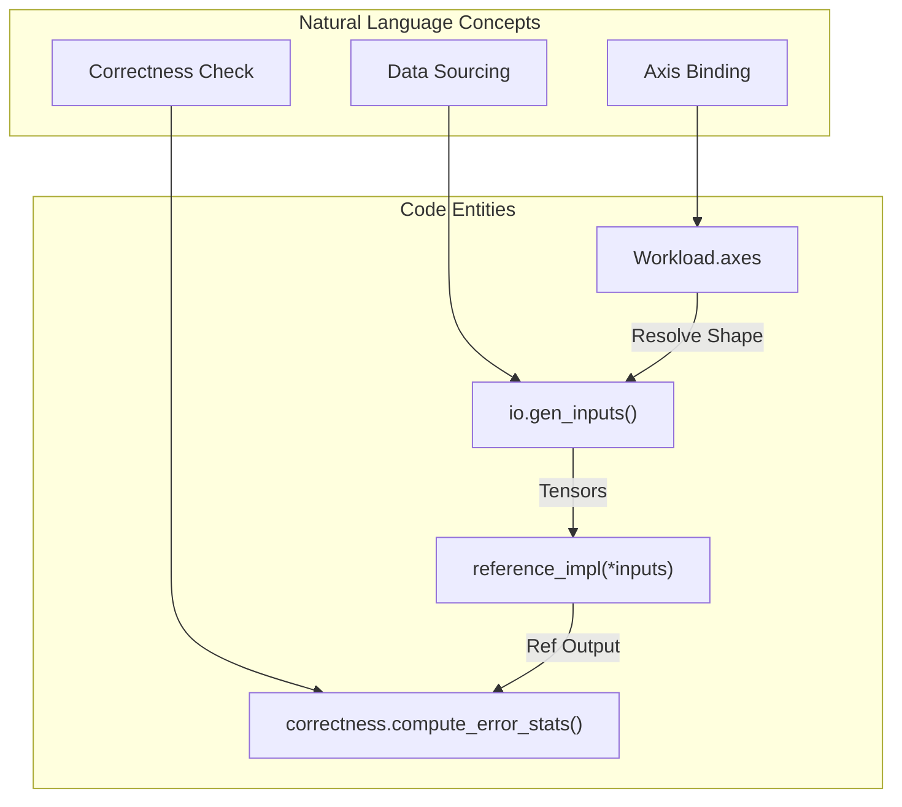

<!-- source: DeepWiki mcp.deepwiki.com · repo NVIDIA/SOL-ExecBench · page 2.2 Workload Schema · fetched 2026-10-26 -->

# Workload Schema

Relevant source files

The following files were used as context for generating this wiki page:

- [README.md](README.md)
- [bench_config.example.json](bench_config.example.json)

A **Workload** makes a Definition concrete and executable by binding specific values to all variable axes and specifying the source of input data. It represents the exact configuration under which a kernel solution is benchmarked. In a typical evaluation, the system runs a solution against a set of workloads defined in a `workload.jsonl` file [README.md:126-129]().

## Top-Level Schema

Workloads are stored as JSONL (JSON Lines), where each line is a standalone JSON object representing one benchmark configuration [README.md:129-129]().

| Field | Type | Required | Description |
| :--- | :--- | :--- | :--- |
| `uuid` | string | Yes | Unique identifier for the workload. |
| `axes` | object | Yes | Map of `var` axis names to concrete integer values. |
| `inputs` | object | Yes | Map of input names to input descriptors. |
| `tolerance` | object | No | Per-workload correctness bounds (overrides defaults). |

Sources: [README.md:126-130]()

## Input Descriptors

The `inputs` field defines how the evaluator should source or generate tensor data for the kernel. The `type` field determines the strategy used.

### 1. `random`
Generates a random tensor using the shape and dtype specified in the `definition.json`.
*   **Usage:** `"input_name": {"type": "random"}`.
*   **Implementation:** Handled by `io.gen_inputs()` which uses `torch.randn` or custom random generators for specific dtypes, including specialized packing for FP4 and FP8 [README.md:94-94]().

### 2. `scalar`
Passes a fixed Python scalar directly to the function. This is used for inputs where `shape` is `null` in the Definition.
*   **Fields:** `value` (int, float, or bool).
*   **Usage:** `"eps": {"type": "scalar", "value": 1e-6}`.

### 3. `safetensors`
Loads data from a `.safetensors` file, typically used for real-world weights or specific indices.
*   **Fields:** `path` (relative path to file), `tensor_key` (key inside the container).
*   **Usage:** `"weight": {"type": "safetensors", "path": "data.safetensors", "tensor_key": "w1"}`.

### 4. `custom`
Delegates tensor generation to the `custom_inputs_entrypoint` defined in the problem's reference code. This is used for data with structural constraints (e.g., valid router indices in MoE).

---

## Correctness and Tolerance

Each workload can specify its own tolerance configuration. If omitted, the evaluator uses global defaults.

| Field | Type | Default | Description |
| :--- | :--- | :--- | :--- |
| `max_atol` | float | `1e-2` | Maximum absolute error threshold. |
| `max_rtol` | float | `1e-2` | Maximum relative error threshold. |
| `required_matched_ratio` | float | `0.99` | Fraction of elements that must pass. |
| `max_error_cap` | float \| null | `null` | Hard ceiling on max absolute error. |
| `allow_negative_inf` | bool | `false` | If true, matching `-inf` values are ignored in error calculation. |

**Correctness Formula:**
An element $i$ is considered correct if:
$$|output_i - reference_i| \le max\_atol + max\_rtol \times |reference_i|$$
The workload passes if the ratio of correct elements $\ge required\_matched\_ratio$ AND (if set) the largest absolute error is $\le max\_error\_cap$.

Sources: [README.md:14-15]()

---

## Implementation and Data Flow

The `sol-execbench` core uses Pydantic models to validate these schemas and provides utility functions for handling JSONL files.

### Workload Loading Logic
The following diagram illustrates how the system interacts with the workload schema during the evaluation setup.

**Workload Serialization Flow**

Sources: [README.md:128-130]()

### Evaluator Execution Flow
The evaluator resolves the workload into concrete tensors before calling the solution.

**Natural Language to Code Mapping: Workload Resolution**

Sources: [README.md:14-16](), [README.md:94-94]()

### Evaluation Configuration
The `BenchmarkConfig` allows users to override evaluator defaults, such as the RNG seed used for `random` input descriptors or the number of iterations used for timing the resolved workload.

| Field | Type | Default | Description |
| :--- | :--- | :--- | :--- |
| `warmup_runs` | int | `10` | GPU warmup iterations before timing [bench_config.example.json:2](). |
| `iterations` | int | `50` | Timing iterations averaged into the latency report [bench_config.example.json:3](). |
| `seed` | int | `200` | RNG seed for input generation [bench_config.example.json:6](). |

Sources: [README.md:84-95](), [bench_config.example.json:1-7]()

---

