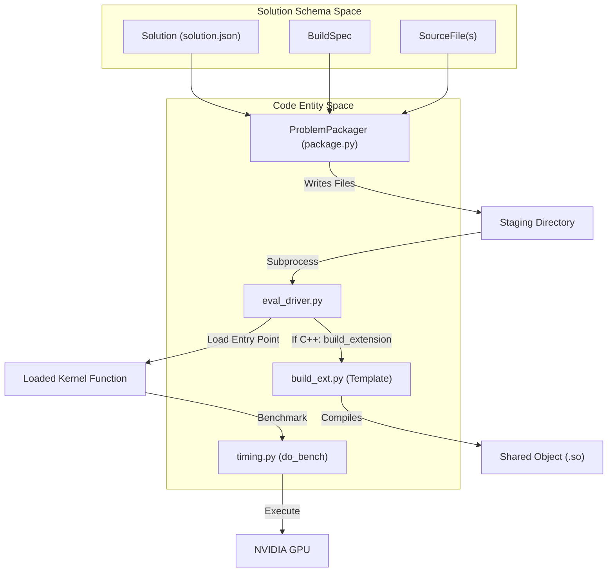
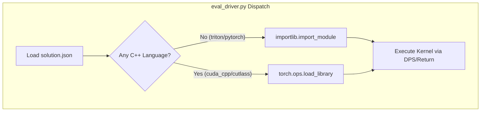

<!-- source: DeepWiki mcp.deepwiki.com · repo NVIDIA/SOL-ExecBench · page 2.3 Solution Schema · fetched 2026-10-26 -->

# Solution Schema

<details>
<summary>Relevant source files</summary>

The following files were used as context for generating this wiki page:

- [docs/solution.md](docs/solution.md)
- [src/sol_execbench/core/data/solution.py](src/sol_execbench/core/data/solution.py)

</details>


A **Solution** represents a concrete kernel implementation for a specific problem defined by a `Definition`. It encapsulates the source code, build metadata, and submission identity. The schema is defined as a Pydantic model `Solution` in [src/sol_execbench/core/data/solution.py:220-255]().

## Top-Level Schema

The `solution.json` file contains the following top-level fields:

| Field | Type | Required | Description |
|-------|------|----------|-------------|
| `name` | `NonEmptyString` | Yes | Unique identifier for the solution (e.g., `rmsnorm_triton_v1`). |
| `definition` | `NonEmptyString` | Yes | The `name` of the `Definition` this solution targets. |
| `author` | `NonEmptyString` | Yes | Identifier for the agent or human author. |
| `description` | `Optional[str]` | No | Brief explanation of the optimization technique used. |
| `spec` | `BuildSpec` | Yes | Build and execution configuration. |
| `sources` | `list[SourceFile]` | Yes | Array of source code files embedded as strings. |

Sources: [src/sol_execbench/core/data/solution.py:220-255](), [docs/solution.md:28-38]()

## Build Specification (`spec`)

The `BuildSpec` object [src/sol_execbench/core/data/solution.py:131-157]() defines how the evaluator should compile and execute the kernel.

| Field | Type | Default | Description |
|-------|------|---------|-------------|
| `languages` | `list[SupportedLanguages]` | - | Supported languages (e.g., `pytorch`, `triton`, `cuda_cpp`). |
| `target_hardware` | `list[SupportedHardware]` | - | Target hardware: `["B200"]`, `["LOCAL"]`, or both. |
| `entry_point` | `NonEmptyString` | - | Format: `"filename::function_name"`. |
| `destination_passing_style` | `bool` | `True` | Whether outputs are passed as pre-allocated arguments. |
| `binding` | `Optional[SupportedBindings]` | `None` | Binding type for C++/CUDA (defaults to `torch`). |
| `dependencies` | `list[NonEmptyString]` | `[]` | Required libraries (e.g., `CUTLASS_3_7`, `triton >= 2.3`). |
| `compile_options` | `Optional[CompileOptions]` | `None` | Extra flags for GCC/NVCC. |

### Destination Passing Style (DPS) vs. Return-Value Style

SOL-ExecBench defaults to **Destination Passing Style (DPS)**. In this mode, the evaluator pre-allocates all output tensors defined in the `Definition` and passes them as the final positional arguments to the entry point function [docs/solution.md:55-60]().

*   **DPS (Default):** `def run(input_a, input_b, output_c):` - The function writes to `output_c` in-place (e.g., `output_c[:] = ...`) and returns `None`.
*   **Return-Value Style:** `def run(input_a, input_b):` - The function returns the output tensor(s). This is enabled by setting `destination_passing_style: false` [src/sol_execbench/core/data/solution.py:148-151]().

The argument order for DPS is strictly: all inputs in the order they appear in `Definition.inputs`, followed by all outputs in the order they appear in `Definition.outputs` [docs/solution.md:73-81]().

Sources: [src/sol_execbench/core/data/solution.py:131-157](), [docs/solution.md:41-81]()

## Supported Languages and Bindings

The evaluator supports a variety of programming models, categorized into Python-based and C++-based families. These families cannot be mixed within a single solution [src/sol_execbench/core/data/solution.py:175-200]().

| Language Key | Family | Build Mechanism |
|--------------|--------|-----------------|
| `pytorch`, `triton`, `cute_dsl`, `cutile`, `cudnn_frontend` | Python | Direct import / JIT |
| `cuda_cpp`, `cutlass`, `cudnn`, `cublas` | C++ | `torch.utils.cpp_extension` |

### C++ Compilation (`compile_options`)
For C++ solutions, the `CompileOptions` class [src/sol_execbench/core/data/solution.py:117-129]() allows specifying additive flags:
*   `cflags`: Extra flags for the C++ compiler (gcc/g++).
*   `cuda_cflags`: Extra flags for NVCC (defaults to `["-O3", "--use_fast_math"]`).
*   `ld_flags`: Extra flags for the linker (defaults to `["-lcuda"]`).

The `ProblemPackager` automatically injects architecture-specific gencode flags (e.g., `sm_100a` for Blackwell targets) during the staging process [src/sol_execbench/core/package.py:118-124]().

Sources: [src/sol_execbench/core/data/solution.py:28-55](), [src/sol_execbench/core/data/solution.py:117-129](), [docs/solution.md:140-154]()

## Source File Embedding

The `sources` field is an array of `SourceFile` objects [src/sol_execbench/core/data/solution.py:80-113](). Each object contains a `path` (relative to the staging root) and the full `content` of the file.

```json
"sources": [
  {
    "path": "kernel.cu",
    "content": "#include <torch/extension.h>\nvoid MyKernel(torch::Tensor out, ...) { ... }"
  }
]
```

**Security Validation:** The `SourceFile` model validates that paths are not absolute and do not contain parent directory traversal (`..`) [src/sol_execbench/core/data/solution.py:95-113]().

Sources: [src/sol_execbench/core/data/solution.py:80-113](), [docs/solution.md:124-138]()

## Data Flow: Solution to Execution

The following diagram illustrates how the `Solution` schema is processed by the system to reach the hardware.

### System Entity Mapping: Solution to Hardware

Sources: [src/sol_execbench/core/package.py:28-135](), [src/sol_execbench/core/eval_driver.py:12-80]()

### Language-Specific Dispatch Logic
The `eval_driver.py` script determines the loading strategy based on the `languages` list in the solution's `BuildSpec`.


Sources: [src/sol_execbench/core/eval_driver.py:240-300]()

## Dependencies

The `dependencies` field supports a restricted set of libraries to ensure environment stability and reproducibility.

| Library | Specifier Example | Action |
|---------|-------------------|--------|
| **CUTLASS** | `"CUTLASS_3_7"` | Evaluator injects header paths for version 3.7. |
| **Triton** | `"triton >= 2.3"` | Validated against the environment; build fails if missing. |
| **cuDNN** | `"cudnn"` | Links against cuDNN libraries in C++ solutions via `ld_flags`. |
| **cuBLAS** | `"cublas"` | Links against cuBLAS libraries in C++ solutions. |

Sources: [src/sol_execbench/core/data/solution.py:145-147](), [docs/solution.md:107-122]()

---

