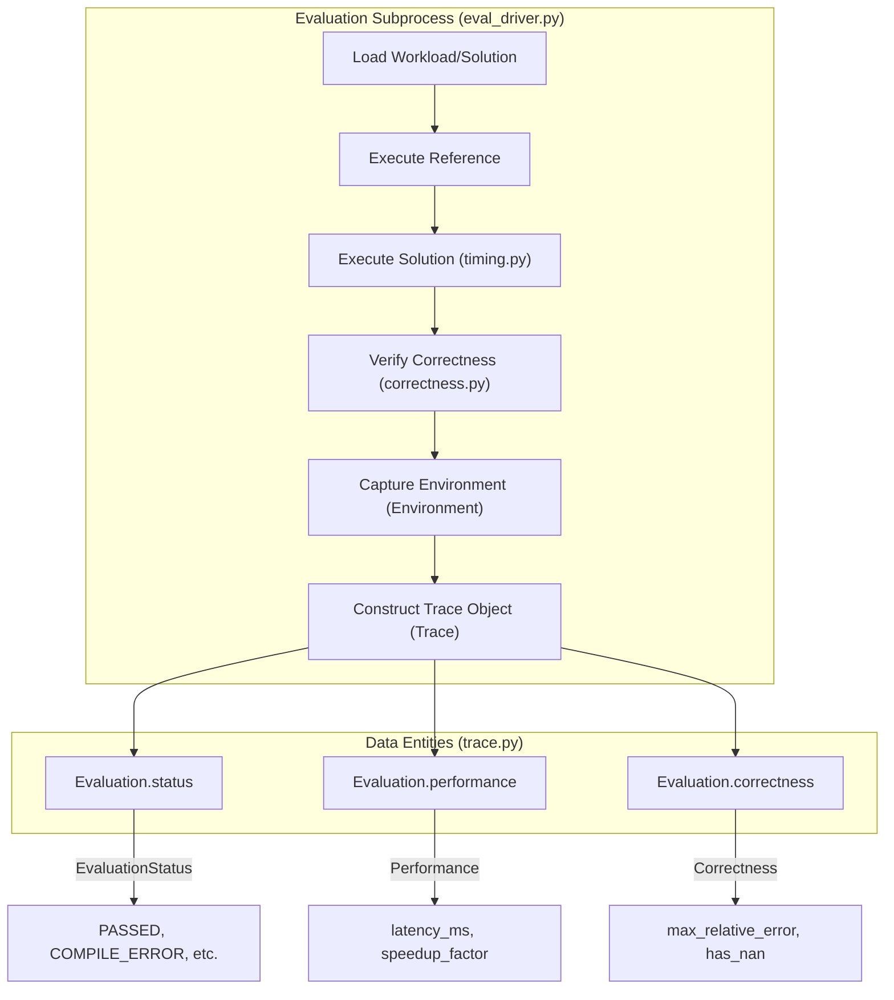
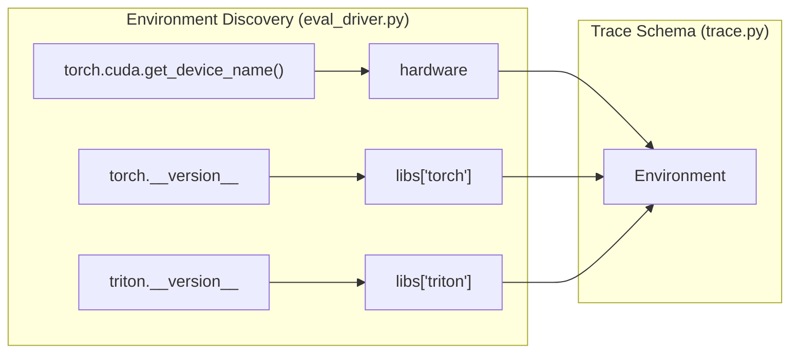

<!-- source: DeepWiki mcp.deepwiki.com · repo NVIDIA/SOL-ExecBench · page 2.4 Trace Schema · fetched 2026-10-26 -->

# Trace Schema

<details>
<summary>Relevant source files</summary>

The following files were used as context for generating this wiki page:

- [README.md](README.md)
- [src/sol_execbench/core/data/trace.py](src/sol_execbench/core/data/trace.py)

</details>


A **Trace** is an atomic, immutable record of a single benchmark execution. It serves as the primary data contract between the evaluation subprocess (`eval_driver.py`) and the CLI runner, capturing the linkage between a `Definition`, a `Solution`, and a specific `Workload` instance. The collection of these traces forms the database of benchmark results used for scoring and performance analysis.

### Trace Data Flow
The following diagram illustrates how the `Trace` object is populated during the evaluation lifecycle, bridging the gap between the high-level evaluation status and the low-level performance metrics collected from the GPU.

**Trace Generation Lifecycle**

Sources: [src/sol_execbench/core/data/trace.py:16-118](), [src/sol_execbench/core/data/trace.py:171-185]()

---

### Top-Level Structure

The `Trace` object (defined in `src/sol_execbench/core/data/trace.py`) encapsulates four primary domains: identity, input configuration, evaluation results, and environment metadata.

| Field | Type | Required | Description |
| :--- | :--- | :--- | :--- |
| `definition` | `NonEmptyString` | Yes | The name of the `Definition` being evaluated. |
| `solution` | `Optional[str]` | No | The name of the `Solution` implementation. |
| `workload` | `Workload` | Yes | The concrete `Workload` parameters (axes and input descriptors). |
| `evaluation` | `Optional[Evaluation]` | No | The detailed results of the run, including status and metrics. |

Sources: [src/sol_execbench/core/data/trace.py:171-185]()

---

### Evaluation Results (`Evaluation`)

The `Evaluation` class contains the outcome of the benchmark. Its contents are strictly validated based on the `status` field via a Pydantic `model_validator`.

#### Status Codes (`EvaluationStatus`)
The `status` field indicates the final state of the evaluation:
- `PASSED`: Evaluation completed successfully with correct results. [src/sol_execbench/core/data/trace.py:93-94]()
- `INVALID_REFERENCE`: Definition reference code failed to run. [src/sol_execbench/core/data/trace.py:95-96]()
- `INCORRECT_SHAPE`: Solution produced output with incorrect tensor shape. [src/sol_execbench/core/data/trace.py:97-98]()
- `INCORRECT_NUMERICAL`: Solution produced results exceeding tolerances. [src/sol_execbench/core/data/trace.py:99-100]()
- `INCORRECT_DTYPE`: Solution produced output with incorrect data type. [src/sol_execbench/core/data/trace.py:101-102]()
- `RUNTIME_ERROR`: Solution encountered a runtime error during execution. [src/sol_execbench/core/data/trace.py:103-104]()
- `COMPILE_ERROR`: Solution failed to build (e.g., `nvcc` or Triton JIT failure). [src/sol_execbench/core/data/trace.py:105-106]()
- `TIMEOUT`: Evaluation did not complete within the configured timeout. [src/sol_execbench/core/data/trace.py:107-108]()
- `REWARD_HACK`: Anti-cheating logic detected a benchmark manipulation attempt (monkey-patching, thread injection, etc.). [src/sol_execbench/core/data/trace.py:109-110]()

Sources: [src/sol_execbench/core/data/trace.py:86-111]()

#### Correctness Fields (`Correctness`)
Captured via numerical evaluation comparing solution output against the reference:
- `max_relative_error`: Maximum relative error observed across all output elements. [src/sol_execbench/core/data/trace.py:39-40]()
- `max_absolute_error`: Maximum absolute error observed across all output elements. [src/sol_execbench/core/data/trace.py:41-42]()
- `has_nan`: True when the solution or reference output contains NaN values. [src/sol_execbench/core/data/trace.py:43-44]()
- `has_inf`: True when the solution or reference output contains Inf values (but no NaN). [src/sol_execbench/core/data/trace.py:45-46]()

Sources: [src/sol_execbench/core/data/trace.py:27-48]()

#### Performance Fields (`Performance`)
Captured via timing evaluation:
- `latency_ms`: Solution execution latency in milliseconds. [src/sol_execbench/core/data/trace.py:65-66]()
- `reference_latency_ms`: Reference implementation latency in milliseconds for comparison. [src/sol_execbench/core/data/trace.py:67-68]()
- `speedup_factor`: Calculated as `reference_latency_ms / latency_ms`. [src/sol_execbench/core/data/trace.py:69-70]()

Sources: [src/sol_execbench/core/data/trace.py:58-70]()

---

### Field Nullability Mapping

To maintain data integrity, the `Evaluation` model enforces presence or absence of metrics based on the status code using the `_validate_status_correctness_performance` validator. [src/sol_execbench/core/data/trace.py:133-168]()

| Status | `correctness` | `performance` |
| :--- | :--- | :--- |
| `PASSED` | **Required** | **Required** |
| `INCORRECT_NUMERICAL` | **Required** | **Forbidden** |
| All other errors | **Forbidden** | **Forbidden** |

Sources: [src/sol_execbench/core/data/trace.py:145-168]()

---

### Environment Snapshot (`Environment`)

The `Environment` class provides the context necessary to reproduce the performance results.

- `hardware`: Hardware identifier where the evaluation was performed (e.g., `'NVIDIA_H100'`). [src/sol_execbench/core/data/trace.py:80-81]()
- `libs`: A dictionary mapping library names to version strings (e.g., `{"torch": "2.5.1", "triton": "3.1.0"}`). [src/sol_execbench/core/data/trace.py:82-83]()

**Code Entity Mapping: Environment Capture**

Sources: [src/sol_execbench/core/data/trace.py:73-83]()

---

### Example Trace (JSON)

Below is an example of a `Trace` object serialized to JSON, as emitted by the evaluation driver.

```json
{
  "definition": "test_vecadd",
  "solution": "test_vecadd_solution",
  "workload": {
    "uuid": "sub-test-0001",
    "axes": {},
    "inputs": {
      "x": {"type": "random"},
      "y": {"type": "random"}
    }
  },
  "evaluation": {
    "status": "PASSED",
    "timestamp": "2026-01-01T12:00:00Z",
    "log": "Benchmarking kernel...\n",
    "correctness": {
      "max_relative_error": 0.0,
      "max_absolute_error": 0.0,
      "has_nan": false,
      "has_inf": false
    },
    "performance": {
      "latency_ms": 0.015,
      "reference_latency_ms": 0.045,
      "speedup_factor": 3.0
    },
    "environment": {
      "hardware": "NVIDIA_H100_80GB_HBM3",
      "libs": {
        "torch": "2.5.1",
        "triton": "3.1.0"
      }
    }
  }
}
```
Sources: [src/sol_execbench/core/data/trace.py:113-131](), [src/sol_execbench/core/data/trace.py:171-185]()

---

