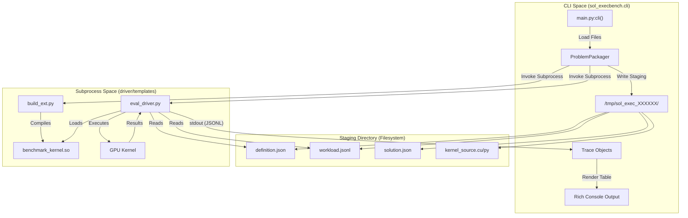
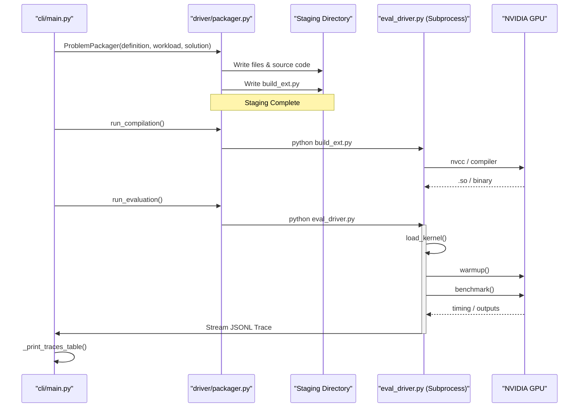

<!-- source: DeepWiki mcp.deepwiki.com · repo NVIDIA/SOL-ExecBench · page 3 Evaluation Pipeline · fetched 2026-10-26 -->

# Evaluation Pipeline

Relevant source files

The following files were used as context for generating this wiki page:

- [src/sol_execbench/cli/main.py](src/sol_execbench/cli/main.py)
- [src/sol_execbench/driver/templates/eval_driver.py](src/sol_execbench/driver/templates/eval_driver.py)

The SOL-ExecBench evaluation pipeline is designed to provide a reproducible, isolated, and tamper-resistant environment for measuring GPU kernel performance and correctness. The process transitions from high-level problem definitions to low-level hardware execution through a multi-stage workflow involving file staging, subprocess isolation, and automated compilation.

### Pipeline Overview

The evaluation follows a linear path from the CLI entry point to the generation of performance traces:

1.  **Invocation**: The user provides a problem directory or explicit JSON/JSONL files to the `sol-execbench` CLI [[src/sol_execbench/cli/main.py:18-21]]().
2.  **Staging**: The `ProblemPackager` creates a temporary directory and populates it with all necessary assets, including source code, configuration files, and the `eval_driver.py` template [[src/sol_execbench/driver/packager.py:34-40]]().
3.  **Compilation**: For C++ or CUDA kernels, a compilation subprocess is triggered using a specialized `build_ext.py` template to produce a shared library [[src/sol_execbench/driver/templates/build_ext.py:1-10]]().
4.  **Execution**: The `eval_driver.py` script runs in a fresh subprocess to ensure environment isolation and prevent state leakage between workloads [[src/sol_execbench/driver/packager.py:168-175]]().
5.  **Collection**: Results are streamed back to the CLI as JSONL `Trace` objects and displayed in a formatted table [[src/sol_execbench/cli/main.py:103-107]]().

### System Architecture and Data Flow

The following diagram illustrates how the logical phases of the pipeline map to specific code entities and files within the repository.

**Evaluation Data Flow**

Sources: [src/sol_execbench/cli/main.py:39-49](), [src/sol_execbench/driver/packager.py:34-60](), [src/sol_execbench/driver/templates/eval_driver.py:18-23]()

### 3.1 CLI Interface (sol-execbench)
The `sol-execbench` command is the primary entry point for individual kernel evaluation. It handles argument parsing, resolves file paths (supporting both a unified `problem_dir` or explicit `--definition`, `--workload`, and `--solution` flags), and manages the lifecycle of the evaluation subprocesses [[src/sol_execbench/cli/main.py:180-217]](). It also supports optional GPU clock locking via `--lock-clocks` to ensure benchmark stability [[src/sol_execbench/cli/main.py:220-230]]().

For details, see [CLI Interface (sol-execbench)](#3.1).

### 3.2 Problem Packager and Staging
Before any code is executed, the `ProblemPackager` class orchestrates the "Staging" phase. This involves creating a filesystem-isolated directory where the kernel's environment is reconstructed [[src/sol_execbench/driver/packager.py:34-40]](). A critical responsibility of this phase is injecting hardware-specific metadata, such as `sm_100a` gencode flags for Blackwell GPUs or `sm_90a` for Hopper, into the build configuration to ensure the kernel is optimized for the target hardware [[src/sol_execbench/driver/packager.py:34-60]]().

For details, see [Problem Packager and Staging](#3.2).

### 3.3 Evaluation Driver (eval_driver.py)
The `eval_driver.py` is a self-contained Python script injected into the staging directory. It executes in a separate process to maintain a clean `torch` and `triton` state [[src/sol_execbench/driver/templates/eval_driver.py:18-23]](). It is responsible for:
*   Redirecting `stdout` to `stderr` before importing heavy libraries to keep the JSONL stream clean [[src/sol_execbench/driver/templates/eval_driver.py:38-43]]().
*   Loading the kernel (either via `importlib` for Python/Triton or `torch.ops.load_library` for C++).
*   Generating inputs and allocating outputs based on the `Definition` and `Workload` specifications [[src/sol_execbench/driver/templates/eval_driver.py:53-87]]().
*   Executing the kernel and calculating correctness and performance metrics while monitoring for reward-hacking attempts [[src/sol_execbench/driver/templates/eval_driver.py:113-133]]().

For details, see [Evaluation Driver (eval_driver.py)](#3.3).

### 3.4 Batch Evaluation (run_dataset.py)
For large-scale testing across the entire SOL-ExecBench dataset, the `scripts/run_dataset.py` script provides a batch-processing wrapper. It automates the discovery of problems across categories, manages parallel or sequential execution, and generates a consolidated summary of the entire dataset's performance.

For details, see [Batch Evaluation (run_dataset.py)](#3.4).

### Pipeline Execution Flow
The following sequence diagram details the interaction between the core classes during a typical evaluation run.

**Sequence: CLI to GPU Execution**

Sources: [src/sol_execbench/cli/main.py:220-250](), [src/sol_execbench/driver/packager.py:168-190](), [src/sol_execbench/driver/templates/eval_driver.py:53-87]()

---

