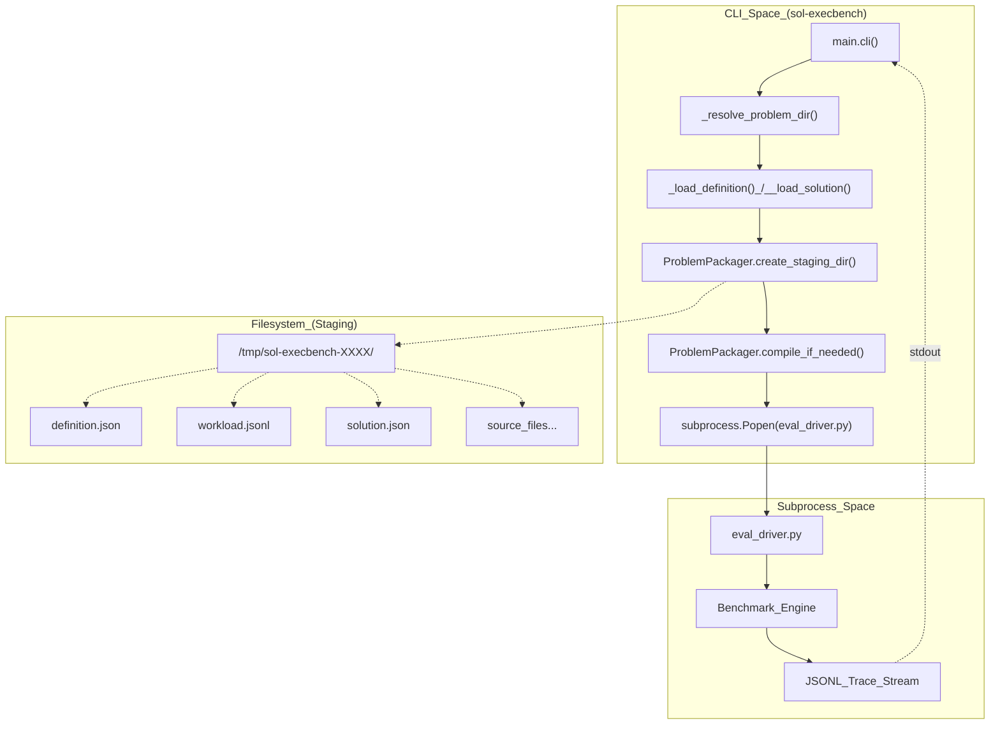

<!-- source: DeepWiki mcp.deepwiki.com · repo NVIDIA/SOL-ExecBench · page 3.1 CLI Interface (sol-execbench) · fetched 2026-10-26 -->

# CLI Interface (sol-execbench)

<details>
<summary>Relevant source files</summary>

The following files were used as context for generating this wiki page:

- [src/sol_execbench/cli/main.py](src/sol_execbench/cli/main.py)

</details>


The `sol-execbench` command is the primary entry point for evaluating a single GPU kernel solution against a specific problem definition and set of workloads. It orchestrates the staging of source files, handles compilation for C++-based DSLs, executes the evaluation driver in a protected subprocess, and aggregates results into a human-readable or machine-parsable format.

### Execution Modes

The CLI supports two primary invocation modes for specifying the problem and solution files:

1.  **Problem Directory Mode**: Pass a single positional argument `problem_dir`. The CLI automatically looks for `definition.json` and `workload.jsonl` within that directory [src/sol_execbench/cli/main.py:83-100](). It can also auto-detect `solution.json` and `config.json` if present in the same directory [src/sol_execbench/cli/main.py:98-99]().
2.  **Explicit File Mode**: Use individual flags (`--definition`, `--workload`, `--solution`) to point to files located anywhere on the filesystem [src/sol_execbench/cli/main.py:185-201]().

### CLI Arguments and Flags

The CLI is implemented using the `click` library [src/sol_execbench/cli/main.py:34]().

| Flag | Type | Description |
| :--- | :--- | :--- |
| `problem_dir` | Argument | Positional path to a directory containing problem files [src/sol_execbench/cli/main.py:181-183](). |
| `--definition` | Option | Path to the `definition.json` file [src/sol_execbench/cli/main.py:185-189](). |
| `--workload` | Option | Path to the `workload.jsonl` file [src/sol_execbench/cli/main.py:191-195](). |
| `--solution` | Option | Path to the `solution.json` file [src/sol_execbench/cli/main.py:197-201](). |
| `--config` | Option | Path to a `BenchmarkConfig` JSON file [src/sol_execbench/cli/main.py:203-207](). |
| `--compile-timeout`| Option | Timeout in seconds for C++/CUDA compilation (default: 120) [src/sol_execbench/cli/main.py:209-213](). |
| `--timeout` | Option | Timeout in seconds for the evaluation subprocess (default: 600) [src/sol_execbench/cli/main.py:215-216](). |
| `--lock-clocks` | Flag | Attempt to lock GPU clocks via `nvidia-smi` before benchmarking [src/sol_execbench/cli/main.py:228-232](). |
| `--keep-staging` | Flag | Do not delete the temporary staging directory after execution [src/sol_execbench/cli/main.py:234-238](). |
| `--json` | Flag | Output the final traces as a JSON array to stdout instead of a table [src/sol_execbench/cli/main.py:223-227](). |
| `--output`, `-o` | Option | Path to save the trace results (JSONL format) [src/sol_execbench/cli/main.py:218-222](). |

**Sources:** [src/sol_execbench/cli/main.py:180-240]()

---

### Data Flow and Implementation

The CLI uses the `ProblemPackager` class [src/sol_execbench/driver/packager.py:18]() to prepare the execution environment. It creates a temporary "staging" directory where all necessary files (definitions, workloads, and kernel source code) are materialized before launching the evaluation driver.

#### System Architecture: CLI to Subprocess

The following diagram illustrates how the CLI entities interact with the filesystem and the driver subprocess.

**CLI Execution Flow**

**Sources:** [src/sol_execbench/cli/main.py:243-324](), [src/sol_execbench/driver/packager.py:18-40]()

---

### Results Display and Rich Integration

When not in `--json` mode, the CLI uses the `Rich` library [src/sol_execbench/cli/main.py:35-37]() to render a formatted table of results to `stderr` [src/sol_execbench/cli/main.py:49](). This ensures that benchmark data is clearly visible even if the user redirects `stdout`.

#### Table Columns
*   **Status**: Displays the `EvaluationStatus` (e.g., `PASSED`, `INCORRECT_NUMERICAL`, `RUNTIME_ERROR`) with color coding [src/sol_execbench/cli/main.py:123-131]().
*   **Latency (ms)**: The measured execution time of the solution kernel [src/sol_execbench/cli/main.py:136]().
*   **Ref (ms)**: The execution time of the reference implementation [src/sol_execbench/cli/main.py:137]().
*   **Speedup**: The ratio of reference latency to solution latency [src/sol_execbench/cli/main.py:138]().
*   **Max Abs/Rel Err**: Numerical error statistics extracted from the `Trace` object [src/sol_execbench/cli/main.py:142-151]().

#### Error Logging
If a workload fails with a status other than `PASSED` or `INCORRECT_NUMERICAL`, the CLI captures the `ev.log` (which includes stdout/stderr from the driver subprocess) and prints it below the summary table [src/sol_execbench/cli/main.py:160-177]().

**Sources:** [src/sol_execbench/cli/main.py:103-179]()

---

### Internal Component Mapping

This diagram maps CLI concepts to the specific Pydantic models and logic classes defined in the core package.

**Code Entity Mapping**
```mermaid
classDiagram
    class "cli.main" {
        +cli()
        +_print_traces_table()
        +_load_definition()
        +_load_solution()
    }
    class "ProblemPackager" {
        +create_staging_dir()
        +compile_if_needed()
        +get_eval_command()
    }
    class "Trace" {
        +evaluation: Evaluation
        +environment: Environment
    }
    class "Evaluation" {
        +status: EvaluationStatus
        +performance: PerformanceStats
        +correctness: CorrectnessStats
        +log: str
    }

    "cli.main" ..> "ProblemPackager" : "uses_to_stage_files"
    "cli.main" ..> "Trace" : "parses_from_driver_output"
    "Trace" *-- "Evaluation" : "contains"
    "Evaluation" ..> "EvaluationStatus" : "reports"
```
**Sources:** [src/sol_execbench/cli/main.py:39-47](), [src/sol_execbench/driver/packager.py:18-40]()

### Key Implementation Details

*   **Source Resolution**: When loading a `Solution`, the CLI automatically reads local file paths specified in the `sources` list and embeds their content into the `Solution` object if the `content` field is empty [src/sol_execbench/cli/main.py:65-74]().
*   **Clock Management**: If `--lock-clocks` is specified, the CLI invokes `lock_clocks()` from the `core.bench` package. It uses a `try...finally` block to ensure `unlock_clocks()` is called even if the evaluation crashes [src/sol_execbench/cli/main.py:274-324]().
*   **Trace Streaming**: The CLI reads the output of the `eval_driver.py` subprocess line-by-line. Each line is expected to be a valid JSON representation of a `Trace` object, which is then parsed into the Pydantic model [src/sol_execbench/cli/main.py:302-308]().
*   **Subprocess Execution**: The CLI uses `subprocess.Popen` to run the evaluation driver, capturing `stdout` to parse `Trace` objects and `stderr` for logging [src/sol_execbench/cli/main.py:291-300]().

**Sources:** [src/sol_execbench/cli/main.py:52-81](), [src/sol_execbench/cli/main.py:274-324]()

---

