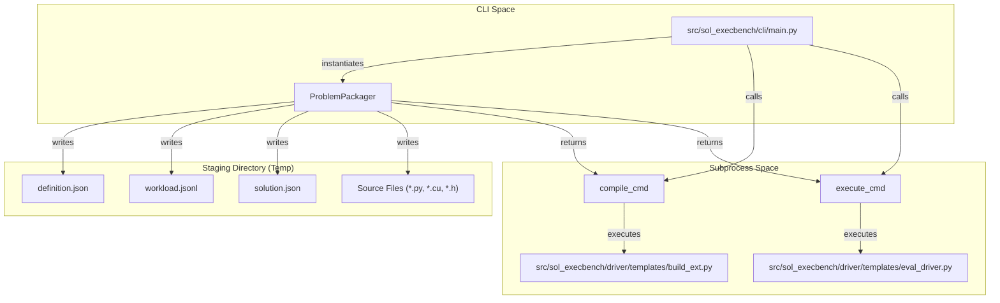
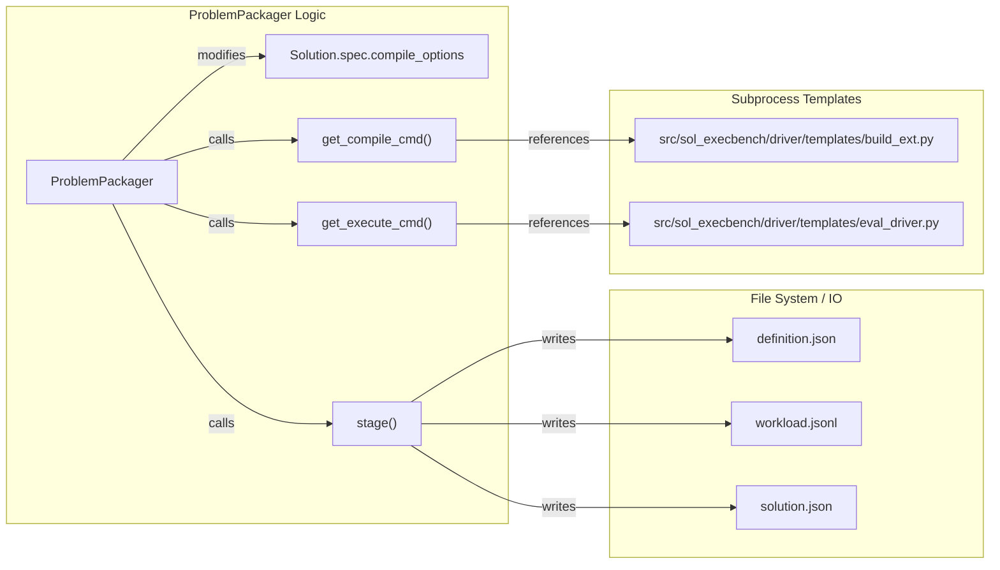

<!-- source: DeepWiki mcp.deepwiki.com · repo NVIDIA/SOL-ExecBench · page 3.2 Problem Packager and Staging · fetched 2026-10-26 -->

# Problem Packager and Staging

<details>
<summary>Relevant source files</summary>

The following files were used as context for generating this wiki page:

- [src/sol_execbench/cli/main.py](src/sol_execbench/cli/main.py)
- [src/sol_execbench/driver/templates/build_ext.py](src/sol_execbench/driver/templates/build_ext.py)

</details>


The `ProblemPackager` is the central orchestration component responsible for preparing a kernel solution for execution. It bridges high-level data models (`Definition`, `Workload`, `Solution`) and the low-level execution environment by creating a self-contained staging directory. This process includes file serialization, automatic CUDA architecture flag injection, and the generation of subprocess commands for compilation and evaluation.

## Purpose and Scope

Before a kernel can be benchmarked, it must be isolated from the host environment to ensure reproducibility and prevent side effects. The `ProblemPackager` performs the following critical tasks:
1.  **Staging**: Creates a temporary directory and writes all necessary JSON descriptors and source code files.
2.  **Gencode Injection**: Automatically detects the GPU architecture (e.g., Blackwell `sm_100a`) and injects the appropriate `nvcc` flags into the build specification.
3.  **Command Generation**: Produces the exact shell commands required to compile C++/CUDA extensions and to invoke the `eval_driver.py`.

### Architectural Context

The following diagram illustrates how the `ProblemPackager` sits between the CLI and the Subprocess execution layers.

**Diagram: Problem Packager Data Flow**

Sources: `[src/sol_execbench/driver/packager.py:31-48]()`, `[src/sol_execbench/cli/main.py:284-315]()`

## Implementation Details

The `ProblemPackager` is defined in `src/sol_execbench/driver/packager.py`. It takes Pydantic models as input and manages the lifecycle of the staging directory.

### Key Class: ProblemPackager
The class constructor accepts the core data models and an optional staging path. If no path is provided, it creates a temporary directory using `tempfile.mkdtemp()` `[src/sol_execbench/driver/packager.py:53-70]()`.

| Function | Responsibility |
| :--- | :--- |
| `stage()` | Serializes `definition.json`, `workload.jsonl`, `solution.json`, and all `sources` to the staging path `[src/sol_execbench/driver/packager.py:100-118]()`. |
| `get_compile_cmd()` | Generates the `python build_ext.py` command with appropriate flags `[src/sol_execbench/driver/packager.py:133-160]()`. |
| `get_execute_cmd()` | Generates the `python eval_driver.py` command, passing paths to the staged JSON files `[src/sol_execbench/driver/packager.py:162-180]()`. |

Sources: `[src/sol_execbench/driver/packager.py:48-180]()`

## Automatic Gencode Injection

A key feature of the packager is ensuring that C++ and CUDA kernels are compiled for the correct hardware. It inspects the `target_hardware` field of the `Solution` and the current system's GPU.

### Blackwell and LOCAL Targets
If the solution targets `LOCAL` or specifically `sm_100a` (Blackwell), the packager modifies the `compile_options` within the solution spec before staging:
- It checks for Blackwell support using `torch.cuda.get_device_capability()` `[src/sol_execbench/driver/packager.py:84-88]()`.
- It appends `-gencode=arch=compute_100,code=sm_100a` to the `cuda_cflags` if a Blackwell GPU is detected `[src/sol_execbench/driver/packager.py:91-98]()`.

This automation removes the burden from the user to specify complex architecture-specific flags in their `solution.json`.

Sources: `[src/sol_execbench/driver/packager.py:72-98]()`

## Staging Directory Structure

When `stage()` is called, the directory is populated as follows:

```text
/tmp/sol-execbench-XXXXXX/
├── definition.json       # Kernel axes and tensor specs
├── workload.jsonl       # Concrete input values/bindings
├── solution.json         # Build spec and entry point (modified with gencodes)
└── [source_files...]     # All files defined in solution.spec.sources (e.g., kernel.cu, model.py)
```

Sources: `[src/sol_execbench/driver/packager.py:100-118]()`

## Subprocess Command Generation

The packager facilitates the transition to the execution phase by providing pre-formatted commands.

### Compilation Command
For C++ based languages (CUDA, CUTLASS, cuDNN, cuBLAS), the `get_compile_cmd` function produces a command that invokes the internal `build_ext.py` utility.
- **Path**: `src/sol_execbench/driver/templates/build_ext.py`
- **Behavior**: `build_ext.py` uses `torch.utils.cpp_extension.load` to compile all source files in the current directory into `benchmark_kernel.so` `[src/sol_execbench/driver/templates/build_ext.py:51-60]()`.

### Execution Command
The `get_execute_cmd` function targets the `eval_driver.py`.
- **Path**: `src/sol_execbench/driver/templates/eval_driver.py`
- **Arguments**:
    - `--definition`: Path to staged `definition.json`
    - `--workload`: Path to staged `workload.jsonl`
    - `--solution`: Path to staged `solution.json`

**Diagram: Mapping System Logic to Code Entities**

Sources: `[src/sol_execbench/driver/packager.py:133-180]()`, `[src/sol_execbench/driver/templates/build_ext.py:20-60]()`

---

