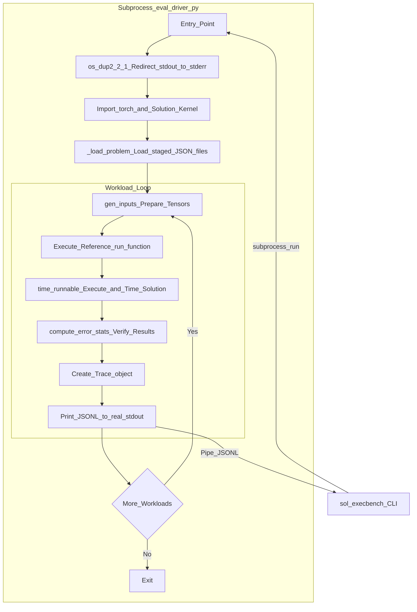
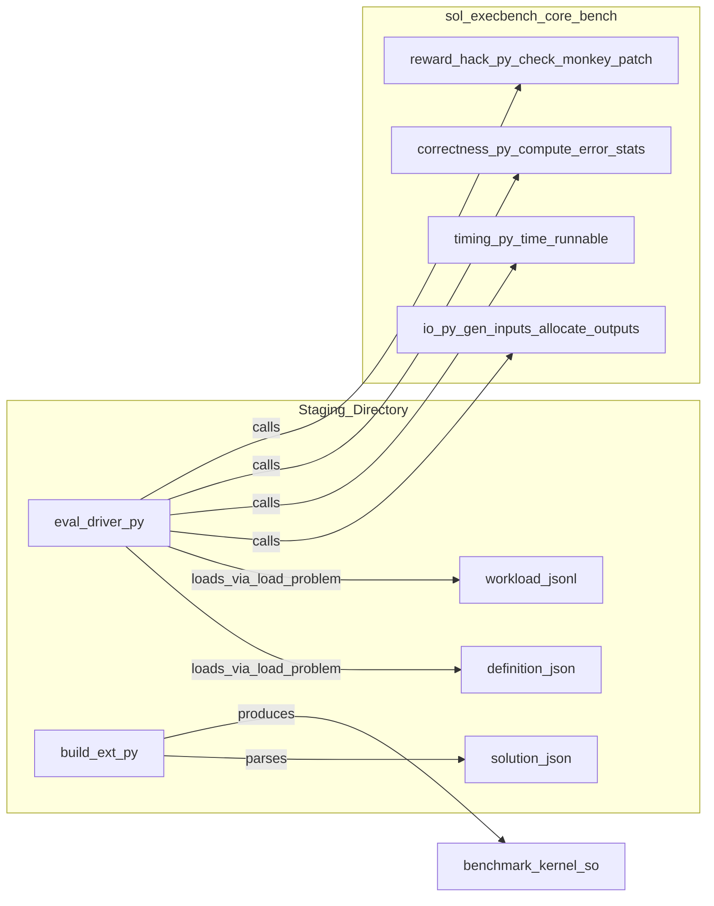

<!-- source: DeepWiki mcp.deepwiki.com · repo NVIDIA/SOL-ExecBench · page 3.3 Evaluation Driver (eval_driver.py) · fetched 2026-10-26 -->

# Evaluation Driver (eval_driver.py)

Relevant source files

The following files were used as context for generating this wiki page:

- [src/sol_execbench/driver/templates/build_ext.py](src/sol_execbench/driver/templates/build_ext.py)
- [src/sol_execbench/driver/templates/eval_driver.py](src/sol_execbench/driver/templates/eval_driver.py)

The `eval_driver.py` script is a self-contained Python template that serves as the execution engine for a single kernel evaluation. It is designed to run within a subprocess, isolated from the main CLI process, to ensure that kernel crashes, memory leaks, or environment mutations (like `torch.cuda` initialization) do not destabilize the benchmarking suite.

## Overview and Purpose

When `sol-execbench` initiates an evaluation, the `ProblemPackager` stages the `eval_driver.py` template into a temporary directory. This script is responsible for the entire lifecycle of a benchmark run:
1.  **Environment Setup**: Redirecting stdout to stderr before `torch` import to prevent library chatter from corrupting the JSONL stream [src/sol_execbench/driver/templates/eval_driver.py:38-45]().
2.  **Problem Loading**: Loading `definition.json`, `workload.jsonl`, and `solution.json` from the local staging directory [src/sol_execbench/driver/templates/eval_driver.py:90-108]().
3.  **Kernel Loading**: Importing the solution and reference implementations [src/sol_execbench/driver/templates/eval_driver.py:168-184]().
4.  **Data Preparation**: Generating or loading tensors using `gen_inputs` based on the `Workload` and `Definition` schemas [src/sol_execbench/driver/templates/eval_driver.py:120-125]().
5.  **Execution & Timing**: Running the kernel using `time_runnable` with hardware-accurate timing [src/sol_execbench/driver/templates/eval_driver.py:134-134]().
6.  **Correctness Verification**: Comparing solution outputs against reference outputs via `compute_error_stats` [src/sol_execbench/driver/templates/eval_driver.py:116-117]().
7.  **Result Streaming**: Emitting `Trace` objects as JSONL to the original stdout for the CLI to consume.

### Execution Flow Diagram

The following diagram illustrates how the `eval_driver.py` orchestrates the evaluation within the subprocess.

**Subprocess Execution Lifecycle**

Sources: [src/sol_execbench/driver/templates/eval_driver.py:38-147](), [src/sol_execbench/driver/templates/eval_driver.py:53-87]()

---

## Implementation Details

### Early Stdout Redirection
To ensure that all logs (including C++ extension build logs or library initialization warnings) are captured without corrupting the result stream, `eval_driver.py` performs a low-level redirection of file descriptor 1 to file descriptor 2 (stderr) before importing `torch` [src/sol_execbench/driver/templates/eval_driver.py:38-43](). It saves a handle to the original stdout (`_real_stdout`) to print the final JSON results [src/sol_execbench/driver/templates/eval_driver.py:40-41]().

### Kernel Calling Conventions
The driver handles the interface between the benchmarking engine and the user kernel through the `_call_and_collect_outputs` helper [src/sol_execbench/driver/templates/eval_driver.py:53-62](). It supports two primary calling styles:
*   **Destination-Passing Style (DPS)**: If `destination_passing_style` is True, the driver calls `allocate_outputs` and passes these pre-allocated tensors to the kernel [src/sol_execbench/driver/templates/eval_driver.py:70-75]().
*   **Return-Value Style**: If False, the driver captures the kernel's return value and uses `normalize_outputs` to convert it into a standardized dictionary of tensors [src/sol_execbench/driver/templates/eval_driver.py:77-86]().

### Reward Hack Detection and Integrity
The driver implements aggressive anti-cheating measures. Before importing user code, it takes an `_integrity_snapshot` of critical function IDs [src/sol_execbench/driver/templates/eval_driver.py:186-201](). During execution, it invokes several checks:
*   `check_monkey_patch`: Ensures core PyTorch/Benchmarking functions haven't been replaced [src/sol_execbench/driver/templates/eval_driver.py:130-130]().
*   `check_thread_injection`: Detects unauthorized background threads [src/sol_execbench/driver/templates/eval_driver.py:131-131]().
*   `check_lazy_outputs`: Verifies that outputs are actual tensors and not proxy objects [src/sol_execbench/driver/templates/eval_driver.py:129-129]().

---

## C++/CUDA Compilation (build_ext.py)

For solutions written in CUDA C++, CUTLASS, or cuBLAS, the system uses `build_ext.py` to compile the source into a shared object (`benchmark_kernel.so`) [src/sol_execbench/driver/templates/build_ext.py:51-60]().

| Component | Role |
| :--- | :--- |
| **Source Collection** | Automatically finds `.cu`, `.cpp`, and `.c` files in the staging directory [src/sol_execbench/driver/templates/build_ext.py:36-40](). |
| **Compile Options** | Applies `cuda_cflags`, `cflags`, and `ld_flags` from the `Solution` schema [src/sol_execbench/driver/templates/build_ext.py:28-33](). |
| **Include Paths** | Injects paths for the local staging directory and `CUTLASS_DIR` [src/sol_execbench/driver/templates/build_ext.py:44-49](). |
| **Artifact** | Renames the platform-specific output to a stable `benchmark_kernel.so` [src/sol_execbench/driver/templates/build_ext.py:63-67](). |

### System Entity Mapping

This diagram maps the conceptual "Evaluation" steps to the specific code entities and files involved.

**Code Entity Mapping**

Sources: [src/sol_execbench/driver/templates/eval_driver.py:90-148](), [src/sol_execbench/driver/templates/build_ext.py:22-28]()

---

## Data Flow and Output

The driver communicates with the parent CLI process primarily through stdout using `Trace` objects.

1.  **Workload Processing**: For each workload in `workload.jsonl`, the driver generates inputs and runs both the reference and solution [src/sol_execbench/driver/templates/eval_driver.py:160-184]().
2.  **Performance Measurement**: `time_runnable` is used to collect latency statistics (min, max, mean, median) [src/sol_execbench/driver/templates/eval_driver.py:134-134]().
3.  **Correctness Check**: `compute_error_stats` calculates absolute and relative errors [src/sol_execbench/driver/templates/eval_driver.py:116-117]().
4.  **Trace Emission**: The driver constructs a `Trace` object containing `EvaluationStatus`, `Correctness`, and `Performance` data, then serializes it to JSONL [src/sol_execbench/driver/templates/eval_driver.py:138-147]().

Sources: [src/sol_execbench/driver/templates/eval_driver.py:53-148]()

---

