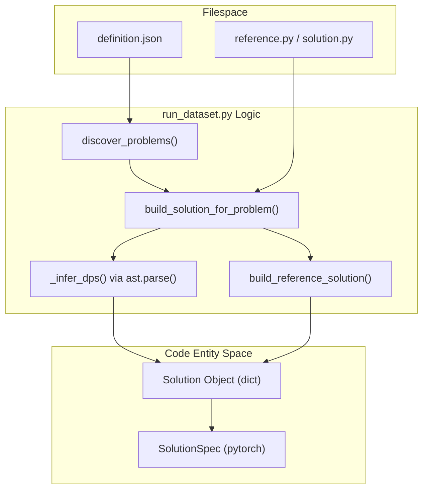
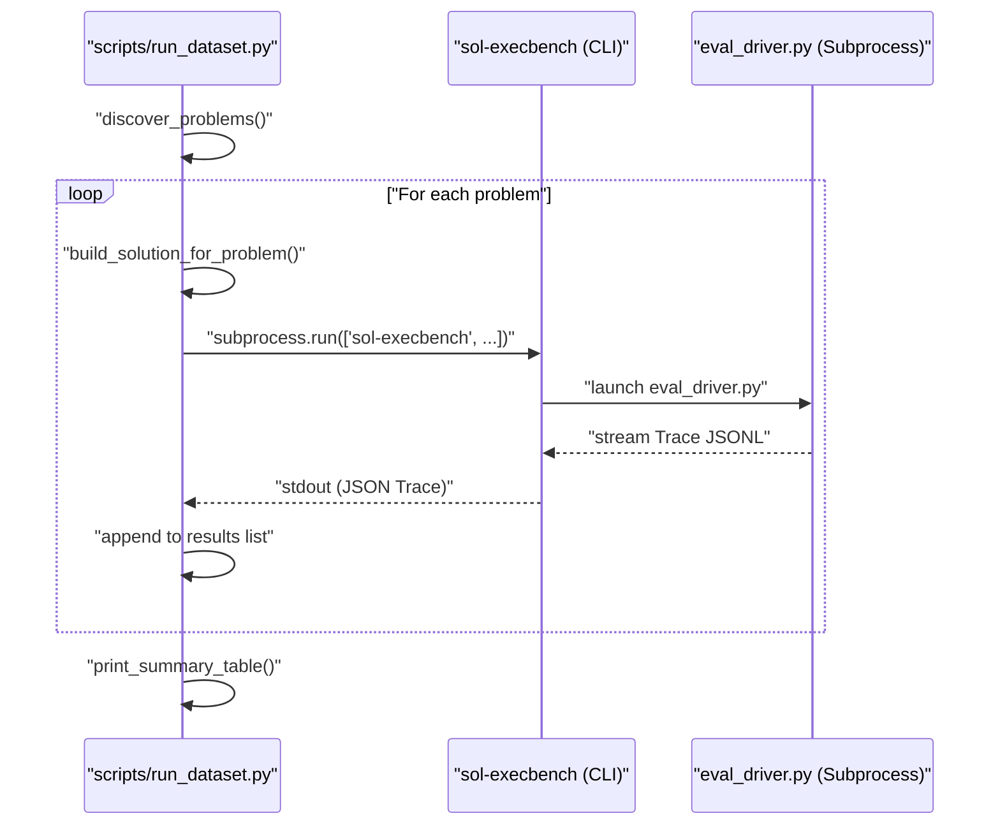

<!-- source: DeepWiki mcp.deepwiki.com · repo NVIDIA/SOL-ExecBench · page 3.4 Batch Evaluation (run_dataset.py) · fetched 2026-10-26 -->

# Batch Evaluation (run_dataset.py)

Relevant source files

The following files were used as context for generating this wiki page:

- [README.md](README.md)
- [src/sol_execbench/cli/main.py](src/sol_execbench/cli/main.py)

The `scripts/run_dataset.py` script is a high-level batch runner designed to automate the evaluation of multiple kernels across the SOL-ExecBench dataset. It handles problem discovery, solution generation from reference implementations or custom files, and incremental execution to avoid redundant benchmarking.

## Overview and Purpose

`run_dataset.py` acts as an orchestration layer over the core `sol-execbench` CLI. While the core CLI focuses on single-problem evaluation, the batch runner allows users to evaluate entire categories (e.g., L1, L2) or the complete benchmark suite with a single command. It is particularly useful for establishing baseline performance using reference implementations or for validating a set of new kernel optimizations against the entire dataset.

### Key Capabilities
*   **Dataset Discovery**: Automatically identifies problem directories containing `definition.json` and `workload.jsonl` [scripts/run_dataset.py:53-77]().
*   **Automatic Solution Construction**: Can dynamically wrap the reference Python code from a `definition.json` into a valid `Solution` object [scripts/run_dataset.py:167-196]().
*   **Incremental Re-runs**: Skips problems that already have a result file in the output directory, facilitating long-running batch jobs [scripts/run_dataset.py:262-265]().
*   **Summary Reporting**: Aggregates results into a formatted table showing pass/fail status, speedup, and error metrics [scripts/run_dataset.py:275-300]().

Sources: [README.md:103-122](), [scripts/run_dataset.py:53-77](), [scripts/run_dataset.py:167-196]().

## Dataset Discovery and Categories

The script supports two modes of operation based on the provided `problems_dir` argument:
1.  **Single Problem Mode**: If the directory contains a `definition.json`, it is treated as a standalone problem [scripts/run_dataset.py:228-232]().
2.  **Dataset Root Mode**: If no definition is found at the root, the script searches for sub-directories matching known categories [scripts/run_dataset.py:234-239]().

### Supported Categories
The script recognizes the following categories by default:
*   `L1`: Level 1 kernels (simple element-wise or reduction).
*   `L2`: Level 2 kernels (more complex tiling/memory patterns).
*   `FlashInfer-Bench`: Kernels derived from the FlashInfer library.
*   `Quant`: Quantization-related kernels (FP8, INT8, etc.).

**Table: Category Discovery Logic**
| Feature | Logic |
| :--- | :--- |
| **Category Filter** | Controlled by the `--category` flag [scripts/run_dataset.py:311](). |
| **Problem Validation** | A directory must contain both `definition.json` and `workload.jsonl` [scripts/run_dataset.py:73-75](). |
| **Sorting** | Problems are processed in alphabetical order by directory name [scripts/run_dataset.py:72](). |

Sources: [scripts/run_dataset.py:53-77](), [scripts/run_dataset.py:228-239](), [scripts/run_dataset.py:311-313]().

## Solution Construction

A unique feature of `run_dataset.py` is its ability to "bootstrap" solutions. This allows benchmarking even if a formal `solution.json` has not been written yet.

### Reference-to-Solution Mapping
The `build_reference_solution` function extracts the `reference` field from a problem's `Definition` and wraps it in a `Solution` schema, targeting the `pytorch` language [scripts/run_dataset.py:167-196](). 

### Destination-Passing Style (DPS) Inference
To ensure the kernel is called correctly, the script uses Python's `ast` module in `_infer_dps()` to inspect the `run()` function's signature [scripts/run_dataset.py:85-114](). If the last parameter name in the source code matches the last output name defined in the `definition.json`, the script automatically sets `destination_passing_style: True` [scripts/run_dataset.py:110-111]().

**Diagram: Solution Generation Data Flow**
This diagram shows how the `run_dataset.py` logic transforms raw problem files into a temporary `Solution` entity for the evaluation pipeline.

Sources: [scripts/run_dataset.py:85-114](), [scripts/run_dataset.py:117-136](), [scripts/run_dataset.py:167-196]().

## Execution Flow

The batch runner iterates through discovered problems and invokes the `sol-execbench` CLI as a subprocess for each one.

### Subprocess Invocation
For each problem, the script:
1.  Constructs the `Solution` dictionary (either from a file or from the reference code).
2.  Writes the solution to a temporary JSON file.
3.  Calls `subprocess.run` with the following arguments [scripts/run_dataset.py:246-258]():
    *   `--definition`: Path to the problem's definition.
    *   `--workload`: Path to the problem's workload.
    *   `--solution`: Path to the generated temporary solution.
    *   `--json`: Enables JSON output for programmatic parsing of results.
    *   `--lock-clocks`: Passed if the batch runner was invoked with `--lock-clocks` [scripts/run_dataset.py:255]().

### Incremental Re-runs
The script checks for the existence of `{problem_name}.json` in the output directory [scripts/run_dataset.py:262](). If found and the `--rerun` flag is not set, it skips the evaluation and loads the previous result to include in the final summary table [scripts/run_dataset.py:264-265]().

**Diagram: Batch Execution Pipeline**
This diagram maps the CLI invocation to the internal subprocess management.

Sources: [scripts/run_dataset.py:241-273](), [scripts/run_dataset.py:262-265](), [src/sol_execbench/cli/main.py:180-220]().

## Output and Reporting

After all problems are processed, the script generates a summary table using the `rich` library [scripts/run_dataset.py:275-300]().

### Summary Metrics
The table includes:
*   **Status**: SUCCESS, FAILED, or COMPILE_ERROR.
*   **Speedup**: The `speedup_factor` relative to the reference implementation.
*   **Max Relative Error**: The maximum relative error found across all workloads.
*   **Latency**: The measured latency in milliseconds.
*   **SOL-Score**: While not always in the table, the script can compute scores using the `sol_score` function [src/sol_execbench/sol_score.py:1-24]().

The final output is also saved as a comprehensive JSON file if the `--output` flag is provided, containing the full `Trace` for every problem in the batch [scripts/run_dataset.py:328-330]().

Sources: [scripts/run_dataset.py:275-300](), [scripts/run_dataset.py:328-330](), [src/sol_execbench/sol_score.py:1-24]().

---

