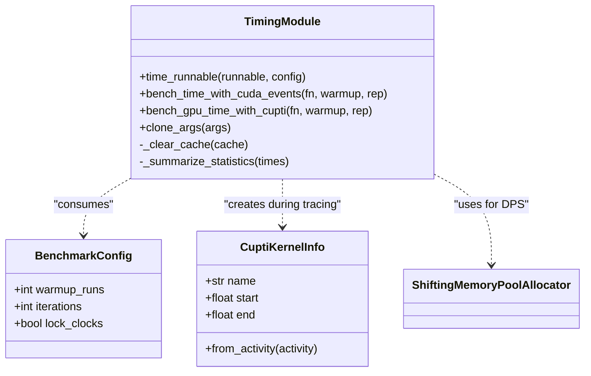

<!-- source: DeepWiki mcp.deepwiki.com · repo NVIDIA/SOL-ExecBench · page 4.1 Timing and Performance Measurement · fetched 2026-10-26 -->

# Timing and Performance Measurement

<details>
<summary>Relevant source files</summary>

The following files were used as context for generating this wiki page:

- [src/sol_execbench/core/bench/config/benchmark_config.py](src/sol_execbench/core/bench/config/benchmark_config.py)
- [src/sol_execbench/core/bench/timing.py](src/sol_execbench/core/bench/timing.py)

</details>


The benchmarking engine in SOL-ExecBench is designed to provide high-precision, reproducible GPU kernel latency measurements while defending against common benchmarking pitfalls such as L2 cache hits, JIT compilation overhead, and "caching attacks" where solutions might attempt to bypass computation by memoizing results based on input memory addresses.

The core logic resides in `timing.py`, which provides functions for both standard CUDA Event-based timing and advanced CUPTI-based hardware tracing.

## Core Timing Logic: `bench_time_with_cuda_events`

The `bench_time_with_cuda_events` function is the primary utility for measuring a kernel's performance. It implements a rigorous measurement loop that includes warming up the GPU, clearing the L2 cache, and executing multiple timed iterations.

### Implementation Workflow

1.  **Resource Allocation**: Before timing starts, the system allocates a buffer for clearing the L2 cache by doubling the detected L2 cache size of the device [src/sol_execbench/core/bench/timing.py:61-65](). It also initializes two lists of `torch.cuda.Event` objects (start and end) for each iteration [src/sol_execbench/core/bench/timing.py:274-275]().
2.  **Warmup Phase**: The function runs a configurable number of warmup iterations to ensure the GPU is in a high-performance state and any JIT compilation (e.g., Triton or `torch.compile`) has completed [src/sol_execbench/core/bench/timing.py:250-251]().
3.  **Argument Pinning**: To prevent "caching attacks"—where a kernel might use `id(input_tensor)` as a key to return a pre-computed result—the timing loop maintains a `_pinned` list. This ensures that the memory addresses of inputs from previous iterations are not recycled by the Python interpreter during the benchmark loop [src/sol_execbench/core/bench/timing.py:277-283]().
4.  **Timed Execution Loop**:
    *   **Setup**: If a `setup` callable is provided, it is executed to generate fresh inputs. These inputs are "pinned" to prevent address recycling [src/sol_execbench/core/bench/timing.py:285-295]().
    *   **Cache Clearing**: If `cold_l2_cache` is enabled, the buffer is zeroed to flush the L2 cache [src/sol_execbench/core/bench/timing.py:68-70]().
    *   **Synchronization**: An explicit `torch.cuda.synchronize()` is called before recording the start event to ensure previous operations (like cache clearing) are complete [src/sol_execbench/core/bench/timing.py:300-302]().
    *   **Measurement**: The kernel `fn` is executed, bracketed by `start_event.record()` and `end_event.record()` [src/sol_execbench/core/bench/timing.py:303-305]().
5.  **Result Aggregation**: After all iterations, the system synchronizes the device and calculates the elapsed time between each event pair in milliseconds [src/sol_execbench/core/bench/timing.py:309-313]().

### Performance Measurement Data Flow

The following diagram illustrates how the timing engine interacts with the kernel and GPU hardware.

**Timing Execution Flow**
```mermaid
graph TD
    subgraph "Host (CPU)"
        [A] -- "bench_time_with_cuda_events()" --> [B]
        [B] -- "_get_empty_cache_for_benchmark()" --> [C]
        [C] -- "Warmup Iterations" --> [D]
        [D] -- "Timed Loop (rep times)" --> [E]
        [E] -- "setup() -> Fresh Args" --> [F]
        [F] -- "Pin Args (Prevent id() reuse)" --> [G]
        [G] -- "_clear_cache(L2_Buffer)" --> [H]
        [H] -- "torch.cuda.synchronize()" --> [I]
        [I] -- "start_event.record()" --> [J]
        [J] -- "Execute Kernel fn" --> [K]
        [K] -- "end_event.record()" --> [L]
        [L] -- "Final torch.cuda.synchronize()" --> [M]
        [M] -- "Calculate ms via Event.elapsed_time" --> [N]
    end
    
    subgraph "Device (GPU)"
        [G] -.-> [G1]
        [G1] -- "Flush L2 Cache" --> [J1]
        [J] -.-> [J1]
        [J1] -- "Kernel Execution" --> [K]
    end
    
    [N] --> [O]
    [O] -- "_summarize_statistics()" --> [P]
    [P] -- "Result (min/max/mean/median)" --> [Q]
```
Sources: [src/sol_execbench/core/bench/timing.py:230-316](), [src/sol_execbench/core/bench/timing.py:61-71]()

## Advanced Hardware Tracing: `bench_gpu_time_with_cupti`

For even higher precision, SOL-ExecBench includes `bench_gpu_time_with_cupti`. This uses the CUDA Profiling Tools Interface (CUPTI) to measure actual hardware execution time, effectively excluding CPU-side launch overhead [src/sol_execbench/core/bench/timing.py:166-170]().

*   **Precise Attribution**: It captures `ActivityKind.CONCURRENT_KERNEL` and `MEMCPY`/`MEMSET` activities [src/sol_execbench/core/bench/timing.py:127-133]().
*   **Demangling**: Kernel names are automatically demangled using `__cxa_demangle` for readability in trace logs [src/sol_execbench/core/bench/timing.py:92-97]().

Sources: [src/sol_execbench/core/bench/timing.py:157-228]()

## Statistical Summarization

The timing engine supports multiple modes for reporting final latency via `_summarize_statistics`.

| Mode | Description |
| :--- | :--- |
| `mean` | Arithmetic average of all timed iterations [src/sol_execbench/core/bench/timing.py:54-55](). |
| `median` | Middle value (50th percentile) [src/sol_execbench/core/bench/timing.py:56-57](). |
| `all` | Returns the raw list of all iteration timings [src/sol_execbench/core/bench/timing.py:52-53](). |

Sources: [src/sol_execbench/core/bench/timing.py:47-58]()

## Anti-Caching and Integrity

A critical feature of the benchmarking engine is the prevention of memory address recycling. In Python, if a tensor is deleted, its memory address (returned by `id()`) can be immediately reused. An adversarial kernel could exploit this by caching results based on input addresses.

SOL-ExecBench mitigates this by:
1.  **Cloning Arguments**: The `clone_args` utility ensures that each iteration works on a distinct copy of the data by calling `arg.clone()` on tensors [src/sol_execbench/core/bench/timing.py:73-79]().
2.  **The Pinned Buffer**: The `_pinned` list stores references to inputs used in previous iterations. This prevents the Python garbage collector from freeing that memory, thus ensuring the `id()` of those objects cannot be reused for new inputs in the current benchmark run [src/sol_execbench/core/bench/timing.py:277-283]().
3.  **VRAM Protection**: To avoid Out-Of-Memory (OOM) errors during long benchmark runs, the pinning mechanism is capped at 15 GB [src/sol_execbench/core/bench/timing.py:283-295]().

## Configuration: `BenchmarkConfig`

The behavior of the timing engine is governed by the `BenchmarkConfig` dataclass [src/sol_execbench/core/bench/config/benchmark_config.py:24]().

| Field | Default | Description |
| :--- | :--- | :--- |
| `warmup_runs` | 10 | Number of iterations before timing begins [src/sol_execbench/core/bench/config/benchmark_config.py:30](). |
| `iterations` | 50 | Number of timed iterations to collect [src/sol_execbench/core/bench/config/benchmark_config.py:31](). |
| `lock_clocks` | `False` | Whether to attempt GPU clock locking [src/sol_execbench/core/bench/config/benchmark_config.py:32](). |
| `seed` | 200 | Random seed for input generation consistency [src/sol_execbench/core/bench/config/benchmark_config.py:34](). |

Sources: [src/sol_execbench/core/bench/config/benchmark_config.py:30-34]()

## Integration with the Benchmark Engine

The following diagram maps the logical timing concepts to the specific code entities that implement them.

**Code Entity Map: Timing Subsystem**

Sources: [src/sol_execbench/core/bench/timing.py:101-111](), [src/sol_execbench/core/bench/timing.py:30-31](), [src/sol_execbench/core/bench/config/benchmark_config.py:24-35]()

---

