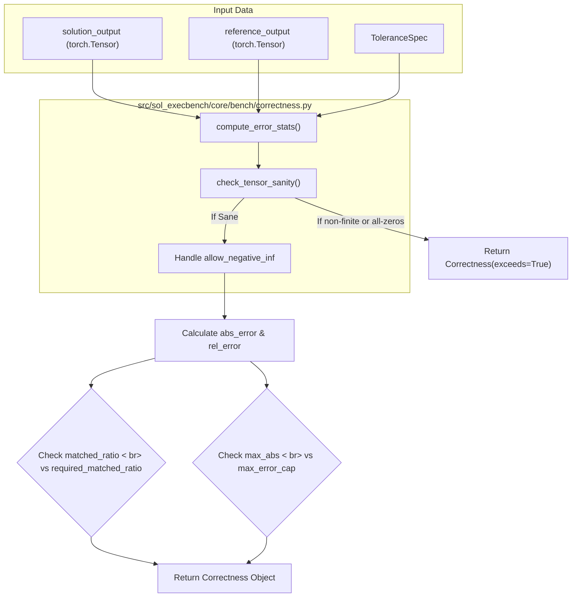
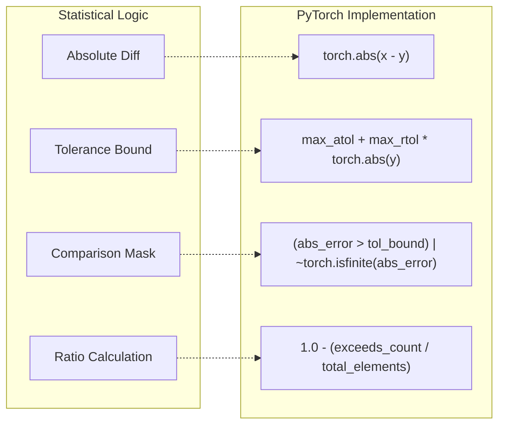

<!-- source: DeepWiki mcp.deepwiki.com · repo NVIDIA/SOL-ExecBench · page 4.2 Correctness Checking · fetched 2026-10-26 -->

# Correctness Checking

Relevant source files

The following files were used as context for generating this wiki page:

- [src/sol_execbench/driver/templates/eval_driver.py](src/sol_execbench/driver/templates/eval_driver.py)
- [tests/sol_execbench/core/bench/test_timing.py](tests/sol_execbench/core/bench/test_timing.py)

Correctness checking in SOL-ExecBench ensures that kernel outputs are numerically accurate compared to a reference implementation. The system implements a robust validation pipeline that handles floating-point tolerances, non-finite values (NaN/Inf), and common "cheat" patterns like all-zero outputs.

The primary logic resides in `src/sol_execbench/core/bench/correctness.py`, which provides utilities for deterministic seeding and statistical error computation.

## Core Error Logic

The system uses a two-stage validation process: first, a "sanity check" for non-finite values and degenerate outputs, followed by a statistical comparison using a configurable tolerance formula.

### The Tolerance Formula
SOL-ExecBench adopts the `torch.allclose` style for determining if an element is correct:
$$\text{error} \le \text{max\_atol} + \text{max\_rtol} \times |\text{reference}|$$

A solution is considered passing if the ratio of elements satisfying this condition meets or exceeds the `required_matched_ratio` [src/sol_execbench/core/bench/correctness.py:126-139]().

### Data Flow and Entity Mapping

The following diagram illustrates how the `compute_error_stats` function processes solution outputs against reference tensors using the `ToleranceSpec`.

**Correctness Validation Flow**

Sources: [src/sol_execbench/core/bench/correctness.py:37-88](), [src/sol_execbench/core/bench/correctness.py:91-149]()

## Sanity Checks

Before performing detailed statistical analysis, `check_tensor_sanity` performs two critical checks to filter out invalid computations.

### NaN and Infinity Detection
By default, any `NaN` or `Inf` in either the solution or the reference tensor triggers an immediate failure [src/sol_execbench/core/bench/correctness.py:53-65](). 
* **NaN Priority**: If both `NaN` and `Inf` are present, `has_nan` is set to `True` as it indicates a more severe numerical failure [src/sol_execbench/core/bench/correctness.py:67-73]().
* **Negative Infinity Handling**: Some kernels (e.g., Softmax with masking) naturally produce `-inf`. If `allow_negative_inf` is enabled in the `ToleranceSpec`, positions where **both** tensors contain `-inf` are treated as valid and excluded from error calculations [src/sol_execbench/core/bench/correctness.py:59-63]().

### All-Zeros Sanity Check
To prevent "reward hacking" where a kernel might return an uninitialized (zeroed) buffer to save time, the system checks if the solution is all zeros while the reference has a non-zero norm. If this occurs, the check fails immediately with the reference norm reported as the absolute error [src/sol_execbench/core/bench/correctness.py:75-86]().

Sources: [src/sol_execbench/core/bench/correctness.py:37-88]()

## Statistical Error Computation

The `compute_error_stats` function performs the heavy lifting of numerical comparison.

| Metric | Implementation Detail | Code Reference |
| :--- | :--- | :--- |
| **Absolute Error** | `torch.abs(output - reference)` calculated in `float32`. | [src/sol_execbench/core/bench/correctness.py:101-119]() |
| **Relative Error** | `abs_error / clamp(|reference|, min=max_atol)` to avoid division by zero. | [src/sol_execbench/core/bench/correctness.py:144-145]() |
| **Matched Ratio** | Percentage of elements that satisfy the `allclose` formula. | [src/sol_execbench/core/bench/correctness.py:132-134]() |
| **Max Error Cap** | A hard ceiling on absolute error; if any element exceeds this, the solution fails regardless of ratio. | [src/sol_execbench/core/bench/correctness.py:140-141]() |

### Implementation Mapping
The following diagram maps the logical steps of error computation to the specific PyTorch operations used in the implementation.

**Computation Logic Mapping**

Sources: [src/sol_execbench/core/bench/correctness.py:119-135]()

## Subprocess Execution and Collection
Correctness checking is orchestrated by the `eval_driver.py` template, which is executed in an isolated subprocess during evaluation [src/sol_execbench/driver/templates/eval_driver.py:21-23](). 

1. **Reference Execution**: The driver loads the `Definition` and executes the reference Python code to obtain the "ground truth" tensors [src/sol_execbench/driver/templates/eval_driver.py:171-183]().
2. **Kernel Execution**: The user solution is called via `_call_and_collect_outputs` (supporting both Destination-Passing Style and Return-Value style) [src/sol_execbench/driver/templates/eval_driver.py:53-86]().
3. **Comparison**: The driver calls `compute_error_stats` for each output defined in the problem [src/sol_execbench/driver/templates/eval_driver.py:116-117]().
4. **Trace Generation**: The results are serialized into a `Trace` object and printed to the original stdout (saved as `_real_stdout`) for the parent process to collect [src/sol_execbench/driver/templates/eval_driver.py:40-43]().

Sources: [src/sol_execbench/driver/templates/eval_driver.py:1-201]()

## Reproducibility
To ensure that correctness checks are deterministic (especially when the reference or input generation involves randomness), the `set_seed` utility synchronizes seeds across:
1. Python `random` module.
2. PyTorch CPU.
3. PyTorch CUDA (all devices).

Sources: [src/sol_execbench/core/bench/correctness.py:29-34]()

---

