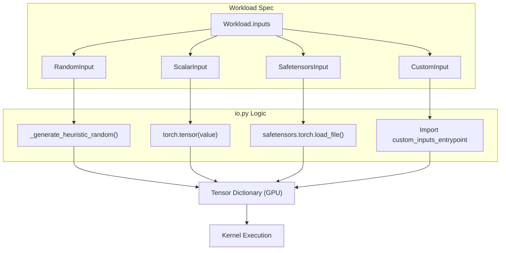
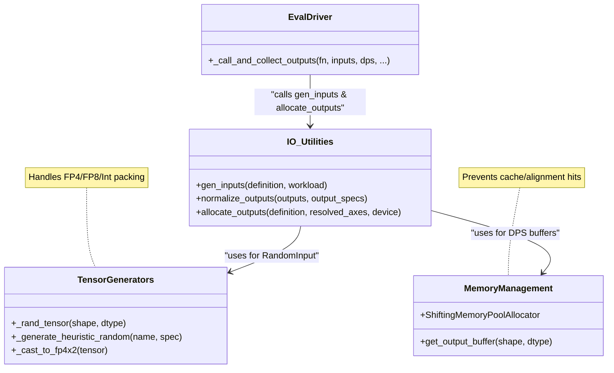

<!-- source: DeepWiki mcp.deepwiki.com · repo NVIDIA/SOL-ExecBench · page 4.3 Input/Output Utilities · fetched 2026-10-26 -->

# Input/Output Utilities

Relevant source files

The following files were used as context for generating this wiki page:

- [src/sol_execbench/core/bench/config/benchmark_config.py](src/sol_execbench/core/bench/config/benchmark_config.py)
- [src/sol_execbench/driver/templates/eval_driver.py](src/sol_execbench/driver/templates/eval_driver.py)

The `io.py` utility module provides the infrastructure for generating, loading, and managing tensor data required for kernel execution and validation. It handles complex data types including packed FP4/FP8 formats, implements heuristic-based random data generation to ensure numerical stability, and provides memory management utilities for pre-allocating output buffers.

## Random Tensor Generation

The core of the input utility system is the ability to generate realistic random data that respects the semantic constraints of different operators (e.g., ensuring weights are small, masks are binary, or variances are positive).

### DType Support and Packing
The utility supports standard PyTorch dtypes and specialized low-precision formats. For `torch.float4_e2m1fn_x2`, it implements a custom quantization and packing routine that converts two FP4 values into a single `uint8` byte [src/sol_execbench/core/bench/io.py:34-67]().

| DType Group | Implementation Detail |
| :--- | :--- |
| **Standard Floats** | Uses `torch.randn` for FP32, FP16, and BF16 [src/sol_execbench/core/bench/io.py:73-74](). |
| **FP8 (E4M3/E5M2)** | Generates FP32 randn, clamps to `[-2.0, 2.0]`, and casts to FP8 [src/sol_execbench/core/bench/io.py:77-79](). |
| **FP4 (Packed)** | Uses `_cast_to_fp4x2` to quantize FP32 values into packed 4-bit elements [src/sol_execbench/core/bench/io.py:80-81](). |
| **Integers** | Uses `torch.randint` with ranges tailored to the bit-width (e.g., -128 to 128 for Int8) [src/sol_execbench/core/bench/io.py:88-96](). |

### Heuristic-Based Initialization
To prevent numerical instability (like NaN gradients or exploding activations), `_generate_heuristic_random` applies specific distributions based on tensor names and shapes [src/sol_execbench/core/bench/io.py:222-224]().

**Heuristic Mapping Logic:**
*   **Weight Matrices:** Initialized with a small standard deviation ($1/\sqrt{N}$) [src/sol_execbench/core/bench/io.py:230-234]().
*   **Normalization Params:** Weights (gamma) are initialized to 1.0, and biases (beta) to 0.0 [src/sol_execbench/core/bench/io.py:236-241]().
*   **Binary/Causal Masks:** Generated as boolean or 0/1 tensors [src/sol_execbench/core/bench/io.py:243-254]().
*   **Positive Tensors:** (e.g., `std`, `var`) are forced to be positive using `abs()` plus a small epsilon [src/sol_execbench/core/bench/io.py:260-263]().
*   **RoPE Embeddings:** Sin/Cos tensors are generated within `[-1, 1]` [src/sol_execbench/core/bench/io.py:256-258]().

**Sources:** [src/sol_execbench/core/bench/io.py:34-98](), [src/sol_execbench/core/bench/io.py:222-284]()

---

## Input Orchestration

The `gen_inputs` function serves as the high-level coordinator, transforming a `Workload` and `Definition` into a dictionary of live PyTorch tensors [src/sol_execbench/core/bench/io.py:321-324]().

### Data Flow: Workload to Tensors
The following diagram illustrates how different input descriptor types in the `Workload` schema are resolved into GPU tensors.

**Input Resolution Pipeline**

**Sources:** [src/sol_execbench/core/bench/io.py:321-384](), [src/sol_execbench/core/data/workload.py:1-50]()

### Loading Mechanisms
1.  **Safetensors:** Loads specific tensors from a `.safetensors` file path defined in the workload using `load_safetensors` [src/sol_execbench/core/bench/io.py:346-353]().
2.  **Custom Entrypoints:** If the definition specifies a `custom_inputs_entrypoint`, the system dynamically imports the specified module and calls the function to generate the input dictionary [src/sol_execbench/core/bench/io.py:368-379]().

---

## Output Management

SOL-ExecBench supports two primary kernel styles: **Destination-Passing Style (DPS)**, where the caller provides the output buffer, and **Return-Value Style**, where the kernel allocates and returns tensors.

### ShiftingMemoryPoolAllocator
To ensure that kernels do not rely on "lucky" memory alignments or previous execution artifacts, the `ShiftingMemoryPoolAllocator` manages a large pre-allocated buffer [src/sol_execbench/core/bench/io.py:431-435](). This is heavily utilized by `time_runnable` to prevent id-based caching attacks [src/sol_execbench/core/bench/timing.py:30-31]().

*   **Pre-allocation:** It allocates a single large chunk of GPU memory (default 256MB) [src/sol_execbench/core/bench/io.py:444-448]().
*   **Shifting:** Each time `get_output_buffer` is called, it returns a slice of this pool. The starting offset shifts by a small amount (e.g., 256 bytes) between iterations to catch out-of-bounds access or alignment bugs [src/sol_execbench/core/bench/io.py:453-471]().

### Output Normalization
The `normalize_outputs` function ensures consistency between different kernel return types. It converts single tensors, lists, or dictionaries into a standardized dictionary format keyed by the output names defined in the `Definition` [src/sol_execbench/core/bench/io.py:387-391](). The `eval_driver.py` uses this to process results from return-value style kernels before correctness checking [src/sol_execbench/driver/templates/eval_driver.py:80-86]().

**Sources:** [src/sol_execbench/core/bench/io.py:387-428](), [src/sol_execbench/core/bench/io.py:431-471](), [src/sol_execbench/driver/templates/eval_driver.py:53-86]()

---

## Code Entity Map

This diagram maps the logical IO operations to the specific classes and functions implemented in `io.py` and their orchestration in the `eval_driver.py`.

**Entity Relationship Diagram**

**Sources:** [src/sol_execbench/core/bench/io.py:34-67](), [src/sol_execbench/core/bench/io.py:321-324](), [src/sol_execbench/core/bench/io.py:431-435](), [src/sol_execbench/driver/templates/eval_driver.py:53-86]()

---

