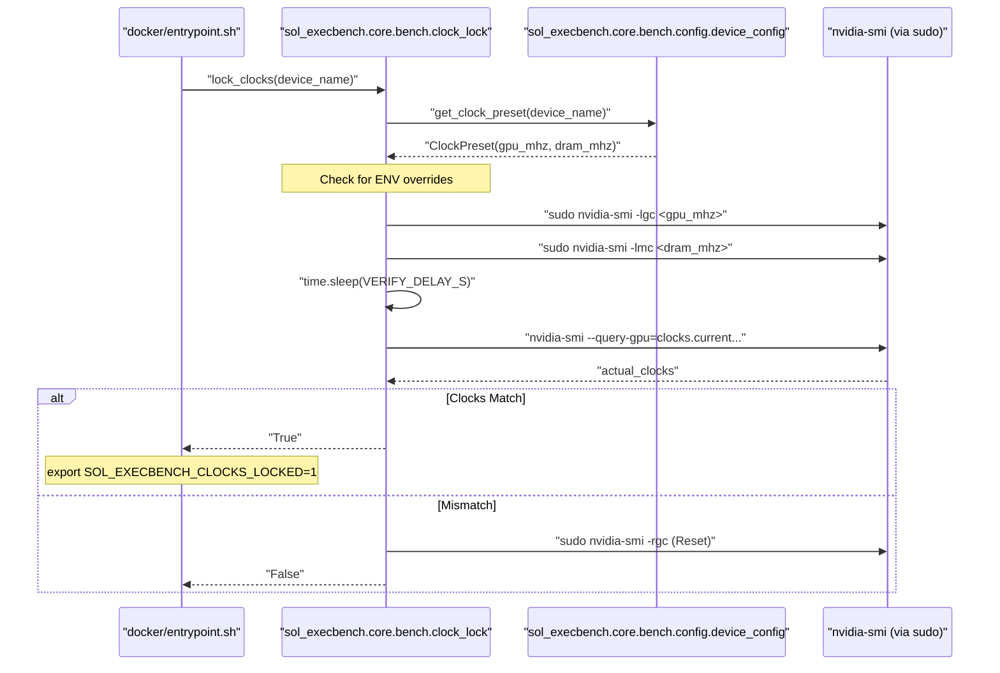
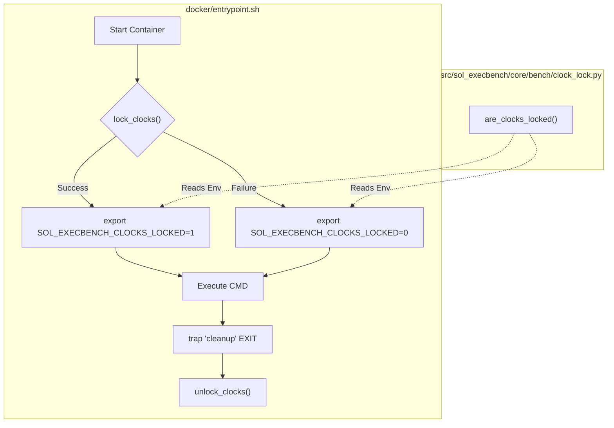

<!-- source: DeepWiki mcp.deepwiki.com · repo NVIDIA/SOL-ExecBench · page 4.4 GPU Clock Locking · fetched 2026-10-26 -->

# GPU Clock Locking

Relevant source files

The following files were used as context for generating this wiki page:

- [docker/Dockerfile](docker/Dockerfile)
- [src/sol_execbench/core/bench/config/benchmark_config.py](src/sol_execbench/core/bench/config/benchmark_config.py)

GPU clock locking is a critical component of the SOL-ExecBench core benchmarking engine. It ensures reproducible performance measurements by pinning GPU and DRAM frequencies to fixed values, eliminating the 10-30% latency variance typically caused by dynamic boost clock fluctuations and thermal throttling [src/sol_execbench/core/bench/clock_lock.py:16-20]().

## Implementation Overview

The clock locking system interfaces with the hardware via `nvidia-smi` commands executed through subprocesses with `sudo`. It supports pre-defined profiles for major NVIDIA architectures and allows for environment-based overrides.

### Key Components and Data Flow

The system relies on three primary layers:
1.  **Configuration**: `device_config.py` defines the standard frequencies for supported GPUs.
2.  **Logic**: `clock_lock.py` handles the orchestration of locking, unlocking, and verifying frequencies.
3.  **Integration**: `entrypoint.sh` automates the locking process when the Docker container starts.

### Clock Locking Process Flow

The following diagram illustrates the sequence of operations performed during a clock lock request.

**Diagram: Clock Locking Sequence**

**Sources:** [src/sol_execbench/core/bench/clock_lock.py:70-142](), [docker/entrypoint.sh:10-27](), [src/sol_execbench/core/bench/config/device_config.py:39-57]()

---

## Device Presets and Configuration

Clock frequencies are managed via the `ClockPreset` dataclass [src/sol_execbench/core/bench/config/device_config.py:24-29](). The system matches the GPU name string (e.g., from `torch.cuda.get_device_name()`) against the keys in `CLOCK_LOCK_PRESETS` [src/sol_execbench/core/bench/config/device_config.py:32-36]().

| GPU Architecture | GPU Core Clock (MHz) | DRAM Clock (MHz) |
| :--- | :--- | :--- |
| NVIDIA B200 | 1500 | 3996 |
| NVIDIA H100 | 1410 | 1593 |
| NVIDIA A100 | 1065 | 1215 |

**Sources:** [src/sol_execbench/core/bench/config/device_config.py:32-36]()

### Environment Overrides
Users can bypass presets by setting specific environment variables:
*   `SOL_EXECBENCH_GPU_CLK_MHZ`: Sets a custom GPU core clock [src/sol_execbench/core/bench/clock_lock.py:88-93]().
*   `SOL_EXECBENCH_DRAM_CLK_MHZ`: Sets a custom DRAM clock [src/sol_execbench/core/bench/clock_lock.py:89-96]().

The `BenchmarkConfig` dataclass also includes a `lock_clocks` boolean field (defaulting to `False`) to signal if clock locking is requested for a specific run [src/sol_execbench/core/bench/config/benchmark_config.py:32]().

---

## Core Functions in `clock_lock.py`

The module `src/sol_execbench/core/bench/clock_lock.py` provides the following functional interface:

### `lock_clocks(device_name)`
Performs the locking of both graphics and memory clocks. It uses `sudo -n nvidia-smi -lgc` (Lock Graphics Clock) and `sudo -n nvidia-smi -lmc` (Lock Memory Clock) [src/sol_execbench/core/bench/clock_lock.py:111-126](). If the memory clock fails to lock, it automatically attempts to roll back the graphics clock lock [src/sol_execbench/core/bench/clock_lock.py:131]().

### `verify_clocks(expected_gpu_mhz, expected_dram_mhz)`
Queries the current state of the GPU using `nvidia-smi --query-gpu=clocks.current.graphics,clocks.current.memory` [src/sol_execbench/core/bench/clock_lock.py:168-173](). It validates that the actual frequencies are within a `tolerance_mhz` (default 50 MHz) of the requested values [src/sol_execbench/core/bench/clock_lock.py:146-206]().

### `unlock_clocks()`
Resets the clocks to their default dynamic state using the `-rgc` (Reset Graphics Clock) and `-rmc` (Reset Memory Clock) flags [src/sol_execbench/core/bench/clock_lock.py:218-233]().

### `probe_clock_lock_available()`
A diagnostic utility that attempts to lock the graphics clock to 1 MHz and immediately reset it to check if the current user has passwordless `sudo` access to `nvidia-smi` [src/sol_execbench/core/bench/clock_lock.py:50-67]().

**Sources:** [src/sol_execbench/core/bench/clock_lock.py:50-233]()

---

## Docker Integration

The Docker environment is designed to be the primary consumer of the clock locking system. To facilitate this, the `Dockerfile` explicitly grants the user `NOPASSWD` sudo access for `/usr/bin/nvidia-smi` [docker/Dockerfile:46]().

**Diagram: Entrypoint Logic and Environment State**

### Entrypoint Behavior
1.  **Startup**: Before launching the benchmark server or CLI, `entrypoint.sh` calls `lock_clocks` via a small Python snippet [docker/entrypoint.sh:10-21]().
2.  **Environment Marking**: If successful, it exports `SOL_EXECBENCH_CLOCKS_LOCKED=1`. This allows the benchmarking engine to verify that the environment is stable before recording metrics [docker/entrypoint.sh:22-26]().
3.  **Cleanup**: A shell `trap` is set on `EXIT` to ensure `unlock_clocks()` is called even if the container crashes or receives a `SIGTERM` [docker/entrypoint.sh:58-59]().

**Sources:** [docker/entrypoint.sh:10-62](), [src/sol_execbench/core/bench/clock_lock.py:31-33](), [docker/Dockerfile:46]()

---

