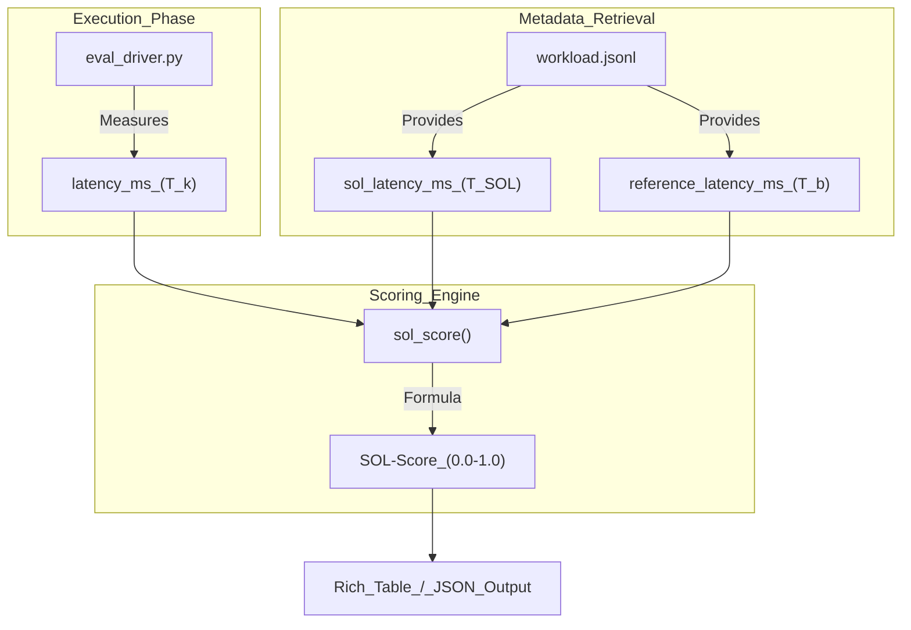
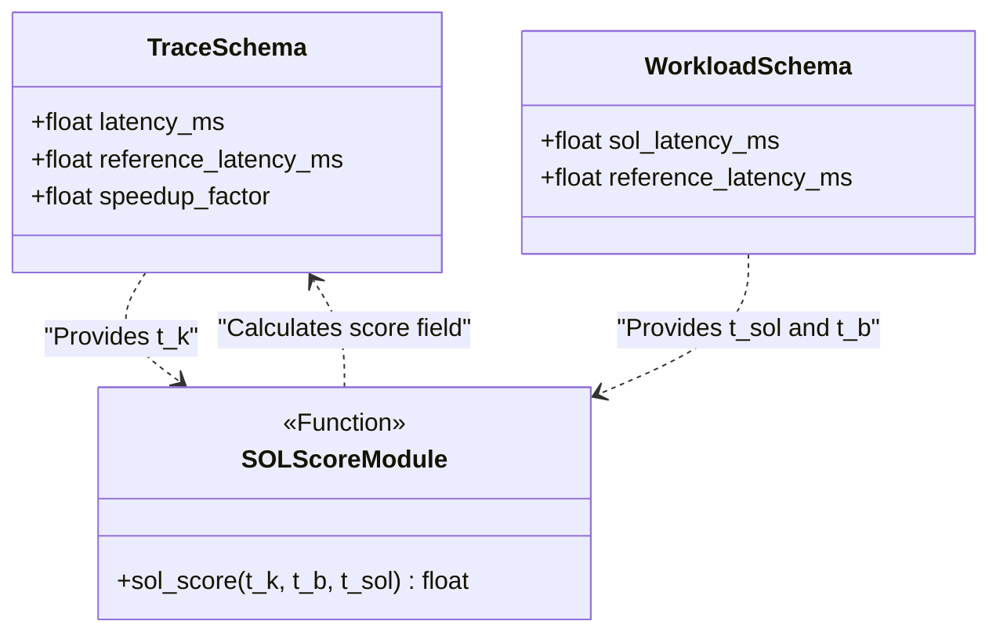

<!-- source: DeepWiki mcp.deepwiki.com · repo NVIDIA/SOL-ExecBench · page 5 SOL-Score · fetched 2026-10-26 -->

# SOL-Score

Relevant source files

The following files were used as context for generating this wiki page:

- [README.md](README.md)
- [src/sol_execbench/sol_score.py](src/sol_execbench/sol_score.py)

The **SOL-Score** (Speed-Of-Light Score) is the primary performance metric used by SOL-ExecBench to evaluate GPU kernel efficiency. Unlike raw latency or speedup factors, the SOL-Score anchors performance against a theoretical hardware limit—the Speed-Of-Light (SOL)—derived from analytical roofline models. This allows for a normalized comparison across different workloads and algorithm complexities, specifically targeting the NVIDIA Blackwell (B200) architecture as the baseline [README.md:18-18]().

### The Scoring Formula

The SOL-Score $S(T_k)$ for a kernel with measured latency $T_k$ is calculated using an anchored scoring formula in `sol_score.py`. The formula is designed to map performance to a range where higher values represent closer proximity to the hardware's theoretical limit [src/sol_execbench/sol_score.py:1-24]().

$$S(T_k) = \frac{1}{1 + \frac{T_k - T_{SOL}}{T_b - T_{SOL}}}$$

Where:
*   **$T_k$**: The measured latency of the candidate kernel runtime in milliseconds [src/sol_execbench/sol_score.py:14-14]().
*   **$T_{SOL}$**: The "Speed-Of-Light" runtime (ms)—the theoretical minimum time required to execute the workload based on raw SOLAR estimates [src/sol_execbench/sol_score.py:16-16]().
*   **$T_b$**: The optimized scoring baseline runtime (ms). In SOL-ExecBench, this is typically set as an optimized PyTorch implementation of the reference solution [src/sol_execbench/sol_score.py:11-15]().

#### Interpretation of Scores
*   **$S(T_k) = 1.0$**: The kernel has achieved the theoretical Speed-Of-Light ($T_k = T_{SOL}$).
*   **$S(T_k) = 0.5$**: The kernel performance matches the baseline ($T_k = T_b$).
*   **$S(T_k) \to 0$**: The kernel is significantly slower than the baseline.

**Note on Edge Cases**: If the gap between the baseline and SOL ($T_b - T_{SOL}$) is zero or negative, the function returns $1.0$ if the kernel matches or beats the SOL, and $0.0$ otherwise [src/sol_execbench/sol_score.py:22-23]().

### SOLAR: Speed-Of-Light Analytical Report

The $T_{SOL}$ values are obtained via **SOLAR**, an analytical tool that estimates the roofline of a kernel on specific hardware [README.md:18-18](). SOLAR considers:
1.  **Memory Bandwidth Limits**: The time required to move the necessary tensors across the GPU memory hierarchy.
2.  **Compute Throughput Limits**: The time required to perform the mathematical operations (FLOPs) based on the specific data types (e.g., FP16, FP8, FP4) and hardware execution units.

In SOL-ExecBench, the $T_{SOL}$ represents the inescapable physical bottleneck of the hardware [README.md:11-18]().

### Implementation and Data Flow

The scoring logic is integrated into the post-evaluation phase. After the evaluation driver measures the kernel latency and produces a Trace, the system calculates the SOL-Score to update the final report.

#### SOL-Score Calculation Logic
The calculation is encapsulated in the `sol_score` function [src/sol_execbench/sol_score.py:1-5](). It requires the measured latency from the execution trace and the corresponding SOL and reference latencies defined in the workload or problem metadata.

**Data Flow: From Latency to Score**
The following diagram illustrates how raw measurements are transformed into the SOL-Score.

"SOL-Score Calculation Flow"

Sources: [src/sol_execbench/sol_score.py:1-24](), [README.md:106-118]()

### The B200 Baseline

SOL-ExecBench anchors its theoretical limits to the **NVIDIA B200 (Blackwell)** architecture [README.md:18-18](). This choice ensures that the benchmark remains forward-looking and challenging for modern DSLs like Triton, CuTe, and cuTile. 

When running benchmarks, the `sol-execbench` tool uses these B200-anchored $T_{SOL}$ values for the leaderboard-style SOL-Score, though local `speedup_factor` relative to the current GPU's reference implementation is also provided in the trace output [README.md:118-118]().

### Code Entities and Metrics

The following table maps the mathematical variables to the code entities found within the schemas and the scoring module.

| Math Symbol | Code Entity | Description |
| :--- | :--- | :--- |
| $T_k$ | `t_k` | The actual time taken by the candidate kernel [src/sol_execbench/sol_score.py:14-14](). |
| $T_{SOL}$ | `t_sol` | The SOLAR-calculated theoretical limit [src/sol_execbench/sol_score.py:16-16](). |
| $T_b$ | `t_b` | The time taken by the optimized scoring baseline [src/sol_execbench/sol_score.py:15-15](). |
| $S(T_k)$ | `sol_score` | The final normalized metric [src/sol_execbench/sol_score.py:1-1]() |

#### Entity Relationship Diagram
This diagram bridges the conceptual "SOL-Score" to the data structures used during evaluation.

"Metric Mapping to Code Entities"

Sources: [src/sol_execbench/sol_score.py:1-24](), [README.md:115-118]()

### Usage in the CLI

The SOL-Score is automatically calculated and displayed by the `sol-execbench` CLI and the `run_dataset.py` batch runner [README.md:48-56](), [README.md:105-110](). When a user runs a solution, the final summary table includes the SOL-Score alongside correctness results, allowing for immediate assessment of how much "headroom" remains for optimization relative to the B200 Speed-Of-Light.

Sources: [README.md:18-18](), [README.md:83-102](), [src/sol_execbench/sol_score.py:1-24]()

---

