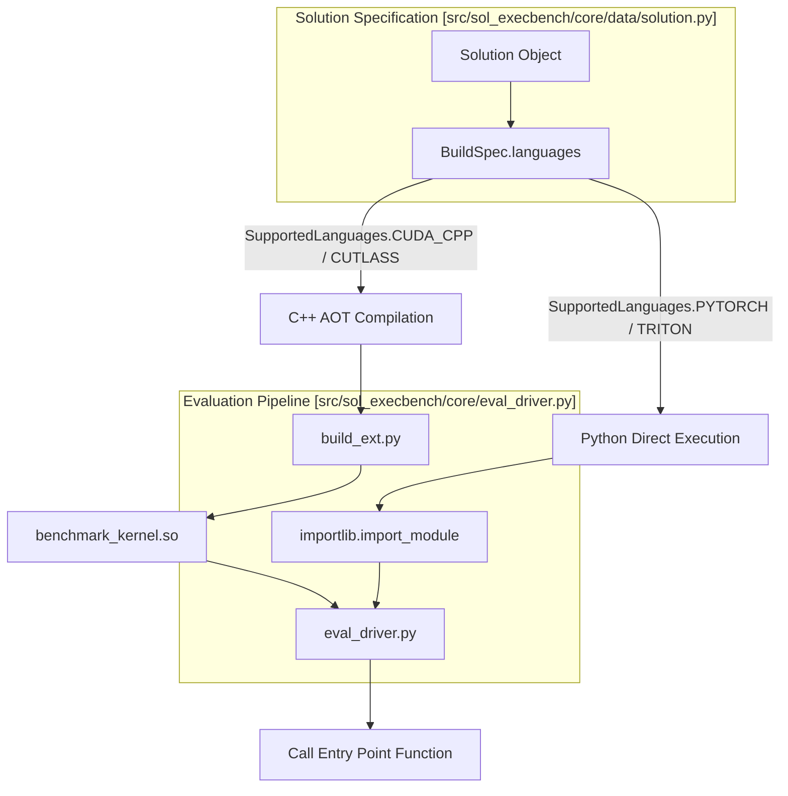
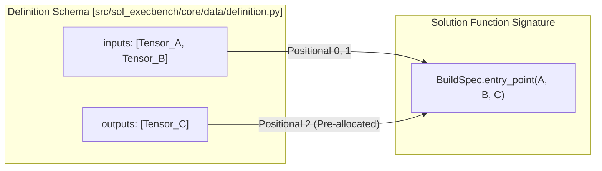

<!-- source: DeepWiki mcp.deepwiki.com · repo NVIDIA/SOL-ExecBench · page 6 Supported GPU Programming Models · fetched 2026-10-26 -->

# Supported GPU Programming Models

Relevant source files

The following files were used as context for generating this wiki page:

- [README.md](README.md)
- [src/sol_execbench/core/data/solution.py](src/sol_execbench/core/data/solution.py)

SOL-ExecBench supports a diverse range of GPU programming models, spanning high-level Python DSLs to low-level C++ template libraries. The evaluation pipeline is designed to handle both JIT-compiled Python kernels and AOT-compiled C++ extensions, providing a unified interface for benchmarking performance and correctness across different abstraction layers.

The system categorizes these models into two primary families based on their compilation and execution flow: **Python-based** (interpreted or JIT-compiled) and **C++-based** (compiled into shared objects via PyTorch bindings).

### Programming Model Overview

The following table summarizes the supported languages and their integration patterns within the `Solution` schema:

| Language Family | `SupportedLanguages` Enum | Entry Point Format | Integration Mechanism |
|:---|:---|:---|:---|
| **Python** | `pytorch` | `file.py::func` | Direct Python import/call |
| **Triton** | `triton` | `file.py::func` | Python JIT (Triton compiler) |
| **NVIDIA DSLs** | `cute_dsl`, `cutile`, `cudnn_frontend` | `file.py::func` | Python-based graph/layout DSLs |
| **CUDA / C++** | `cuda_cpp`, `cutlass`, `cudnn`, `cublas` | `file.cu::func` | `torch.utils.cpp_extension` (AOT) |

Sources: [src/sol_execbench/core/data/solution.py:35-55](), [src/sol_execbench/core/data/solution.py:138-144]()

---

### Execution and Data Flow

The evaluation pipeline bridges the "Natural Language Space" (programming model names) to the "Code Entity Space" (specific Python classes and build scripts) by routing solutions based on their `languages` specification.

#### Programming Model Routing Logic

Sources: [src/sol_execbench/core/data/solution.py:28-55](), [src/sol_execbench/core/data/solution.py:131-157]()

---

### Python-Based Kernels

Python-based models include pure PyTorch implementations, Triton JIT kernels, and NVIDIA's modern Python DSLs. These solutions are executed directly by the `eval_driver.py` without a separate compilation step outside of what the libraries themselves handle (e.g., Triton's internal JIT).

*   **PyTorch (`pytorch`)**: Used for reference implementations or high-level library calls. [src/sol_execbench/core/data/solution.py:36-37]()
*   **Triton (`triton`)**: Support for OpenAI Triton kernels. The entry point is typically a Python function that launches a `@triton.jit` kernel. [src/sol_execbench/core/data/solution.py:38-39]()
*   **CuTe DSL (`cute_dsl`)**: High-level layout and copy abstractions in Python. [src/sol_execbench/core/data/solution.py:40-41]()
*   **cuTile (`cutile`)**: Specialized DSL for Blackwell (sm_100) hardware features. [src/sol_execbench/core/data/solution.py:42-43]()
*   **cuDNN Frontend (`cudnn_frontend`)**: Python graph API for cuDNN operations. [src/sol_execbench/core/data/solution.py:44-45]()

For details on function signatures and DPS conventions for these models, see [Python-Based Kernels (PyTorch, Triton, CuTe DSL, cuTile, cuDNN Frontend)](#6.1).

Sources: [src/sol_execbench/core/data/solution.py:35-45](), [README.md:20-20]()

---

### C++-Based Kernels

C++ and CUDA solutions provide the highest level of control over hardware. These are integrated into the pipeline using PyTorch's C++ extension mechanism, which compiles the provided `SourceFile` entries into a shared library (`.so`) before execution.

*   **CUDA C++ (`cuda_cpp`)**: Raw CUDA kernels (`.cu` files) with C++ host code and inline PTX support. [src/sol_execbench/core/data/solution.py:53-54]()
*   **CUTLASS (`cutlass`)**: Template-based kernels utilizing the NVIDIA CUTLASS library. [src/sol_execbench/core/data/solution.py:47-48]()
*   **cuBLAS / cuDNN (`cublas`, `cudnn`)**: C++ implementations calling NVIDIA's optimized primitive libraries. [src/sol_execbench/core/data/solution.py:49-52]()

The pipeline uses `CompileOptions` to handle dependencies and inject necessary `nvcc` flags (e.g., `-O3`, `--use_fast_math`). [src/sol_execbench/core/data/solution.py:117-129]()

For details on the compilation flow and PyTorch `torch::Tensor` bindings, see [C++-Based Kernels (CUDA C++, CUTLASS, cuDNN, cuBLAS)](#6.2).

Sources: [src/sol_execbench/core/data/solution.py:47-55](), [src/sol_execbench/core/data/solution.py:80-94]()

---

### Calling Conventions: Destination Passing Style (DPS)

Regardless of the programming model, SOL-ExecBench supports both **Destination Passing Style (DPS)** and return-value style, controlled by the `destination_passing_style` flag in the `BuildSpec`.

#### DPS Argument Mapping

Sources: [src/sol_execbench/core/data/solution.py:142-151]()

*   **DPS Enabled (`True`)**: The solution must accept the output tensors as the last arguments. This is the default. [src/sol_execbench/core/data/solution.py:148-151]()
*   **DPS Disabled (`False`)**: The solution should return the output tensors (or a tuple of tensors) to the caller. [src/sol_execbench/core/data/solution.py:148-151]()

### Related Pages
*   [Python-Based Kernels (PyTorch, Triton, CuTe DSL, cuTile, cuDNN Frontend)](#6.1)
*   [C++-Based Kernels (CUDA C++, CUTLASS, cuDNN, cuBLAS)](#6.2)

---

