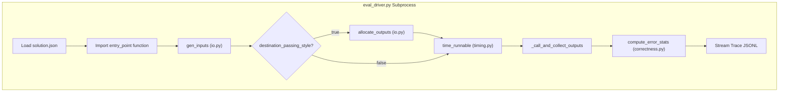
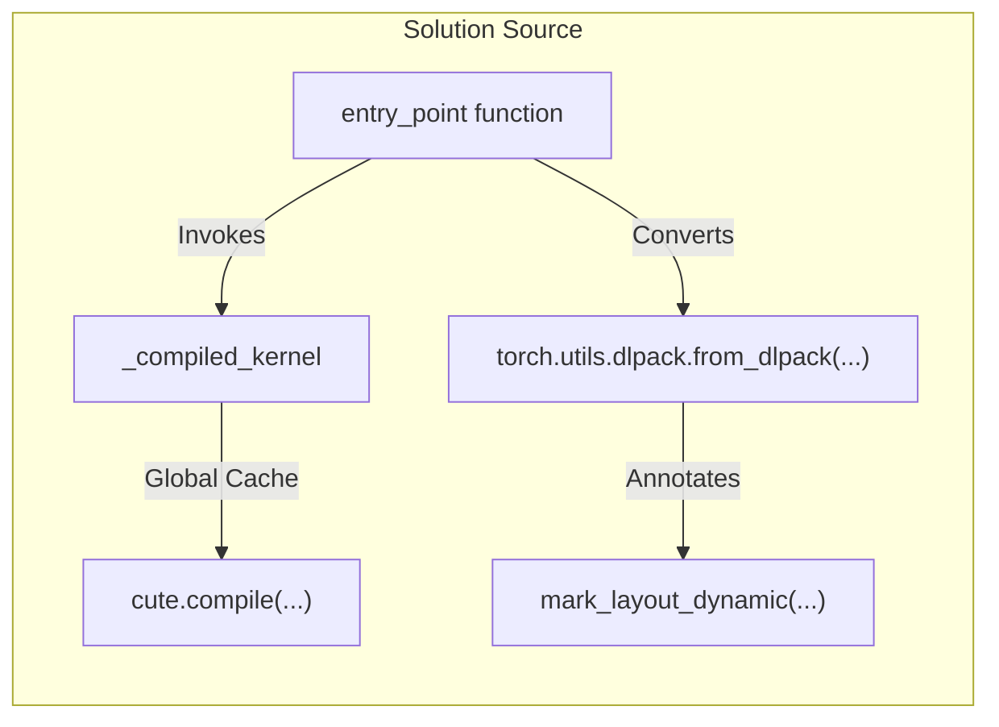
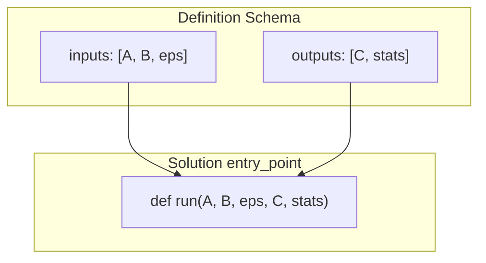

<!-- source: DeepWiki mcp.deepwiki.com · repo NVIDIA/SOL-ExecBench · page 6.1 Python-Based Kernels (PyTorch, Triton, CuTe DSL, cuTile, cuDNN Frontend) · fetched 2026-10-26 -->

# Python-Based Kernels (PyTorch, Triton, CuTe DSL, cuTile, cuDNN Frontend)

Relevant source files

The following files were used as context for generating this wiki page:

- [src/sol_execbench/core/data/solution.py](src/sol_execbench/core/data/solution.py)
- [src/sol_execbench/driver/templates/eval_driver.py](src/sol_execbench/driver/templates/eval_driver.py)

This page covers the implementation and integration of Python-family kernel languages within SOL-ExecBench. These languages leverage the Python runtime and Just-In-Time (JIT) compilation to execute high-performance GPU kernels.

## Overview of Python-Family Integration

SOL-ExecBench supports several Python-based DSLs and frameworks. Unlike C++ kernels which require a separate compilation phase into a shared object, Python kernels are typically invoked directly via an `entry_point` specified in the `solution.json` [src/sol_execbench/core/data/solution.py:142-144]().

### Function Signature Conventions

The `eval_driver.py` supports two primary calling conventions:
1.  **Return-Value Style**: The function creates and returns the output tensors. This is common in pure PyTorch and cuDNN Frontend solutions [src/sol_execbench/driver/templates/eval_driver.py:76-86]().
2.  **Destination-Passing Style (DPS)**: The function receives pre-allocated output tensors as arguments and modifies them in-place. This is the default style for SOL-ExecBench [src/sol_execbench/core/data/solution.py:148-151]().

The style is configured via the `destination_passing_style` boolean in the solution specification [src/sol_execbench/core/data/solution.py:148-151]().

### Data Flow: Python Kernel Execution

The following diagram illustrates how the `eval_driver.py` interacts with a Python-based kernel solution.

**Python Kernel Execution Flow**

Sources: `[src/sol_execbench/driver/templates/eval_driver.py:53-87]()`, `[src/sol_execbench/core/data/solution.py:148-151]()`

---

## Supported Languages

The `SupportedLanguages` enum defines the valid Python-family identifiers [src/sol_execbench/core/data/solution.py:28-55]().

### 1. PyTorch (`pytorch`)
Used for baseline implementations or when utilizing PyTorch's internal specialized kernels (e.g., `ATen`).
*   **Pattern**: Can be DPS or return-value style.
*   **Implementation**: Standard Python function using `torch.*` ops.

### 2. Triton (`triton`)
Triton provides a Python DSL for writing highly efficient JIT-compiled GPU kernels [src/sol_execbench/core/data/solution.py:38-39]().
*   **Pattern**: Uses `@triton.jit` for the kernel and a wrapper function for launching.
*   **Numerical Stability**: Often requires explicit casting to `tl.float32` for intermediate accumulations to match high-precision reference outputs.

### 3. CuTe DSL (`cute_dsl`)
The Python interface for NVIDIA's CuTe (part of CUTLASS) [src/sol_execbench/core/data/solution.py:40-41]().
*   **Pattern**: Uses `mark_layout_dynamic()` on tensors before passing them to `cute.compile` to handle varying shapes without recompilation.
*   **Caching**: Solutions typically use a global variable to cache the compiled kernel to avoid JIT overhead during the timed loop.

### 4. cuTile (`cutile`)
A Python DSL specifically for NVIDIA Blackwell (sm_100+) architectures [src/sol_execbench/core/data/solution.py:42-43]().
*   **Pattern**: Uses `@ct.kernel` decorators and explicit tile loading/storing.
*   **Hardware Gating**: Requires `sm_100` hardware targets.

### 5. cuDNN Frontend (`cudnn_frontend`)
The cuDNN Graph API allows building complex operation graphs in Python that cuDNN optimizes and executes [src/sol_execbench/core/data/solution.py:44-45]().

---

## Implementation Patterns

### CuTe DSL: Dynamic Layout Caching
Because CuTe kernels are often specialized to specific shapes, the Python DSL provides a mechanism to handle dynamic dimensions while maintaining performance.

**Code Entity Mapping: CuTe DSL Caching**

Sources: `[src/sol_execbench/core/data/solution.py:40-41]()`

### Argument Ordering in DPS
In Destination-Passing Style, the evaluator enforces a strict argument order: all inputs first (in the order defined in the `Definition`), followed by all outputs [src/sol_execbench/driver/templates/eval_driver.py:53-75]().

| Argument Type | Source | Position |
| :--- | :--- | :--- |
| **Inputs** | `Definition.inputs` | First `N` arguments |
| **Outputs** | `Definition.outputs` | Final `M` arguments |

**Code Entity Mapping: DPS Signature**

Sources: `[src/sol_execbench/driver/templates/eval_driver.py:70-75]()`, `[src/sol_execbench/core/data/solution.py:148-151]()`

---

## Build Specification (`BuildSpec`)

The `BuildSpec` class governs how these Python kernels are treated by the orchestrator [src/sol_execbench/core/data/solution.py:131-157]().

*   **`languages`**: A list of `SupportedLanguages`. Note that Python and C++ languages cannot be mixed in a single solution [src/sol_execbench/core/data/solution.py:139-139]().
*   **`entry_point`**: Format is `"{file_path}::{function_name}"` [src/sol_execbench/core/data/solution.py:142-144]().
*   **`dependencies`**: For Python kernels, this can include required libraries or packages [src/sol_execbench/core/data/solution.py:145-147]().

### Security and Validation
The `SourceFile` model ensures that source paths do not use absolute paths or parent directory traversal (`..`) to prevent escaping the staging directory [src/sol_execbench/core/data/solution.py:95-113]().

Sources: `[src/sol_execbench/core/data/solution.py:16-172]()`, `[src/sol_execbench/driver/templates/eval_driver.py:159-167]()`

---

