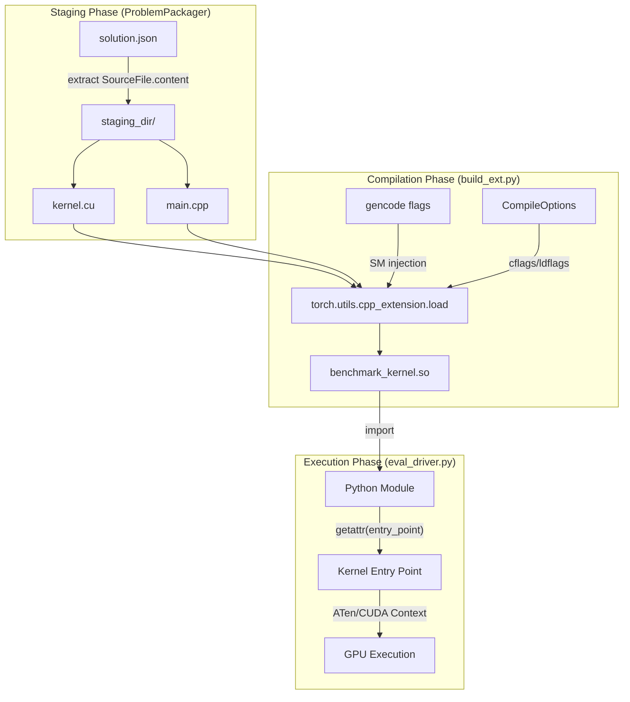

<!-- source: DeepWiki mcp.deepwiki.com · repo NVIDIA/SOL-ExecBench · page 6.2 C++-Based Kernels (CUDA C++, CUTLASS, cuDNN, cuBLAS) · fetched 2026-10-26 -->

# C++-Based Kernels (CUDA C++, CUTLASS, cuDNN, cuBLAS)

<details>
<summary>Relevant source files</summary>

The following files were used as context for generating this wiki page:

- [src/sol_execbench/core/data/solution.py](src/sol_execbench/core/data/solution.py)
- [src/sol_execbench/driver/templates/build_ext.py](src/sol_execbench/driver/templates/build_ext.py)

</details>


This page details the integration and execution of C++-based kernels within SOL-ExecBench. This family of languages includes raw CUDA C++, template-heavy CUTLASS implementations, and high-performance library calls via cuDNN and cuBLAS. Unlike Python-based DSLs, these kernels require a distinct two-phase "compile-then-execute" flow managed by the benchmarking engine.

## Overview of the C++ Integration

SOL-ExecBench supports C++ kernels primarily through the `torch` binding [src/sol_execbench/core/data/solution.py:76-77](), which leverages `torch.utils.cpp_extension` to create Python-accessible modules from source code [src/sol_execbench/driver/templates/build_ext.py:20-51](). The system handles the boilerplate of environment setup, gencode flag injection, and shared object linking.

### Key Components
*   **Source Files**: Typically organized into `.cu` (CUDA source), `.cpp` (C++ host code), and `.h` (headers). The `SourceFile` model validates that paths do not contain absolute references or parent directory traversals [src/sol_execbench/core/data/solution.py:80-113]().
*   **Pybind11 Entry Point**: Every C++ solution must define a function symbol exposed to Python, typically via `PYBIND11_MODULE`. The `entry_point` in the `BuildSpec` must follow the `{file_path}::{function_name}` format [src/sol_execbench/core/data/solution.py:142-144]().
*   **Compile Options**: Specified in the `solution.json`, including `cflags`, `cuda_cflags` (defaulting to `-O3 --use_fast_math`), and `ld_flags` (defaulting to `-lcuda`) [src/sol_execbench/core/data/solution.py:117-129]().

**Sources:** [src/sol_execbench/core/data/solution.py:76-144](), [src/sol_execbench/driver/templates/build_ext.py:20-51]().

## Two-Phase Execution Flow

C++ kernels follow a rigid lifecycle: the `ProblemPackager` stages the source code, the `eval_driver.py` invokes a specialized build script (`build_ext.py`), and finally, the resulting `.so` artifact is loaded for benchmarking.

### Data Flow: From Source to Benchmark
The following diagram illustrates how a `Solution` object containing C++ source code is transformed into an executable kernel.

**C++ Kernel Compilation and Loading Path**

**Sources:** [src/sol_execbench/core/data/solution.py:80-130](), [src/sol_execbench/driver/templates/build_ext.py:16-71]().

## CUDA C++ Kernels

CUDA C++ solutions typically involve a host launcher and a device kernel. The system supports complex implementations including vectorized memory access and shared memory reductions.

### Implementation Pattern
1.  **Device Kernel**: Defined with `__global__` and optimized for specific architectures (e.g., SM90/SM100).
2.  **Host Launcher**: A C++ function that calculates grid/block dimensions and launches the kernel on a specific `cudaStream_t`.
3.  **Torch Wrapper**: Validates `torch::Tensor` properties (dtype, device, contiguity) before calling the launcher. The signature uses `torch::Tensor` by value for inputs and by reference for outputs to support Destination Passing Style (DPS).

### Destination Passing Style (DPS)
For C++ kernels, DPS means the `run` function accepts output tensors as the last arguments [src/sol_execbench/core/data/solution.py:148-151](). The evaluator pre-allocates these tensors, and the C++ code writes results in-place.

**Sources:** [src/sol_execbench/core/data/solution.py:148-151]().

## CUTLASS, cuDNN, and cuBLAS

These specialized C++ languages utilize NVIDIA's high-performance libraries. They require specific linker flags and dependency declarations.

### Library Integration
*   **CUTLASS**: Solutions can specify `cutlass` in `dependencies` [src/sol_execbench/core/data/solution.py:145-147](). The `build_ext.py` template automatically includes `/usr/local/cutlass/include` and the utility headers [src/sol_execbench/driver/templates/build_ext.py:44-49]().
*   **cuDNN and cuBLAS**: Solutions for these libraries involve creating handles and calling standard APIs. These require adding `"-lcudnn"` or `"-lcublas"` to `ld_flags` via the `CompileOptions` model [src/sol_execbench/core/data/solution.py:127-128]().

**Code Entity Mapping: Library Bindings**
```mermaid
classDiagram
    class BuildSpec {
        +List languages
        +String entry_point
        +CompileOptions compile_options
        +List dependencies
    }
    class CompileOptions {
        +List cflags
        +List cuda_cflags
        +List ld_flags
    }
    class BuildExtTemplate {
        +load(name="benchmark_kernel")
        +extra_include_paths
    }
    class PyTorchExtension {
        +PYBIND11_MODULE()
        +void run(torch::Tensor inputs, torch::Tensor outputs)
    }

    BuildSpec --> CompileOptions : "contains"
    BuildSpec --> BuildExtTemplate : "configures"
    BuildExtTemplate --> PyTorchExtension : "compiles"
    PyTorchExtension --|> "CUDA C++ / CUTLASS / cuDNN" : "implements"
```
**Sources:** [src/sol_execbench/core/data/solution.py:117-157](), [src/sol_execbench/driver/templates/build_ext.py:27-60]().

## Compilation and Build System

The benchmarking engine automates the compilation of these C++ components into a standard artifact.

### build_ext.py and Artifacts
The `build_ext.py` script is a template that parses `solution.json`, collects all `.cu`, `.cpp`, `.cc`, `.cxx`, and `.c` files in the staging directory, and calls `ext.load` [src/sol_execbench/driver/templates/build_ext.py:27-51](). It renames the resulting platform-specific shared object (which often contains Python version and architecture suffixes) to a uniform `benchmark_kernel.so` [src/sol_execbench/driver/templates/build_ext.py:62-69]().

### Gencode Flag Injection
To ensure kernels are optimized for the target hardware, the system injects appropriate `gencode` flags into `cuda_cflags`. If `target_hardware` is set to `B200` [src/sol_execbench/core/data/solution.py:63](), flags for `sm_100a` are typically injected during the staging process by the `ProblemPackager`.

### Summary of Compile Options
| Option | Purpose | Default |
| :--- | :--- | :--- |
| `cflags` | Extra flags for GCC/G++ [src/sol_execbench/core/data/solution.py:123-124]() | `[]` |
| `cuda_cflags` | Extra flags for NVCC [src/sol_execbench/core/data/solution.py:125-126]() | `["-O3", "--use_fast_math"]` |
| `ld_flags` | Extra flags for the linker [src/sol_execbench/core/data/solution.py:127-128]() | `["-lcuda"]` |

**Sources:** [src/sol_execbench/core/data/solution.py:117-129](), [src/sol_execbench/driver/templates/build_ext.py:27-71]().

---

