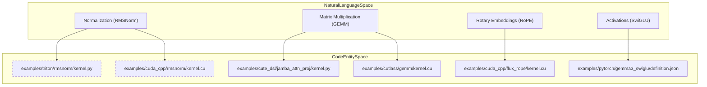
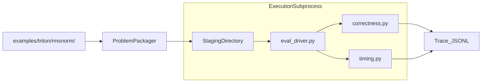

<!-- source: DeepWiki mcp.deepwiki.com · repo NVIDIA/SOL-ExecBench · page 7 Example Problems · fetched 2026-10-26 -->

# Example Problems

Relevant source files

The following files were used as context for generating this wiki page:

- [README.md](README.md)
- [src/sol_execbench/core/data/solution.py](src/sol_execbench/core/data/solution.py)

SOL-ExecBench includes a diverse set of example problems designed to demonstrate the benchmark's support for various GPU programming models and DSLs. These examples serve as both functional templates for creating new problems and as a validation suite for the evaluation pipeline.

The examples are primarily located in the `examples/` directory, organized by the target Domain Specific Language (DSL) or programming model [README.md:63-68](). Additional test samples used for verifying system integrity (like reward-hack detection) are located in `tests/sol_execbench/samples/` [tests/sol_execbench/samples/:1-1]().

### Problem Structure

Each example problem follows a standardized directory layout to ensure compatibility with the `ProblemPackager` and `eval_driver.py`.

| File | Role | Description |
| :--- | :--- | :--- |
| `definition.json` | **Problem Contract** | Defines tensor shapes (using `axes`), dtypes, and the reference implementation [README.md:128-128](). |
| `workload.jsonl` | **Test Cases** | Binds `var` axes to concrete integer values and specifies input generation types [README.md:129-129](). |
| `kernel.py` / `.cu` | **Implementation** | The actual kernel code (Triton, CuTe, CUDA, etc.) to be benchmarked. |
| `solution_*.json` | **Metadata** | Encapsulates the source code, dependencies, and build options for the evaluation engine [README.md:131-131](). |
| `reference.py` | **Golden Truth** | (Optional) A standalone Python file containing the `run` function for correctness checking. |

For a deep dive into the schema requirements of these files, see [Data Schemas](#2).

### Mapping DSLs to Example Implementations

The following diagram illustrates how different high-level problem descriptions (Natural Language/Math) are mapped to specific code entities across the supported DSLs.

**Kernel DSL Association Map**

Sources: [examples/triton/rmsnorm/definition.json:1-45](), [examples/cuda_cpp/rmsnorm/definition.json:1-45](), [examples/cute_dsl/jamba_attn_proj/definition.json:1-59](), [examples/pytorch/gemma3_swiglu/definition.json:1-63]()

---

### Triton Examples
The Triton examples demonstrate how to write Just-In-Time (JIT) compiled kernels using the Triton Python DSL [src/sol_execbench/core/data/solution.py:38-39](). These examples typically feature a `kernel.py` containing a function decorated with `@triton.jit`.

*   **RMSNorm**: A basic implementation of Root Mean Square Normalization captured from Llama-3.1-8B [examples/triton/rmsnorm/definition.json:44-44]().
*   **Nemotron RMSNorm**: Demonstrates normalization specific to the Nemotron model architecture.
*   **OLMo3 Post-Norm**: Shows a post-normalization pattern used in the OLMo3 model.

For details, see [Triton Examples](#7.1).

### CUDA C++ and CUTLASS Examples
These examples represent the C++ family of kernels [src/sol_execbench/core/data/solution.py:46-55](). They require a compilation step handled by `build_ext.py` within the evaluation driver.

*   **Flux RoPE**: Implements the rotary position embedding for the FLUX.1-schnell model [examples/cuda_cpp/flux_rope/definition.json:69-69](). It demonstrates complex number rotation in real space [examples/cuda_cpp/flux_rope/definition.json:68-68]().
*   **CUTLASS GEMM**: A high-performance matrix multiplication using the CUTLASS template library, modeling a transformer linear projection [examples/cutlass/gemm/definition.json:4-4]().

For details, see [CUDA C++ and CUTLASS Examples](#7.2).

### PyTorch, CuTe DSL, cuTile, and cuDNN Examples
This category covers high-level Python integrations and specialized NVIDIA libraries.

*   **PyTorch (Gemma3 SwiGLU)**: Demonstrates a fused gate-up projection with GELU-tanh activation using pure PyTorch operators [examples/pytorch/gemma3_swiglu/definition.json:61-61]().
*   **CuTe DSL (Jamba)**: Uses the CuTe Python DSL to implement a fused attention output projection with residual addition [examples/cute_dsl/jamba_attn_proj/definition.json:57-57]().
*   **cuDNN (Softmax)**: Showcases the use of the cuDNN graph API for a standard softmax operation [examples/cudnn/softmax/definition.json:4-4]().

For details, see [PyTorch, CuTe DSL, cuTile, and cuDNN Examples](#7.3).

---

### Execution Flow for Examples

The following diagram shows how an example problem directory is processed by the core system components.

**Example Processing Pipeline**

Sources: [examples/triton/rmsnorm/workload.jsonl:1-15](), [examples/triton/rmsnorm/reference.py:1-14]()

### Summary Table of Key Examples

| Problem Name | DSL | Key Feature | Reference |
| :--- | :--- | :--- | :--- |
| `rmsnorm_h4096` | Triton | Variable Batch Size | [examples/triton/rmsnorm/definition.json:4-14]() |
| `flux_rope` | CUDA C++ | Complex RoPE Logic | [examples/cuda_cpp/flux_rope/definition.json:1-26]() |
| `gemm_n4096_k4096` | CUTLASS | Template Metaprogramming | [examples/cutlass/gemm/definition.json:1-20]() |
| `linear_backward` | PyTorch | Custom Input Entrypoint | [examples/pytorch/linear_backward/definition.json:9-19]() |
| `jamba_attn_proj` | CuTe DSL | Fused Residual Add | [examples/cute_dsl/jamba_attn_proj/definition.json:1-17]() |

Sources:
- [src/sol_execbench/core/data/solution.py:28-55]()
- [examples/cuda_cpp/flux_rope/definition.json:1-70]()
- [examples/cuda_cpp/rmsnorm/definition.json:1-45]()
- [examples/cudnn/softmax/definition.json:1-32]()
- [examples/cute_dsl/jamba_attn_proj/definition.json:1-59]()
- [examples/cutlass/gemm/definition.json:1-42]()
- [examples/pytorch/gemma3_swiglu/definition.json:1-63]()
- [examples/pytorch/linear_backward/definition.json:1-20]()
- [examples/triton/rmsnorm/definition.json:1-45]()
- [examples/triton/rmsnorm/workload.jsonl:1-15]()

---

