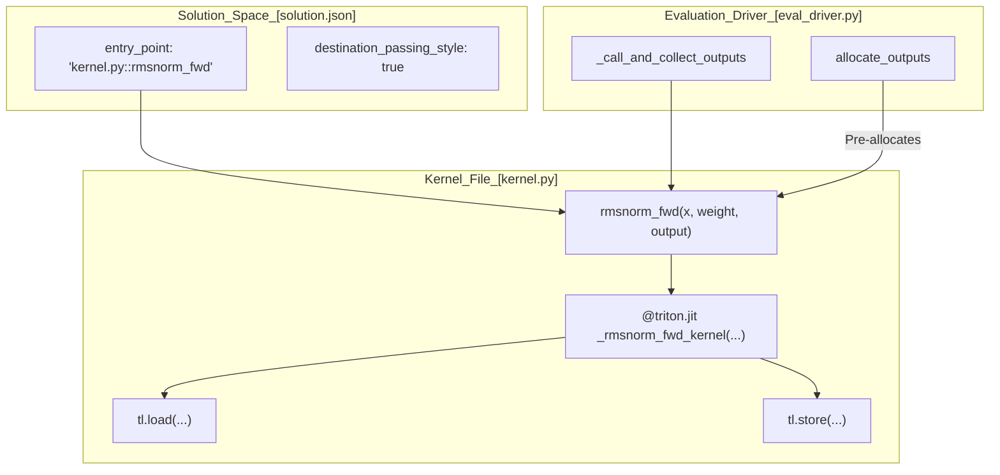
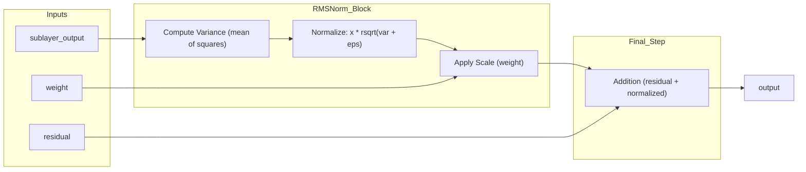

<!-- source: DeepWiki mcp.deepwiki.com · repo NVIDIA/SOL-ExecBench · page 7.1 Triton Examples · fetched 2026-10-26 -->

# Triton Examples

<details>
<summary>Relevant source files</summary>

The following files were used as context for generating this wiki page:

- [README.md](README.md)
- [src/sol_execbench/driver/templates/eval_driver.py](src/sol_execbench/driver/templates/eval_driver.py)

</details>


This page provides a technical walkthrough of the Triton-based examples bundled with SOL-ExecBench. These examples demonstrate how to implement fused kernels for Large Language Model (LLM) normalization layers using Triton's JIT-compiled Python DSL.

The examples cover three distinct patterns:
1.  **Basic RMSNorm**: A standard root-mean-square normalization.
2.  **Nemotron RMSNorm**: A fused residual addition followed by RMSNorm.
3.  **OLMo3 Post-Norm**: A post-normalization residual pattern (residual + RMSNorm).

## Core Triton Implementation Pattern

All Triton examples in SOL-ExecBench follow a common structural pattern consisting of a JIT-compiled kernel and a Python wrapper function. Solutions are categorized under `SupportedLanguages.TRITON` [src/sol_execbench/core/data/solution.py:38-39]().

### System Mapping: Triton DSL to SOL-ExecBench

The following diagram maps the Triton code entities to the SOL-ExecBench evaluation components.

**Triton-to-Bench Mapping**

**Sources:** [examples/triton/rmsnorm/solution_triton.json:12-17](), [examples/triton/rmsnorm/kernel.py:5-51](), [src/sol_execbench/core/data/solution.py:142-144](), [src/sol_execbench/driver/templates/eval_driver.py:53-86]()

---

## 1. Basic RMSNorm (`rmsnorm`)

This example implements Root Mean Square Normalization as captured from the Llama-3.1-8B architecture. It uses a fixed `hidden_size` of 4096 [examples/triton/rmsnorm/definition.json:2-13]().

### Data Flow and Precision
The kernel performs computation in `float32` for numerical stability, even when the input/output tensors are `bfloat16`.

1.  **Load**: Data is loaded from global memory using `tl.load` and cast to `tl.float32` [examples/triton/rmsnorm/kernel.py:20-21]().
2.  **Reduction**: The mean of squares is computed along the row [examples/triton/rmsnorm/kernel.py:24-25]().
3.  **Normalization**: The input is divided by the RMS value [examples/triton/rmsnorm/kernel.py:26-29]().
4.  **Store**: The result is cast back to the original dtype and written to the `output_ptr` [examples/triton/rmsnorm/kernel.py:37-38]().

### Kernel Configuration
The wrapper function `rmsnorm_fwd` calculates the `BLOCK_SIZE` as the next power of 2 of the hidden dimension and sets the grid to match the `batch_size` [examples/triton/rmsnorm/kernel.py:42-45]().

**Sources:** [examples/triton/rmsnorm/kernel.py:5-51](), [examples/triton/rmsnorm/definition.json:1-45]()

---

## 2. Nemotron RMSNorm (`nemotron_rms_norm`)

This example represents a fused kernel used in the NVIDIA Llama-3.3-Nemotron-70B model. It fuses two operations: `hidden_states = residual + hidden_states` followed by `RMSNorm` [examples/triton/nemotron_rms_norm/definition.json:1-2]().

### Workload Specification
The definition defines a constant `hidden_size` of 8192 [examples/triton/nemotron_rms_norm/definition.json:12-16](). The reference implementation demonstrates the mathematical requirement:

```python
# Residual addition
x = residual + hidden_states
# RMSNorm in float32
variance = x_fp32.pow(2).mean(-1, keepdim=True)
output = weight * (x_fp32 * torch.rsqrt(variance + eps)).to(torch.bfloat16)
```
**Sources:** [examples/triton/nemotron_rms_norm/definition.json:61-61]()

---

## 3. OLMo3 Post-Norm (`olmo3_post_norm`)

The OLMo3 architecture uses a "Post-normalization" pattern where the residual is added *after* the normalization: `output = residual + RMSNorm(sublayer_output)` [examples/triton/olmo3_post_norm/definition.json:2-2]().

### Logic Flow Diagram
The following diagram illustrates the data flow within the `olmo3_post_norm` reference and how it differs from standard pre-norm architectures.

**OLMo3 Post-Norm Data Flow**

**Sources:** [examples/triton/olmo3_post_norm/definition.json:61-61]()

### Key Differences
*   **Axes**: Uses a `hidden_size` of 4096 [examples/triton/olmo3_post_norm/definition.json:14-14]().
*   **Precision**: Explicitly converts the `weight` parameter to `float32` before scaling to maintain precision during the normalization multiply [examples/triton/olmo3_post_norm/definition.json:61-61]().

---

## Solution File Structure

Triton solutions in SOL-ExecBench are defined in a `solution.json` file. This file embeds the source code and metadata required for the `eval_driver.py` to execute the kernel. The `BuildSpec` class validates these fields [src/sol_execbench/core/data/solution.py:131-156]().

| Field | Description | Example Value |
| :--- | :--- | :--- |
| `languages` | List of languages (must include `triton`) | `["triton"]` |
| `entry_point` | Path to the wrapper function [src/sol_execbench/core/data/solution.py:142-144]() | `"kernel.py::rmsnorm_fwd"` |
| `destination_passing_style` | Whether the kernel writes to a pre-allocated output [src/sol_execbench/core/data/solution.py:148-151]() | `true` |
| `sources` | List of `SourceFile` objects [src/sol_execbench/core/data/solution.py:80-93]() | `[{"path": "kernel.py", "content": "..."}]` |

**Sources:** [examples/triton/rmsnorm/solution_triton.json:1-26](), [src/sol_execbench/core/data/solution.py:131-156]()

## Workload Execution

Workloads are defined in `.jsonl` files. Each line represents a unique execution point with specific axis bindings (e.g., `batch_size`).

```json
{"uuid": "33bf737d...", "axes": {"batch_size": 7}, "inputs": {"hidden_states": {"type": "random"}, "weight": {"type": "random"}}}
```
When `sol-execbench` runs these examples, the `eval_driver.py` loads the `definition.json` and `workload.jsonl` from the staging directory [src/sol_execbench/driver/templates/eval_driver.py:90-108](). It then iterates through each workload, generates the random tensors using `gen_inputs`, and passes them to the Triton wrapper via `_call_and_collect_outputs` [src/sol_execbench/driver/templates/eval_driver.py:53-86]().

**Sources:** [examples/triton/rmsnorm/workload.jsonl:1-15](), [src/sol_execbench/driver/templates/eval_driver.py:53-108]()

---

