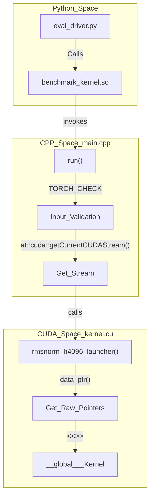

<!-- source: DeepWiki mcp.deepwiki.com · repo NVIDIA/SOL-ExecBench · page 7.2 CUDA C++ and CUTLASS Examples · fetched 2026-10-26 -->

# CUDA C++ and CUTLASS Examples

<details>
<summary>Relevant source files</summary>

The following files were used as context for generating this wiki page:

- [src/sol_execbench/core/data/solution.py](src/sol_execbench/core/data/solution.py)
- [src/sol_execbench/driver/templates/build_ext.py](src/sol_execbench/driver/templates/build_ext.py)

</details>


This page provides a technical walkthrough of the C++-based kernel examples in SOL-ExecBench, specifically focusing on CUDA C++ and CUTLASS implementations. These examples demonstrate how to integrate low-level GPU code with the PyTorch-based evaluation pipeline using the `cuda_cpp` and `cutlass` solution types.

## Multi-File Structure and Build Pattern

Unlike Python-based DSLs (like Triton), C++ solutions typically follow a multi-file structure to separate the CUDA kernel logic, the host-side launcher, and the PyTorch/Pybind11 bindings. This separation allows for cleaner code and easier debugging of the kernel logic independently of the binding code.

### File Roles

| File | Purpose | Key Entities |
| :--- | :--- | :--- |
| `kernel.h` | Header file defining the C++ interface for the kernel launcher. | Function prototypes (e.g., `rmsnorm_h4096_launcher`) [examples/cuda_cpp/rmsnorm/kernel.h:21-27]() |
| `kernel.cu` | Implementation of the `__global__` CUDA kernel and the host-side launcher function. | `__global__` functions, `warp_reduce_sum`, `launcher` functions [examples/cuda_cpp/rmsnorm/kernel.cu:41-46]() |
| `main.cpp` | Pybind11 entry point. Performs tensor validation and calls the launcher. | `PYBIND11_MODULE`, `run` function [examples/cuda_cpp/rmsnorm/main.cpp:24-59]() |

### Data Flow: Python to CUDA
The following diagram illustrates how data flows from the `eval_driver.py` (Python) through the Pybind11 layer into the raw CUDA kernel.

**C++ Kernel Execution Flow**

**Sources:** [examples/cuda_cpp/rmsnorm/main.cpp:24-59](), [examples/cuda_cpp/rmsnorm/kernel.cu:131-157]()

## CUDA C++ Example: RMSNorm

The `rmsnorm` example (hidden size 4096) demonstrates a high-performance implementation optimized for the NVIDIA B200 architecture.

### Implementation Highlights
- **Vectorized Access:** The kernel uses `__nv_bfloat162` to load two elements per instruction, maximizing memory throughput [examples/cuda_cpp/rmsnorm/kernel.cu:63-65]().
- **Two-Stage Reduction:**
    1.  **Shared Memory:** Threads within a block perform partial sum-of-squares reductions into `__shared__ float s_sum[1024]` [examples/cuda_cpp/rmsnorm/kernel.cu:78-88]().
    2.  **Warp Shuffle:** The final reduction is performed using `__shfl_down_sync` within the first warp for maximum efficiency [examples/cuda_cpp/rmsnorm/kernel.cu:16-21]().
- **Precision:** While inputs/outputs are `bfloat16`, all intermediate accumulations and the `rsqrtf` calculation are performed in `float32` [examples/cuda_cpp/rmsnorm/kernel.cu:71-107]().

### Configuration in solution.json
To compile these files, the `solution.json` must specify the source files and any necessary include paths or libraries.
- **`languages`**: Set to `["cuda_cpp"]` [src/sol_execbench/core/data/solution.py:138-139]().
- **`binding`**: Defaults to `torch` for C++/CUDA solutions [src/sol_execbench/core/data/solution.py:152-154]().
- **`compile_options`**: Includes `cuda_cflags` (defaulting to `-O3 --use_fast_math`), `cflags`, and `ld_flags` [src/sol_execbench/core/data/solution.py:117-130]().

**Sources:** [examples/cuda_cpp/rmsnorm/kernel.cu:1-166](), [examples/cuda_cpp/rmsnorm/main.cpp:1-65](), [src/sol_execbench/core/data/solution.py:117-160]()

## CUDA C++ Example: FLUX RoPE

The `flux_rope` example demonstrates a complex rotary position embedding (RoPE) applied to query/key tensors.

### Definition and Axes
The problem defines variable axes for `batch_size` and `seq_len`, while fixing `num_attention_heads` at 24 and `attention_head_dim` at 128 [examples/cuda_cpp/flux_rope/definition.json:3-27]().
- **Inputs**: `query_or_key`, `freqs_cos`, `freqs_sin` [examples/cuda_cpp/flux_rope/definition.json:28-55]().
- **Logic**: It performs a complex rotation: `(x1*cos - x2*sin, x1*sin + x2*cos)` on paired features [examples/cuda_cpp/flux_rope/definition.json:2]().

**Sources:** [examples/cuda_cpp/flux_rope/definition.json:1-70]()

## CUTLASS Example: GEMM

The CUTLASS example demonstrates how to use the CUTLASS template library for high-performance matrix multiplication (`C = A @ B`).

### Layout and Transposition
PyTorch tensors are stored in **Row-Major** order by default. However, many CUTLASS templates default to **Column-Major**. To avoid expensive physical transpositions, the example uses the following mathematical identity:
- Row-major $C(M, N) = A(M, K) \times B(K, N)$ is equivalent to:
- Column-major $C^T(N, M) = B^T(N, K) \times A^T(K, M)$ [examples/cutlass/gemm/kernel.cu:20-23]().

### CUTLASS Kernel Configuration
The kernel is instantiated using the `cutlass::gemm::device::Gemm` template:
```cpp
using CutlassGemm = cutlass::gemm::device::Gemm<float, ColumnMajor, float, ColumnMajor, float, ColumnMajor>;
```
**Sources:** [examples/cutlass/gemm/kernel.cu:7-12]()

### Mapping Code to CUTLASS Arguments
The `gemm_launcher` maps PyTorch tensor dimensions and pointers to the `CutlassGemm::Arguments` struct.

**CUTLASS Mapping Logic**
```mermaid
classDiagram
    class PyTorch_Tensor {
        +data_ptr()
        +size(0) M
        +size(1) K
    }
    class Cutlass_Arguments {
        +problem_size "{N, M, K}"
        +ref_A "{B_ptr, N}"
        +ref_B "{A_ptr, K}"
        +ref_C "{C_ptr, N}"
        +epilogue "{alpha, beta}"
    }
    PyTorch_Tensor --> Cutlass_Arguments : "Swaps M/N for Row-to-Col conversion"
```
**Sources:** [examples/cutlass/gemm/kernel.cu:24-40]()

## Compilation and Binding Pattern

The build process for these examples is handled by the `build_ext.py` template within the evaluation driver.

1.  **Staging**: All source files defined in the `Solution` model are written to a temporary directory [src/sol_execbench/core/data/solution.py:80-94]().
2.  **Compilation**: The system uses `torch.utils.cpp_extension.load` to compile all `.cu`, `.cpp`, `.cc`, `.cxx`, and `.c` files found in the directory into a shared object (`benchmark_kernel.so`) [src/sol_execbench/driver/templates/build_ext.py:35-60]().
3.  **Environment Integration**: The build template automatically includes the CUTLASS library path (defaulting to `/usr/local/cutlass`) in the include paths [src/sol_execbench/driver/templates/build_ext.py:44-49]().
4.  **Linking**: The `TORCH_EXTENSION_NAME` macro [examples/cuda_cpp/rmsnorm/main.cpp:63]() is used to ensure the module name matches what the `eval_driver.py` expects to import.
5.  **Execution**: The `run` function defined in `main.cpp` [examples/cuda_cpp/rmsnorm/main.cpp:24]() must match the `entry_point` specified in the `BuildSpec` [src/sol_execbench/core/data/solution.py:142-144]().

**Sources:** [src/sol_execbench/driver/templates/build_ext.py:16-71](), [src/sol_execbench/core/data/solution.py:117-157](), [examples/cuda_cpp/rmsnorm/main.cpp:61-65]()

---

