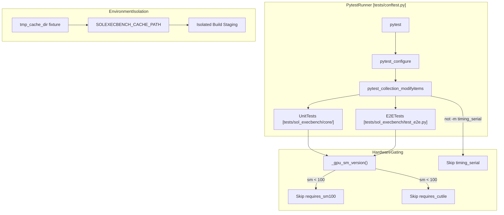
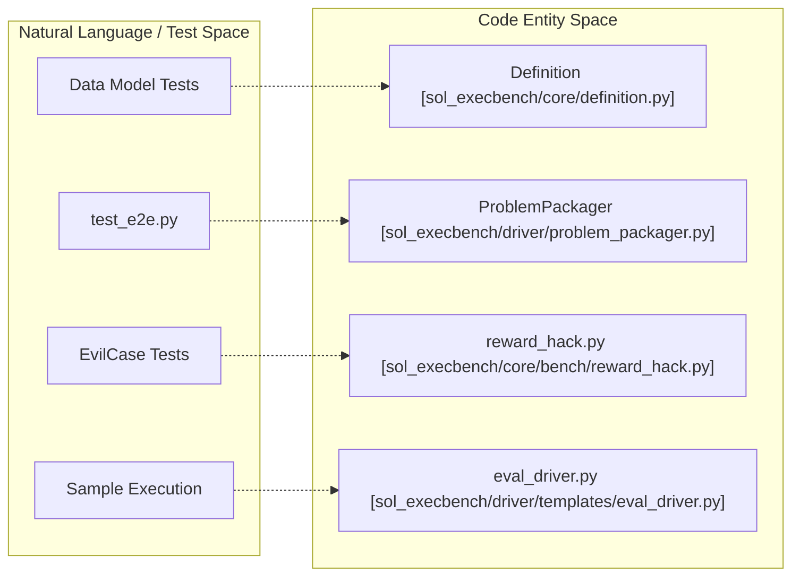

<!-- source: DeepWiki mcp.deepwiki.com · repo NVIDIA/SOL-ExecBench · page 8 Testing · fetched 2026-10-26 -->

# Testing

Relevant source files

The following files were used as context for generating this wiki page:

- [tests/conftest.py](tests/conftest.py)
- [tests/sol_execbench/test_e2e.py](tests/sol_execbench/test_e2e.py)

This page provides an overview of the SOL-ExecBench test suite. The project utilizes `pytest` for automated testing, incorporating hardware-specific markers and specialized fixtures to handle the complexities of GPU kernel benchmarking.

## Test Suite Structure

The test suite is divided into core unit tests and high-level integration/sample tests. It is designed to run efficiently using `pytest-xdist` for parallel execution where possible, as configured in the `pyproject.toml` `addopts` [pyproject.toml:34-35]().

### Directory Layout
*   `tests/sol_execbench/core/`: Contains unit tests for data models and benchmarking utilities.
*   `tests/sol_execbench/test_e2e.py`: Main entry point for end-to-end evaluation tests [tests/sol_execbench/test_e2e.py:16-28]().
*   `tests/sol_execbench/samples/`: Contains self-contained problem samples used by E2E tests, including "evil" samples designed to test reward-hack detection [tests/sol_execbench/test_e2e.py:49-49]().
*   `tests/docker/dependencies/`: Contains tests to verify the installation and compatibility of various DSLs (Triton, CUTLASS, etc.) within the Docker environment.

Sources: [tests/sol_execbench/test_e2e.py:16-49](), [pyproject.toml:34-35]()

## Pytest Configuration and Markers

SOL-ExecBench uses custom `pytest` markers and configuration logic in `tests/conftest.py` to gate tests based on hardware availability and resource requirements.

### Hardware-Gating Markers
The suite dynamically detects GPU capabilities using `_gpu_sm_version()` [tests/conftest.py:22-32]().

| Marker | Description |
| :--- | :--- |
| `requires_sm100` | Skips the test if the GPU architecture is below SM 100 (Blackwell). Defined in [tests/conftest.py:35-38](). |
| `requires_cutile` | Automatically applied to tests requiring `cuda-tile` if SM version is < 100 [tests/conftest.py:66-71](). |
| `timing_serial` | Used for sensitive GPU timing tests. These are skipped by default and must be run with `-m timing_serial -n 0` to ensure serial execution [tests/conftest.py:41-46](). |

### The `tmp_cache_dir` Fixture
To ensure test isolation and prevent interference between concurrent test runs (especially when compiling kernels), the suite uses the `tmp_cache_dir` fixture. This fixture sets a unique `SOLEXECBENCH_CACHE_PATH` for each test, providing an isolated build cache [tests/conftest.py:76-86]().

### Testing Architecture Overview

Title: Pytest Configuration and Hardware Gating

Sources: [tests/conftest.py:22-86](), [pyproject.toml:34-39]()

## Unit Tests

The unit tests focus on the individual components of the `sol_execbench.core` package. They ensure that the Pydantic data models correctly validate schemas and that the benchmarking logic (timing, correctness, and anti-cheating) behaves as expected in isolation.

Key test areas include:
*   **Data Models**: Validation of `Definition`, `Solution`, and `Workload` schemas.
*   **Benchmarking Core**: Verification of `do_bench` timing accuracy and `compute_error_stats` numerical logic.
*   **Reward Hack Detection**: Unit-level checks for the various detection mechanisms in `reward_hack.py`.

For details, see [Unit Tests](#8.1).

## End-to-End and Sample Tests

End-to-end (E2E) tests in `test_e2e.py` verify the entire pipeline by loading samples, packaging them via `ProblemPackager`, and executing them in a subprocess [tests/sol_execbench/test_e2e.py:184-213]().

Key test areas include:
*   **Pipeline Validation**: Loading `Definition`, `Workload`, and `Solution` objects from `samples/` and asserting `EvaluationStatus.PASSED` [tests/sol_execbench/test_e2e.py:132-145]().
*   **Adversarial Testing**: Using `EvilCase` descriptors (e.g., `evil_monkey_patch`, `evil_thread_inject`, `evil_lazy_output`) to verify that the framework detects cheaters [tests/sol_execbench/test_e2e.py:103-107]().
*   **Custom Inputs**: Testing `custom_inputs_entrypoint` logic via the `custom_inputs_matmul` sample [tests/sol_execbench/test_e2e.py:110-115]().

For details, see [End-to-End and Sample Tests](#8.2).

### Component Association Diagram

Title: Test Component to Code Entity Mapping

Sources: [tests/sol_execbench/test_e2e.py:39-47](), [tests/sol_execbench/test_e2e.py:184-196](), [tests/sol_execbench/test_e2e.py:69-76]()

---

