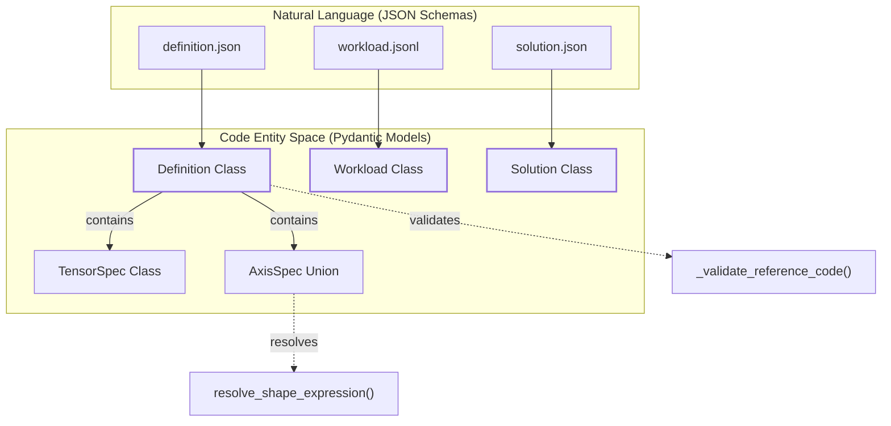
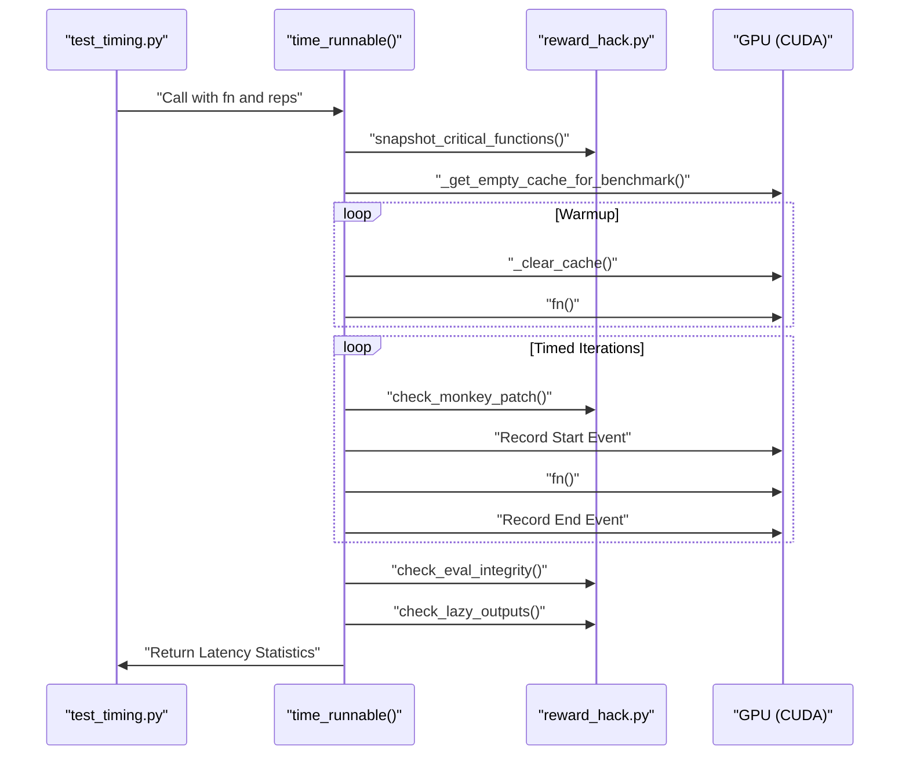

<!-- source: DeepWiki mcp.deepwiki.com · repo NVIDIA/SOL-ExecBench · page 8.1 Unit Tests · fetched 2026-10-26 -->

# Unit Tests

Relevant source files

The following files were used as context for generating this wiki page:

- [tests/conftest.py](tests/conftest.py)
- [tests/sol_execbench/core/bench/test_reward_hack.py](tests/sol_execbench/core/bench/test_reward_hack.py)
- [tests/sol_execbench/core/bench/test_timing.py](tests/sol_execbench/core/bench/test_timing.py)

The SOL-ExecBench test suite ensures the reliability of the core benchmarking engine and the integrity of the data models used for kernel evaluation. The tests are located in `tests/sol_execbench/core/` and cover data validation, performance measurement accuracy, and security defenses against benchmark tampering.

## Data Model Tests

These tests validate the Pydantic-based schemas that form the data contract of the system. They ensure that illegal kernel definitions, workloads, or solutions are caught during validation rather than at runtime.

### Definition and DType Validation
The `test_definition.py` and `test_dtypes.py` files verify the `Definition` model [src/sol_execbench/core/data/definition.py:136-168](). Key checks include:
*   **Axis Resolution**: Ensuring `AxisConst`, `AxisVar`, and `AxisExpr` [src/sol_execbench/core/data/definition.py:35-80]() resolve correctly and that expressions use valid operators.
*   **Reference Code Integrity**: Validating that the `reference` Python string contains a `run` function and follows the required signature [src/sol_execbench/core/data/definition.py:160-163]().
*   **DType Mapping**: Verifying that string identifiers like `float8_e4m3fn` correctly map to their respective `torch.dtype` values [src/sol_execbench/core/data/dtypes.py:22-48]().

### Workload and Solution Validation
*   **Workload**: `test_workload.py` ensures that `Workload` objects correctly bind axis variables to concrete integers and validate input descriptors (random, scalar, or safetensors).
*   **Solution**: `test_solution.py` validates the `Solution` model, specifically checking that the `language` field matches supported DSLs (e.g., `triton`, `cuda_cpp`) and that the `build` specification is present for C++-based kernels.

**Sources:** [src/sol_execbench/core/data/definition.py:35-171](), [src/sol_execbench/core/data/dtypes.py:22-48]()

## Benchmarking Engine Tests

These tests exercise the `core/bench/` package, which is responsible for the actual execution and measurement of kernels on the GPU.

### Timing and Accuracy (`test_timing.py`)
This suite validates the `time_runnable` [src/sol_execbench/core/bench/timing.py:127-168]() and `bench_time_with_cuda_events` [src/sol_execbench/core/bench/timing.py:171-236]() functions. It ensures that:
*   **L2 Cache Clearing**: The 256 MB buffer [src/sol_execbench/core/bench/timing.py:98-101]() is effectively used to prevent L2 cache hits between iterations.
*   **Warmup**: The specified number of warmup iterations are executed before measurement starts [tests/sol_execbench/core/bench/test_timing.py:129-140]().
*   **Argument Pinning**: The `_pinned` list [src/sol_execbench/core/bench/timing.py:178-182]() correctly prevents CPython from recycling `id()` values, which thwarts attacks where kernels cache results based on memory addresses.
*   **Cloning**: `clone_args` [src/sol_execbench/core/bench/timing.py:37-56]() is tested to ensure `torch.Tensor` objects are deep-copied to fresh memory while non-tensors are passed through [tests/sol_execbench/core/bench/test_timing.py:42-68]().

### Correctness and Tolerances (`test_correctness.py`)
These tests verify `compute_error_stats` [src/sol_execbench/core/bench/correctness.py:91-149]() against various edge cases:
*   **Tolerance Formula**: Validates the `max_atol + max_rtol * |ref|` logic [src/sol_execbench/core/bench/correctness.py:128-129]().
*   **Sanity Checks**: Ensures that all-zero outputs [src/sol_execbench/core/bench/correctness.py:77-86]() and unexpected NaNs/Infs [src/sol_execbench/core/bench/correctness.py:53-73]() result in immediate failure.
*   **Negative Inf**: Tests the `allow_negative_inf` flag used in specific LLM activation kernels [src/sol_execbench/core/bench/correctness.py:59-63]().

### Input/Output and Memory (`test_io.py`)
Validates the orchestration of input generation:
*   **Random Generation**: Ensures `gen_inputs` produces tensors with correct shapes and dtypes.
*   **Memory Allocation**: Tests the `ShiftingMemoryPoolAllocator` [src/sol_execbench/core/bench/io.py:151-197]() used to provide fresh output buffers to kernels to avoid in-place modification side effects [tests/sol_execbench/core/bench/test_timing.py:24-31]().

**Sources:** [src/sol_execbench/core/bench/timing.py:37-236](), [src/sol_execbench/core/bench/correctness.py:53-149](), [tests/sol_execbench/core/bench/test_timing.py:42-140](), [src/sol_execbench/core/bench/io.py:151-197]()

## Security and Hardware Tests

### Reward Hack Detection (`test_reward_hack.py`)
This critical suite ensures that the anti-cheating mechanisms in `reward_hack.py` function as intended. It tests the detection of:
*   **Monkey Patching**: Detecting if `torch.cuda.Event.elapsed_time` was replaced by checking the function object's memory address [tests/sol_execbench/core/bench/test_reward_hack.py:34-51]().
*   **Thread Injection**: Detecting if background threads are spawned during kernel execution by monitoring `threading.active_count()` [tests/sol_execbench/core/bench/test_reward_hack.py:56-72]().
*   **Lazy/Proxy Outputs**: Ensuring that outputs are strictly of type `torch.Tensor` and not subclasses or proxy objects that might defer computation [tests/sol_execbench/core/bench/test_reward_hack.py:77-107]().
*   **Evaluation Integrity**: Using `snapshot_critical_functions` [src/sol_execbench/core/bench/reward_hack.py:141-154]() to detect if the user-provided kernel code attempted to overwrite benchmarking functions like `time_runnable` [tests/sol_execbench/core/bench/test_reward_hack.py:112-171]().

### Clock Locking (`test_clock_lock.py`)
Validates the interface with `nvidia-smi` for performance reproducibility:
*   **Lock/Unlock**: Tests that `lock_clocks` [src/sol_execbench/core/bench/clock_lock.py:70-142]() correctly calls `nvidia-smi -lgc` and `-lmc`.
*   **Verification**: Ensures `verify_clocks` [src/sol_execbench/core/bench/clock_lock.py:145-208]() accurately detects when a GPU has deviated from its locked frequency.

### Hardware Markers and Fixtures
The test suite uses specific `pytest` markers and fixtures defined in `conftest.py` to gate tests based on available hardware:
*   `requires_sm100`: Skips tests that require Blackwell-specific features (like FP4 support or `cuTile` DSL) by checking `torch.cuda.get_device_capability()` [tests/conftest.py:35-38]().
*   `timing_serial`: A custom marker for GPU timing tests that are skipped by default to prevent noise and must be run with `-m timing_serial -n 0` [tests/conftest.py:41-46]().
*   `tmp_cache_dir`: A fixture that isolates build artifacts by setting the `SOLEXECBENCH_CACHE_PATH` environment variable to a fresh temporary directory for each test [tests/conftest.py:76-86]().

**Sources:** [tests/conftest.py:22-86](), [tests/sol_execbench/core/bench/test_reward_hack.py:34-171](), [src/sol_execbench/core/bench/clock_lock.py:70-208](), [src/sol_execbench/core/bench/reward_hack.py:141-154]()

## System Flow Diagrams

### Data Model to Code Entity Mapping
The following diagram illustrates how the JSON schemas defined in the "Natural Language Space" map to Pydantic classes and validation logic in the "Code Entity Space".

**Sources:** [src/sol_execbench/core/data/definition.py:136-171](), [src/sol_execbench/core/data/shapes.py:29-30]()

### Benchmarking Execution and Defense Flow
This diagram shows the sequence of operations during a unit test of the benchmarking engine, highlighting where security checks are injected.

**Sources:** [src/sol_execbench/core/bench/timing.py:127-184](), [src/sol_execbench/core/bench/reward_hack.py:49-181](), [tests/sol_execbench/core/bench/test_reward_hack.py:77-171]()

| Test File | Primary Responsibility | Key Function Tested |
| :--- | :--- | :--- |
| `test_definition.py` | Schema integrity | `Definition.model_validate()` |
| `test_timing.py` | Measurement accuracy | `time_runnable()` |
| `test_correctness.py` | Numerical validation | `compute_error_stats()` |
| `test_reward_hack.py` | Anti-cheating | `check_monkey_patch()` |
| `test_clock_lock.py` | Reproducibility | `lock_clocks()` |

**Sources:** [src/sol_execbench/core/bench/timing.py:127-136](), [src/sol_execbench/core/bench/correctness.py:91-100](), [tests/sol_execbench/core/bench/test_reward_hack.py:34-51](), [src/sol_execbench/core/bench/clock_lock.py:70-80]()

---

