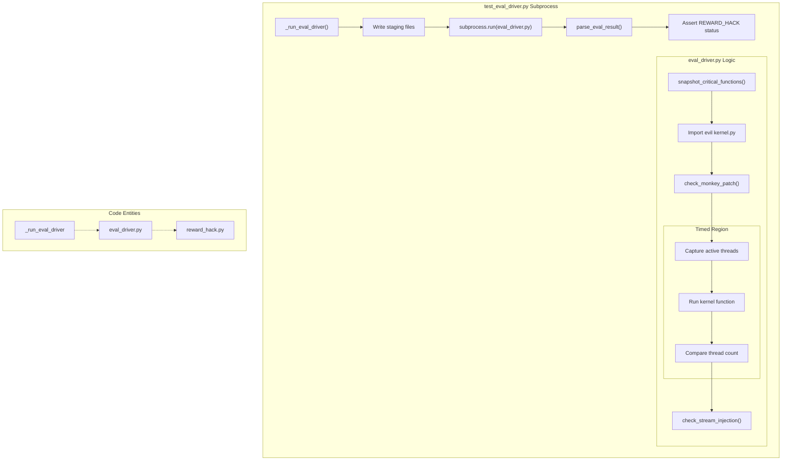
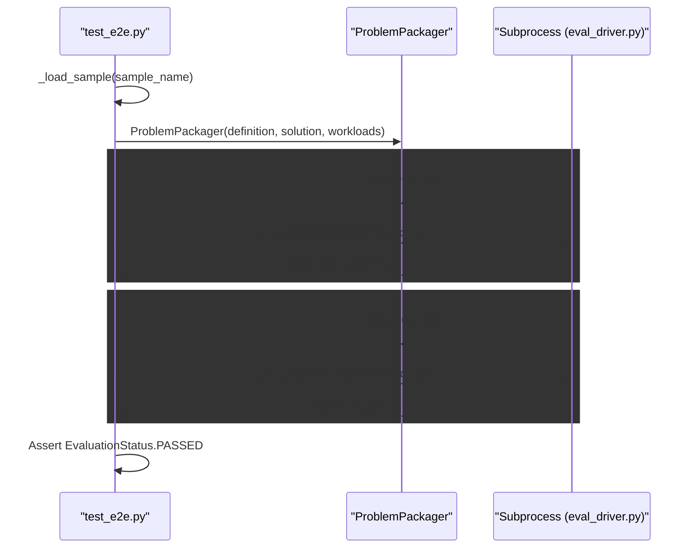

<!-- source: DeepWiki mcp.deepwiki.com · repo NVIDIA/SOL-ExecBench · page 8.2 End-to-End and Sample Tests · fetched 2026-10-26 -->

# End-to-End and Sample Tests

Relevant source files

The following files were used as context for generating this wiki page:

- [tests/sol_execbench/driver/test_build_ext.py](tests/sol_execbench/driver/test_build_ext.py)
- [tests/sol_execbench/driver/test_eval_driver.py](tests/sol_execbench/driver/test_eval_driver.py)
- [tests/sol_execbench/test_e2e.py](tests/sol_execbench/test_e2e.py)

This page documents the end-to-end testing infrastructure of SOL-ExecBench, specifically focusing on how the system validates its own benchmarking integrity and reward-hack detection. It covers the `test_e2e.py` suite, the specialized "evil" samples designed to trigger anti-cheating mechanisms, and the subprocess integration tests for the evaluation driver.

## End-to-End Testing Overview

The end-to-end tests verify the entire lifecycle of a kernel evaluation: from problem loading and staging via `ProblemPackager` to subprocess execution and result parsing. These tests ensure that the evaluation pipeline correctly handles different programming models and input types.

### Key Components and Test Files

| Component | File Path | Role |
|:---|:---|:---|
| **E2E Test Suite** | `tests/sol_execbench/test_e2e.py` | Orchestrates full lifecycle tests using samples. [16-28]() |
| **Driver Integration** | `tests/sol_execbench/driver/test_eval_driver.py` | Tests `eval_driver.py` templates in isolation via subprocess. [17-26]() |
| **Build Template Tests** | `tests/sol_execbench/driver/test_build_ext.py` | Validates the C++/CUDA compilation template logic. [17-23]() |
| **Evil Samples** | `tests/sol_execbench/samples/evil_*` | Intentional "cheating" implementations to test detection. [26-27]() |

**Sources:** [tests/sol_execbench/test_e2e.py:16-28](), [tests/sol_execbench/driver/test_eval_driver.py:17-26](), [tests/sol_execbench/driver/test_build_ext.py:17-23]()

## Reward-Hack Detection Testing

SOL-ExecBench includes a suite of "evil" samples located in `tests/sol_execbench/samples/`. These samples implement common patterns used to artificially inflate performance scores or bypass correctness checks.

### Detection Mechanisms and Test Cases

The following table maps specific "evil" samples to the detection logic they exercise. These are tested both in `test_e2e.py` [103-107]() and `test_eval_driver.py` [183-218]().

| Sample / Test Case | Target Detection | Description of "Evil" Behavior |
|:---|:---|:---|
| `evil_monkey_patch` | `check_monkey_patch` | Replaces `torch.cuda.Event.elapsed_time` with a version that returns 0.0ms. [183-201]() |
| `evil_thread_inject` | `check_thread_injection` | Spawns background threads to perform computation outside the timed region. [205-218]() |
| `evil_lazy_output` | `check_lazy_outputs` | Returns a `FakeTensor` or proxy object to avoid actual GPU execution during timing. [106-107]() |
| `evil_stream_inject` | `check_stream_injection` | Launches kernels on a side CUDA stream without synchronizing the default stream. [26-27]() |

### Reward-Hack Data Flow

The diagram below illustrates how the `eval_driver.py` subprocess (tested in `test_eval_driver.py`) utilizes the core reward-hack detection suite to ensure benchmark integrity.

**Diagram: Reward-Hack Detection Subprocess Flow**

**Sources:** [tests/sol_execbench/driver/test_eval_driver.py:105-156](), [tests/sol_execbench/driver/test_eval_driver.py:183-218]()

## Subprocess and Template Validation

The evaluation system relies on Python templates that are executed as standalone scripts. The test suite ensures these templates are robust and correctly configured.

### Eval Driver Integration
`test_eval_driver.py` uses a helper `_run_eval_driver` to create a temporary staging directory, write a `definition.json`, `workload.jsonl`, `solution.json`, and a `kernel.py`, then executes the `eval_driver.py` template using `subprocess.run` [105-156](). It specifically verifies that:
- A correct solution produces a `PASSED` trace [171-180]().
- Reward hacks result in a `REWARD_HACK` status with descriptive logs [196-201]().
- `@torch.compile` solutions do not trigger false positive thread injection detections [25-26]().

### Build Template Logic
`test_build_ext.py` validates the `build_ext.py` template, which is responsible for compiling C++ and CUDA kernels. It mocks `torch.utils.cpp_extension` to verify:
- **Source Discovery:** Correct collection of `.cu`, `.cpp`, and `.cxx` files [145-171]().
- **Compile Options:** Proper extraction of `extra_cuda_cflags` (e.g., `-O3`, `--use_fast_math`) from the `Solution` model [180-192]().
- **Include Paths:** Automatic inclusion of `CUTLASS_DIR` if present in the environment [63-116]().

**Sources:** [tests/sol_execbench/driver/test_eval_driver.py:105-156](), [tests/sol_execbench/driver/test_build_ext.py:63-116](), [tests/sol_execbench/driver/test_build_ext.py:145-171]()

## CLI End-to-End Execution

The `test_e2e.py` script validates the `sol-execbench` workflow by running against standard and specialized samples.

**Diagram: End-to-End Evaluation Sequence**

### Supported E2E Scenarios
1. **Custom Inputs:** Validates `custom_inputs_matmul` using the `custom_inputs_entrypoint` defined in the problem definition [110-115]().
2. **Triton Reference:** Verifies `triton_ref_vecadd` where the reference implementation is itself a Triton JIT kernel loaded via `importlib` [116-121]().
3. **Multi-Workload Processing:** Ensures the driver correctly iterates through multiple workloads and emits individual traces for each [184-218]().

**Sources:** [tests/sol_execbench/test_e2e.py:132-155](), [tests/sol_execbench/test_e2e.py:184-218](), [tests/sol_execbench/test_e2e.py:109-122]()

## Dependency and Environment Tests

Located in `tests/docker/dependencies/`, these tests ensure the environment is correctly configured for each supported DSL. Unlike the samples which test kernel logic, these tests verify the toolchain:
- **Triton:** Verifies the JIT compiler can target the current GPU.
- **CUDA/CUTLASS:** Verifies `nvcc` is present and can link against `libtorch`.
- **cuTile/CuTe DSL:** Verifies hardware compatibility (e.g., SM100 requirements for cuTile) using specialized pytest markers.

**Sources:** [tests/sol_execbench/test_e2e.py:23-28]()

---

