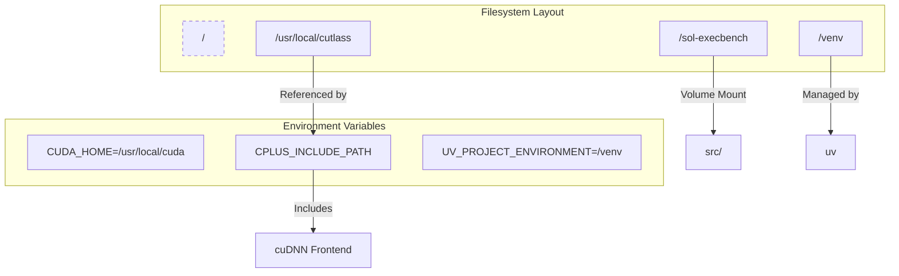
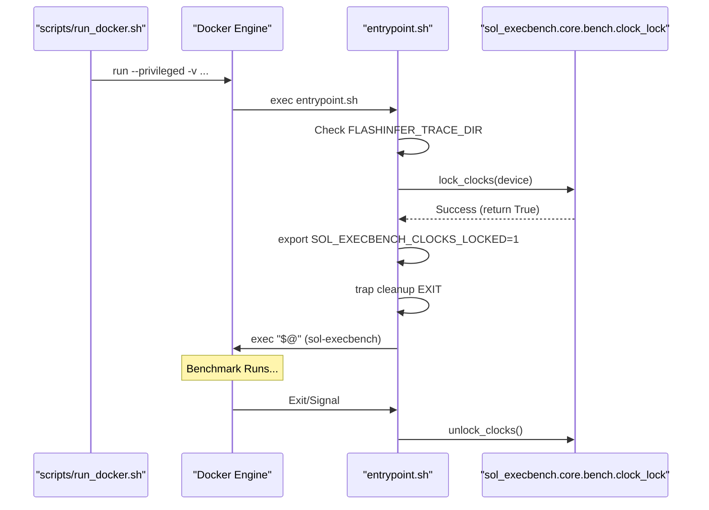

<!-- source: DeepWiki mcp.deepwiki.com · repo NVIDIA/SOL-ExecBench · page 9 Docker Environment · fetched 2026-10-26 -->

# Docker Environment

Relevant source files

The following files were used as context for generating this wiki page:

- [docker/Dockerfile](docker/Dockerfile)
- [uv.lock](uv.lock)

The SOL-ExecBench Docker environment provides a reproducible, high-performance containerized stack for benchmarking GPU kernels. It integrates CUDA 13.1, specialized libraries like CUTLASS and cuDNN, and a sophisticated entrypoint system that ensures hardware consistency through GPU clock locking.

## Dockerfile Architecture

The `Dockerfile` is structured to minimize build times through aggressive layer caching and utilizes `uv` for lightning-fast Python dependency management. It targets Ubuntu 24.04 with the NVIDIA CUDA 13.1 development toolkit [docker/Dockerfile:5-5]().

### Build Strategy and Layers

The build process is divided into logical stages to optimize the cache hit rate:

1.  **System Base**: Installs core utilities (`git`, `build-essential`, `cmake`, `ninja-build`) and Python 3 [docker/Dockerfile:12-18](), [docker/Dockerfile:33-35]().
2.  **Library Installation**:
    *   **CUTLASS**: Clones version 4.4.1 into `/usr/local/cutlass` and exports it to the system include path [docker/Dockerfile:20-23]().
    *   **cuDNN Frontend**: Injected into the include path from the Python site-packages after dependency installation [docker/Dockerfile:69-70]().
3.  **Dependency Management (uv)**:
    *   The `uv` binary is pulled from its official image [docker/Dockerfile:30-30]().
    *   `uv sync` is used with `--no-install-project` to install third-party dependencies (PyTorch, Triton, etc.) before copying the source code. This ensures that source code changes do not trigger a full re-install of heavy ML libraries [docker/Dockerfile:66-67]().
4.  **User Configuration**: Creates a non-root user matching the host's UID/GID to prevent permission issues with volume mounts [docker/Dockerfile:40-43]().

### Docker Environment Entities
The following diagram maps the Docker build components to their filesystem locations and roles.

**Docker Image Structure**

Sources: [docker/Dockerfile:7-9](), [docker/Dockerfile:21-23](), [docker/Dockerfile:40-46](), [docker/Dockerfile:60-60](), [docker/Dockerfile:69-70](), [uv.lock:1-51]()

---

## Entrypoint and Clock Locking

The `entrypoint.sh` script serves as a critical bridge between the containerized environment and the physical GPU hardware. Its primary responsibility is ensuring that benchmarks are run under deterministic hardware conditions.

### Clock Locking Logic
At startup, the entrypoint executes a Python snippet that calls `sol_execbench.core.bench.clock_lock.lock_clocks` [docker/entrypoint.sh:10-21](). 
*   **Privilege Escalation**: The Dockerfile grants the user NOPASSWD access to `/usr/bin/nvidia-smi` [docker/Dockerfile:46-46](), allowing the entrypoint to lock clocks without root login.
*   **State Tracking**: If successful, it sets `SOL_EXECBENCH_CLOCKS_LOCKED=1` [docker/entrypoint.sh:22-22]().
*   **Cleanup**: A `trap` is set on `EXIT` to trigger `unlock_clocks` [docker/entrypoint.sh:29-38](), ensuring the GPU returns to its default power state even if the benchmark crashes or is terminated [docker/entrypoint.sh:58-59]().

### Data Validation
The entrypoint enforces the presence of the `flashinfer-trace` dataset. If the `FLASHINFER_TRACE_DIR` environment variable is not set or the directory is not mounted, the container will exit with a descriptive error message [docker/entrypoint.sh:41-55]().

Sources: [docker/Dockerfile:46-46](), [docker/entrypoint.sh:10-27](), [docker/entrypoint.sh:29-38](), [docker/entrypoint.sh:41-55]()

---

## The `run_docker.sh` Helper

The `scripts/run_docker.sh` script automates the complex `docker run` command required for GPU benchmarking.

### Key Functionalities
*   **Automatic Building**: Passing the `--build` flag triggers a `docker build` using the current user's UID/GID as build arguments [scripts/run_docker.sh:50-59]().
*   **Resource Allocation**: Configures the container with `--gpus all`, `--ipc=host`, and `--privileged` [scripts/run_docker.sh:75-77]().
*   **Memory Limits**: Sets `ulimit memlock=-1` and `stack=67108864` to prevent memory allocation failures during complex kernel compilations [scripts/run_docker.sh:78-79]().
*   **Volume Mapping**: Mounts the repository root to `/sol-execbench` inside the container [scripts/run_docker.sh:80-80]().

### Startup Flow
The following diagram illustrates the sequence from script execution to the running benchmark.

**Container Startup Sequence**

Sources: [scripts/run_docker.sh:73-87](), [docker/entrypoint.sh:10-21](), [docker/entrypoint.sh:29-38](), [docker/entrypoint.sh:57-61]()

---

## Environment Configuration Reference

| Variable | Source | Purpose |
| :--- | :--- | :--- |
| `CUDA_HOME` | `Dockerfile` | Path to CUDA toolkit [docker/Dockerfile:8-8]() |
| `CUTLASS_DIR` | `Dockerfile` | Path to CUTLASS source [docker/Dockerfile:22-22]() |
| `FLASHINFER_TRACE_DIR` | `run_docker.sh` | Mount point for the benchmark dataset [scripts/run_docker.sh:81-81]() |
| `SOL_EXECBENCH_CLOCKS_LOCKED` | `entrypoint.sh` | Flag indicating if hardware clocks are fixed [docker/entrypoint.sh:22-22]() |
| `SOL_EXECBENCH_GPU_CLK_MHZ` | `run_docker.sh` | Optional override for GPU core frequency [scripts/run_docker.sh:82-82]() |
| `SOL_EXECBENCH_DRAM_CLK_MHZ` | `run_docker.sh` | Optional override for GPU memory frequency [scripts/run_docker.sh:83-83]() |

Sources: [docker/Dockerfile:8-22](), [docker/entrypoint.sh:22-22](), [scripts/run_docker.sh:81-83]()

---

