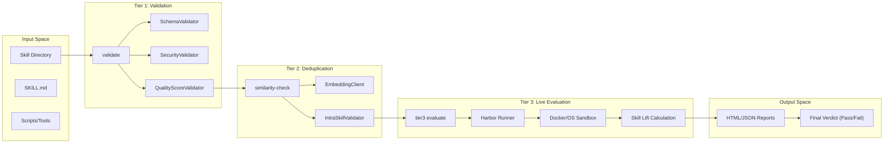
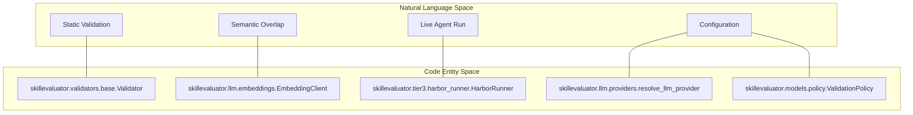

<!-- source: DeepWiki mcp.deepwiki.com · repo NVIDIA/SkillEvaluator · page 1 SkillEvaluator Overview · fetched 2026-10-26 -->

# SkillEvaluator Overview

Relevant source files

The following files were used as context for generating this wiki page:

- [CHANGELOG.md](CHANGELOG.md)
- [CITATION.cff](CITATION.cff)
- [README.md](README.md)
- [docs/assets/three-tier-overview.svg](docs/assets/three-tier-overview.svg)
- [docs/index.mdx](docs/index.mdx)
- [docs/tier1-validation.mdx](docs/tier1-validation.mdx)

SkillEvaluator is an open-source, multi-tier framework designed to evaluate AI agent artifacts, primarily focusing on **Agent Skills** [README.md:9-14](). It provides a comprehensive pipeline that moves from static, deterministic validation to live agent evaluation in sandboxed environments.

The framework is part of the [NVIDIA Verified Skills pipeline](https://github.com/NVIDIA/skills) [README.md:15-16](). It is built to ensure that agent skills—directories containing instructions and supporting files—are safe, well-formed, unique, and effective [README.md:13-14]().

## Three-Tier Architecture

SkillEvaluator organizes its evaluation logic into three distinct tiers. Each tier is an independent entry point, meaning users can run Tier 3 without necessarily completing Tier 1 or 2 [README.md:22-31]().

### Pipeline Flow

The following diagram illustrates how a skill artifact (centered around a `SKILL.md` file) progresses through the evaluation tiers to produce a final verdict and reporting artifacts.

**Title: SkillEvaluator Three-Tier Pipeline**

Sources: [README.md:18-31](), [docs/index.mdx:52-56](), [docs/tier1-validation.mdx:9-23]()

### Tier Summary

| Tier | Focus | Key Components / Tools | Requirement |
| :--- | :--- | :--- | :--- |
| **Tier 1** | Safety & Structure | `SchemaValidator`, `SkillSpector`, `Gitleaks`, `Semgrep` | None (Deterministic) / LLM Key (Optional) |
| **Tier 2** | Redundancy | `EmbeddingClient`, Cosine Similarity | Embedding Provider Key |
| **Tier 3** | Effectiveness | `Harbor`, `SkillLift`, `Docker` | Agent CLI + LLM Provider Key |

Sources: [README.md:24-28](), [docs/index.mdx:33-38]()

## Key Concepts

### Agent Skills
A skill is defined as a folder containing a `SKILL.md` manifest and optional supporting files (scripts, tools, or documentation) [README.md:13-14](). SkillEvaluator can also validate other artifact types like `rules`, `workflows`, and `plugins` [docs/tier1-validation.mdx:74-79]().

### Providers and Credentials
SkillEvaluator abstracts LLM and embedding interactions through a provider layer. It supports:
*   **NVIDIA Build** (Default) [README.md:60-63]()
*   **OpenAI** [README.md:77]()
*   **Anthropic** [README.md:78]()
*   **Amazon Bedrock** [README.md:79]()
*   **OpenAI-compatible** (Local/Hosted) [README.md:81-84]()

### Reporting and Verdicts
Every run generates structured reports (CLI, JSON, HTML, Markdown) [docs/tier1-validation.mdx:68](). Tier 1 and Tier 2 results typically determine the process exit code (merge gate), while Tier 3 results are often treated as "advisory" in a standard `validate` run [README.md:131-132]().

## Code Entity Mapping

The following diagram maps the high-level system concepts to the specific code entities and files that implement them.

**Title: Conceptual to Code Entity Mapping**

Sources: [docs/tier1-validation.mdx:90-103](), [CHANGELOG.md:15-17](), [README.md:70-84]()

## Wiki Structure

This wiki is organized to guide you from initial setup to deep architectural understanding:

*   **[Getting Started: Installation and Quickstart](#1.1)**: Covers `uv` installation, dependency extras (`[security]`, `[all]`), and your first keyless validation run [README.md:39-56]().
*   **[Configuration and Environment Variables](#1.2)**: Details how to configure providers using `SKILL_EVAL_LLM_PROVIDER` and manage validation policies via `policy.yaml` [README.md:58-91]().
*   **Core Architecture**: (Section 2) Explains the internal source layout and data models.
*   **Tier 1: Validation**: (Section 3) Deep dive into deterministic checks like `QualityScoreValidator` and `SecurityValidator` [docs/tier1-validation.mdx:9-23]().
*   **Tier 2: Deduplication**: (Section 4) Details on semantic similarity and context optimization [README.md:95-101]().
*   **Tier 3: Live Evaluation**: (Section 5) Explains the Harbor framework integration, dataset generation, and "Skill Lift" metrics [docs/index.mdx:58-64]().
*   **CI/CD and Testing**: (Sections 6 & 7) Best practices for using SkillEvaluator as a merge gate in GitHub Actions [CHANGELOG.md:8-10]().

Sources: [README.md:134-139](), [docs/index.mdx:66-81]()

---

