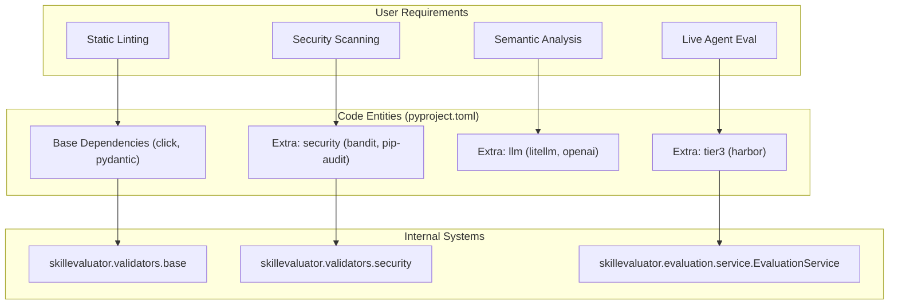
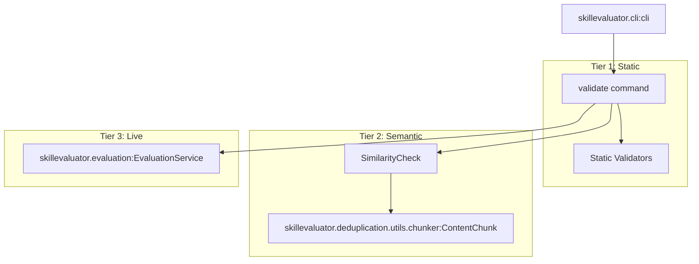

<!-- source: DeepWiki mcp.deepwiki.com · repo NVIDIA/SkillEvaluator · page 1.1 Getting Started: Installation and Quickstart · fetched 2026-10-26 -->

# Getting Started: Installation and Quickstart

<details>
<summary>Relevant source files</summary>

The following files were used as context for generating this wiki page:

- [Dockerfile](Dockerfile)
- [docs/installation.mdx](docs/installation.mdx)
- [docs/quickstart.mdx](docs/quickstart.mdx)
- [pyproject.toml](pyproject.toml)
- [src/skillevaluator/cli_help.py](src/skillevaluator/cli_help.py)
- [src/skillevaluator/deduplication/utils/chunker.py](src/skillevaluator/deduplication/utils/chunker.py)
- [src/skillevaluator/evaluation/__init__.py](src/skillevaluator/evaluation/__init__.py)
- [uv.lock](uv.lock)

</details>


This page provides a technical guide for installing SkillEvaluator and executing your first validation. SkillEvaluator uses a modular dependency model to keep the base footprint small while allowing users to opt-in to LLM-backed checks (Tier 2) and live agent evaluation (Tier 3).

## Installation

SkillEvaluator requires **Python 3.12 or 3.13** [docs/installation.mdx:15-15](). The recommended installation method uses `uv` to manage the environment and tool isolation.

### Modular Dependency Extras

The package is structured to support different levels of evaluation depth via "extras" defined in the project configuration [pyproject.toml:47-76]().

| Extra | Purpose | Key Dependencies |
| :--- | :--- | :--- |
| `llm` | Shared LLM and embedding clients | `anthropic`, `openai`, `litellm`, `boto3` |
| `tier2` | Semantic deduplication and similarity | Inherits `llm` |
| `tier3` | Live agent evaluation via Harbor | Inherits `llm`, `harbor`, `mcp` |
| `security` | Local Python security scanning | `bandit`, `pip-audit` |
| `all` | Full feature set | All of the above |
| `dev` | Contributor tooling | `pytest`, `ruff`, `build` |

**Sources:** [pyproject.toml:47-87](), [docs/installation.mdx:106-121]()

### Installation Methods

#### 1. Global Tool (Recommended)
Install the full bundle as a standalone CLI tool using `uv`:
```bash
uv tool install --python 3.13 "skillevaluator[all] @ git+https://github.com/NVIDIA/SkillEvaluator.git"
```
[docs/installation.mdx:30-32]()

#### 2. Development / Source Install
For contributing or running from source, clone the repository and sync the environment:
```bash
git clone https://github.com/NVIDIA/SkillEvaluator.git
cd SkillEvaluator
uv sync --python 3.13 --all-extras
```
[docs/installation.mdx:59-63]()

#### 3. Docker
The repository includes a `Dockerfile` that installs the `[all]` extra bundle [Dockerfile:17-17](). Note that external binaries like `semgrep` are not bundled in the image and must be provided if full security evidence is required [docs/installation.mdx:101-101]().

**Sources:** [docs/installation.mdx:25-104](), [Dockerfile:1-21]()

### External System Tools
Deterministic Tier 1 checks require external binaries that are not managed by `pip`. These must be available on your `PATH`:
*   **Semgrep**: General static analysis.
*   **Gitleaks**: Secret detection.
*   **SkillSpector**: Domain-specific skill linting.

Install these via system package managers or `uv tool install` [docs/installation.mdx:132-135]().

---

## Quickstart: Your First Validation

SkillEvaluator is designed to work out-of-the-box for Tier 1 checks without an API key.

### Step 1: Quality Check (Keyless)
Run a deterministic scoring pass on a skill directory (containing a `SKILL.md` file):
```bash
skillevaluator quality-check ./my-skill
```
This executes the `QualityScoreValidator`, which provides a 0–100 score based on Correctness, Discoverability, Reliability, and Efficiency [docs/quickstart.mdx:35-39]().

### Step 2: Full Tier 1 Validation
To run the full suite of static and security checks:
```bash
skillevaluator validate ./my-skill --no-dedup
```
The `--no-dedup` flag skips Tier 2 checks that require an embedding provider [docs/quickstart.mdx:48-52]().

### Step 3: Enabling LLM Features
To unlock Tier 2 (deduplication) and Tier 3 (live eval), configure a provider. The `nv_build` provider (NVIDIA API Catalog) is the simplest starting point:
```bash
export SKILL_EVAL_LLM_PROVIDER=nv_build
export NVIDIA_API_KEY='nvapi-...'
```
[docs/quickstart.mdx:67-70]()

**Sources:** [docs/quickstart.mdx:31-75]()

---

## Data Flow and Architecture

The following diagrams illustrate how the installation state and command-line inputs translate into internal system operations.

### Dependency and Feature Mapping
This diagram bridges the "Natural Language" requirements to the "Code Entity" dependencies and internal services.


**Sources:** [pyproject.toml:39-76](), [src/skillevaluator/evaluation/service.py:20-20]()

### CLI Execution Flow
How the `skillevaluator` CLI routes requests to specific evaluation tiers.


**Sources:** [pyproject.toml:95-95](), [src/skillevaluator/evaluation/__init__.py:4-20](), [src/skillevaluator/deduplication/utils/chunker.py:33-42]()

---

## Verification
Confirm the installation and environment health using the following commands:
1.  `skillevaluator --version`: Confirms the CLI is correctly installed on the `PATH` [docs/installation.mdx:148-148]().
2.  `skillevaluator health-check`: Performs an internal check of available extras and external tool paths [docs/installation.mdx:149-149]().

**Sources:** [docs/installation.mdx:143-152]()

---

