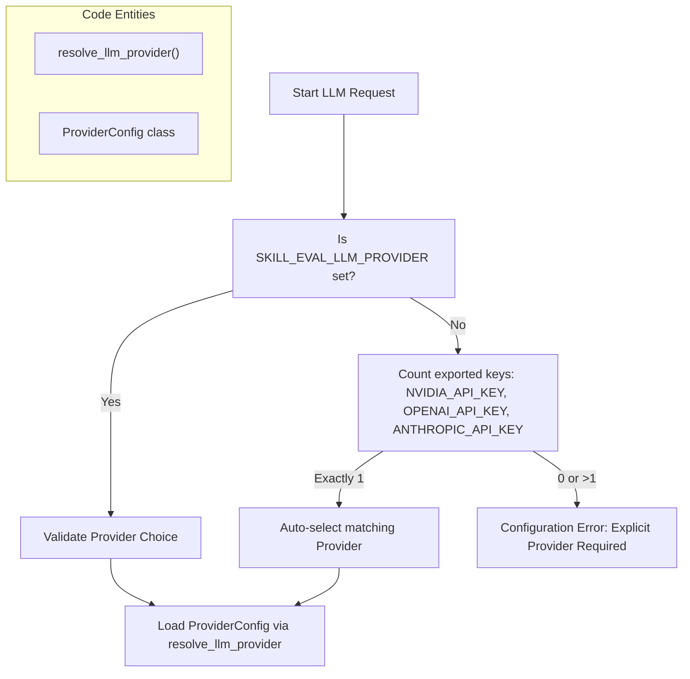
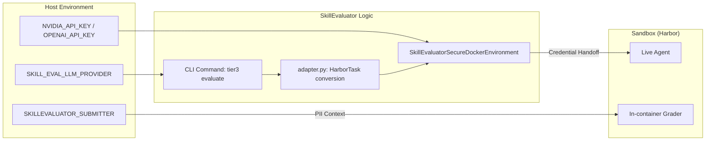

<!-- source: DeepWiki mcp.deepwiki.com · repo NVIDIA/SkillEvaluator · page 1.2 Configuration and Environment Variables · fetched 2026-10-26 -->

# Configuration and Environment Variables

Relevant source files

The following files were used as context for generating this wiki page:

- [docs/configuration.mdx](docs/configuration.mdx)
- [docs/environment-variables.mdx](docs/environment-variables.mdx)
- [src/skillevaluator/constants.py](src/skillevaluator/constants.py)
- [src/skillevaluator/validators/schema.py](src/skillevaluator/validators/schema.py)

SkillEvaluator utilizes a multi-layered configuration system designed to support both deterministic local validation and LLM-powered analysis. Configuration is managed through environment variables, validation profiles, and policy overlays.

## Environment Variable Reference

SkillEvaluator uses two primary prefixes for environment variables: `SKILL_EVAL_*` for provider and model configuration, and `SKILLEVALUATOR_*` for product-level validation behavior and reporting [docs/environment-variables.mdx:11-15]().

### LLM Provider Configuration
These variables control the "Evaluator" LLM used for Tier 1 `rubric-eval`, Tier 2 semantic analysis, and Tier 3 judging.

| Variable | Default | Description |
| :--- | :--- | :--- |
| `SKILL_EVAL_LLM_PROVIDER` | Auto-selected | One of: `openai`, `anthropic`, `nv_build`, `bedrock`, or `openai-compatible` [docs/environment-variables.mdx:28](). |
| `SKILL_EVAL_LLM_MODEL` | Provider default | Chat model override. Required for `openai-compatible` [docs/environment-variables.mdx:29](). |
| `SKILL_EVAL_LLM_BASE_URL` | Provider default | Endpoint override; takes precedence over provider-specific base URLs [docs/environment-variables.mdx:30](). |
| `NVIDIA_API_KEY` | — | Credential for `nv_build` (NVIDIA Build) [docs/environment-variables.mdx:32](). |
| `OPENAI_API_KEY` | — | Credential for `openai` [docs/environment-variables.mdx:33](). |
| `ANTHROPIC_API_KEY` | — | Credential for `anthropic` [docs/environment-variables.mdx:34](). |

### Embedding Configuration (Tier 2)
Tier 2 semantic checks require an OpenAI-compatible embeddings API. If `SKILL_EVAL_EMBEDDING_PROVIDER` is unset, it falls back to the configured LLM provider [docs/environment-variables.mdx:65]().

| Variable | Default | Description |
| :--- | :--- | :--- |
| `SKILL_EVAL_EMBEDDING_PROVIDER` | Fallback to LLM | `openai`, `nv_build`, or `openai-compatible` [docs/environment-variables.mdx:65](). |
| `SKILL_EVAL_EMBEDDING_MODEL` | Provider default | Required for `openai-compatible` [docs/environment-variables.mdx:66](). |
| `SKILL_EVAL_EMBEDDING_BASE_URL` | Provider default | Endpoint override [docs/environment-variables.mdx:67](). |

### Validation and Scanner Paths (Tier 1)
| Variable | Default | Description |
| :--- | :--- | :--- |
| `SKILLEVALUATOR_PROFILE` | `external` | Default validation profile [docs/environment-variables.mdx:76](). |
| `SKILLEVALUATOR_BANDIT_PATH` | auto-discovered | Path to Bandit executable [docs/environment-variables.mdx:77](). |
| `SKILLEVALUATOR_SEMGREP_PATH` | auto-discovered | Path to Semgrep executable [docs/environment-variables.mdx:78](). |
| `SKILLEVALUATOR_SCHEMA_ALLOWED_DIRS` | — | Comma-separated list of extra allowed skill-root directories [docs/environment-variables.mdx:80](). |
| `SKILLEVALUATOR_SUBMITTER` | auto-detected | Identity for home-path PII check [docs/environment-variables.mdx:81](). |

**Sources:** [docs/environment-variables.mdx:22-83](), [docs/configuration.mdx:30-83](), [src/skillevaluator/constants.py:47-51]()

---

## Provider Resolution Logic

SkillEvaluator implements an auto-selection mechanism to simplify setup. If `SKILL_EVAL_LLM_PROVIDER` is not explicitly set, the system inspects exported environment variables.

### Resolution Flow: Provider & Credentials
The following diagram illustrates how `resolve_llm_provider` (and the embedding equivalent) determines the active backend.

**Sources:** [docs/configuration.mdx:85-94](), [docs/environment-variables.mdx:40-49]()

---

## Policy and Profile System

Validation behavior is governed by `ValidationPolicy` objects, which define severity levels and enforcement rules for different checks.

### Profiles
Profiles are pre-defined sets of rules. The default profile is `external` [docs/environment-variables.mdx:76](). Profiles determine:
1. **Severity Overrides**: Changing a `HIGH` finding to `MEDIUM` or `ADVISORY`.
2. **Mandatory Checks**: Which validators are required to pass for a successful exit code.

### Schema Customization
The `SchemaValidator` uses `DEFAULT_ALLOWED_SKILL_DIRS` to restrict skill-root contents [src/skillevaluator/constants.py:43-45](). This can be extended without code changes using the `SKILLEVALUATOR_SCHEMA_ALLOWED_DIRS` environment variable [src/skillevaluator/constants.py:51]().

**Sources:** [src/skillevaluator/validators/schema.py:48-49](), [src/skillevaluator/constants.py:43-51]()

---

## Tier 3: Evaluation Configuration

Tier 3 utilizes the [Harbor](https://github.com/harbor-framework/harbor) framework. It distinguishes between **Evaluator Credentials** (used by SkillEvaluator to grade) and **Agent Credentials** (used by the agent being evaluated) [docs/configuration.mdx:10-13]().

### Harbor Environment Modes
The `--env-mode` flag determines how the sandbox is configured:
*   `docker`: Runs in a secure Docker container.
*   `local`: Runs on the host machine (controlled by `SKILLEVALUATOR_HARBOR_LOCAL_MODE_ALLOW`).
*   `modal`: Remote execution.

### Data Flow: Config to Sandbox
The following diagram shows how environment variables are bridged from the host into the Tier 3 evaluation sandbox.

**Sources:** [docs/configuration.mdx:10-25](), [docs/environment-variables.mdx:88-100]()

---

## Key Configuration Constants

The following constants in `src/skillevaluator/constants.py` define the hard-coded boundaries of the system:

*   **Manifest Files**: `SKILL.md` is the canonical manifest [src/skillevaluator/constants.py:14](). `skill.md` (lowercase) is detected but triggers a `HIGH` severity finding [src/skillevaluator/validators/schema.py:139-155]().
*   **Excluded Directories**: `SCAN_EXCLUDED_DIRS` defines folders like `evals`, `node_modules`, and `.git` that are skipped during Tier 1 scans [src/skillevaluator/constants.py:156-169]().
*   **Field Constraints**: 
    *   Name Max Length: 64 characters [src/skillevaluator/constants.py:101]().
    *   Description Max Length: 1024 characters [src/skillevaluator/constants.py:105]().
    *   Skill File Max Lines: 500 lines [src/skillevaluator/constants.py:109]().

**Sources:** [src/skillevaluator/constants.py:1-182](), [src/skillevaluator/validators/schema.py:17-32]()

---

