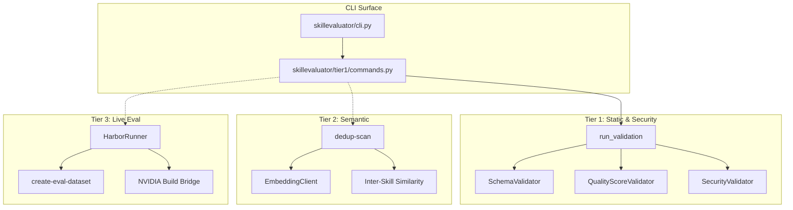
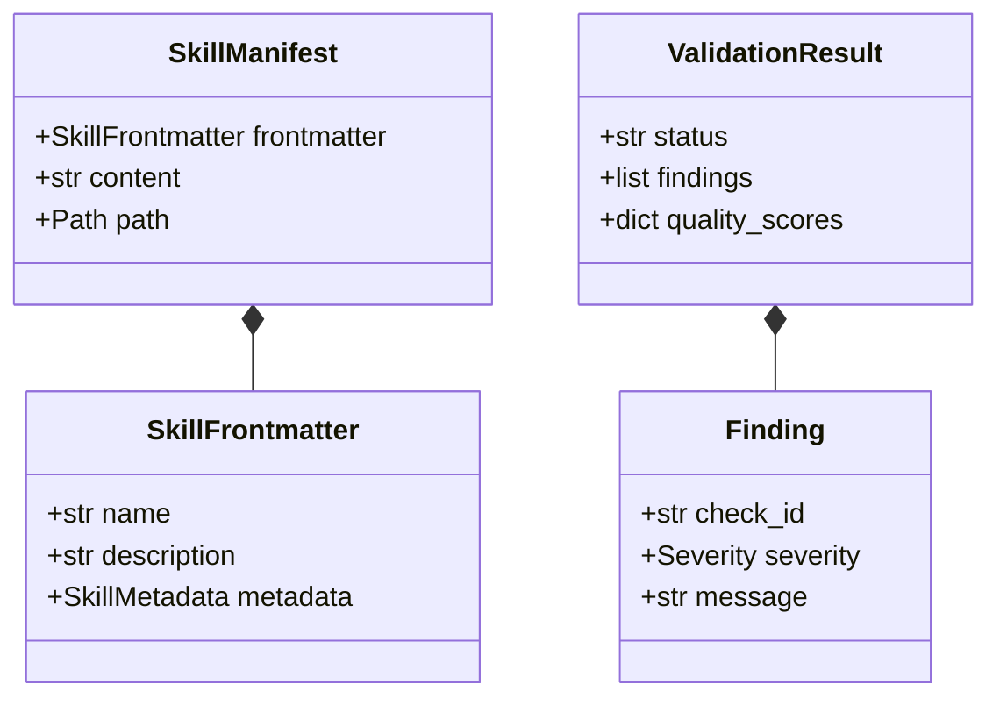

<!-- source: DeepWiki mcp.deepwiki.com · repo NVIDIA/SkillEvaluator · page 2 Core Architecture · fetched 2026-10-26 -->

# Core Architecture

Relevant source files

The following files were used as context for generating this wiki page:

- [docs/developer-guide.mdx](docs/developer-guide.mdx)
- [src/skillevaluator/cli.py](src/skillevaluator/cli.py)
- [src/skillevaluator/constants.py](src/skillevaluator/constants.py)
- [src/skillevaluator/models/skill.py](src/skillevaluator/models/skill.py)

SkillEvaluator is structured as a modular three-tier validation pipeline designed to ensure the quality, security, and functional correctness of AI agent skills. The architecture separates concerns between static analysis (Tier 1), semantic deduplication (Tier 2), and live agent execution (Tier 3).

### System Overview and Code Mapping

The following diagram bridges the high-level system concepts to the specific code entities that implement them.

**System Architecture Map**

Sources: [src/skillevaluator/cli.py:167-180](), [src/skillevaluator/tier1/commands.py:46-47](), [src/skillevaluator/constants.py:117-122]()

---

### Internal Source Layout

The codebase is organized into functional modules that correspond to the three tiers, with shared models and utilities at the root of the `src` directory.

| Directory | Purpose |
| :--- | :--- |
| `src/skillevaluator/models/` | Pydantic definitions for Skills, Rules, Workflows, and Results. |
| `src/skillevaluator/tier1/` | Deterministic validators (Schema, Security, PII, Quality). |
| `src/skillevaluator/tier2/` | Semantic analysis, embedding logic, and deduplication. |
| `src/skillevaluator/tier3/` | Live evaluation logic, Harbor integration, and dataset generation. |
| `src/skillevaluator/reporting/` | Multi-format output engines (CLI, JSON, HTML, Markdown). |
| `src/skillevaluator/providers/` | Abstraction layer for LLM and Embedding providers. |

Sources: [src/skillevaluator/cli.py:32-36](), [src/skillevaluator/constants.py:9-125]()

---

### Key Data Models

SkillEvaluator uses Pydantic for strict schema enforcement. The primary entity is the **Skill**, which is defined by a `SKILL.md` file containing YAML frontmatter and Markdown instructions.

*   **`SkillFrontmatter`**: Validates the required `name` and `description` fields, ensuring kebab-case naming and length constraints [src/skillevaluator/models/skill.py:76-126]().
*   **`ValidationResult`**: The unified output model containing a collection of `Finding` objects, an overall status, and quality scores [src/skillevaluator/models/result.py:18-18]().
*   **`Finding`**: Represents a specific issue discovered by a validator, categorized by `Severity` (CRITICAL, HIGH, MEDIUM, LOW, INFO).

For details, see [Data Models and Skill Schema](#2.1).

**Data Model Relationships**

Sources: [src/skillevaluator/models/skill.py:76-200](), [src/skillevaluator/models/result.py:18-18]()

---

### Provider and LLM Abstraction

To support various environments, SkillEvaluator abstracts LLM and embedding interactions through a provider layer. This allows the system to switch between NVIDIA Build, OpenAI, Anthropic, and Amazon Bedrock without changing the core validator logic.

*   **LLM Provider**: Used for Tier 1 Rubric evaluation and Tier 3 agent execution.
*   **Embedding Provider**: Used for Tier 2 similarity checks and deduplication.

For details, see [LLM and Embedding Provider Layer](#2.2).

Sources: [src/skillevaluator/cli.py:125-129](), [docs/developer-guide.mdx:119-119]()

---

### CLI and Command Routing

The `skillevaluator` CLI is the primary entry point. It uses a "lazy loading" strategy for Tier 2 and Tier 3 dependencies. This ensures that the base installation remains lightweight and only pulls in heavy dependencies (like Harbor or Embedding libraries) when those specific features are invoked.

*   **Core Command**: `validate` - Runs Tier 1 and Tier 2 by default, with optional Tier 3 execution.
*   **Routing**: The CLI uses `click` groups to organize commands into "Core workflows", "Static and security", and "Live evaluation" [src/skillevaluator/cli.py:149-164]().

For details, see [CLI Surface and Command Routing](#2.3).

Sources: [src/skillevaluator/cli.py:32-36](), [src/skillevaluator/cli.py:167-172]()

---

