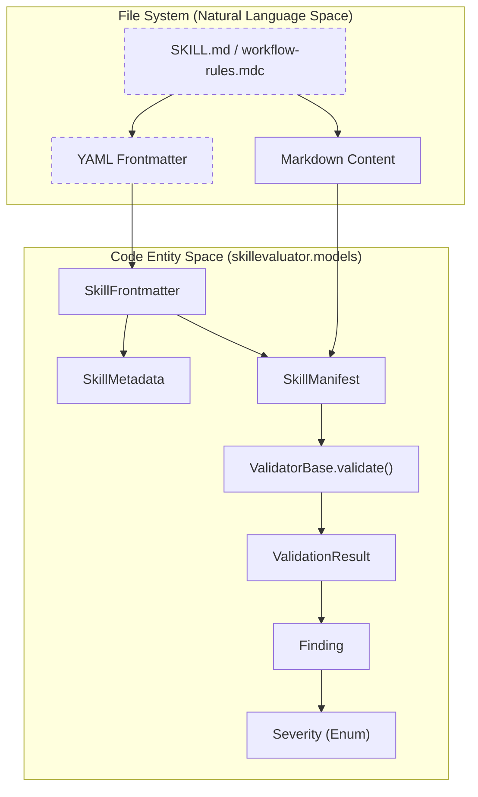
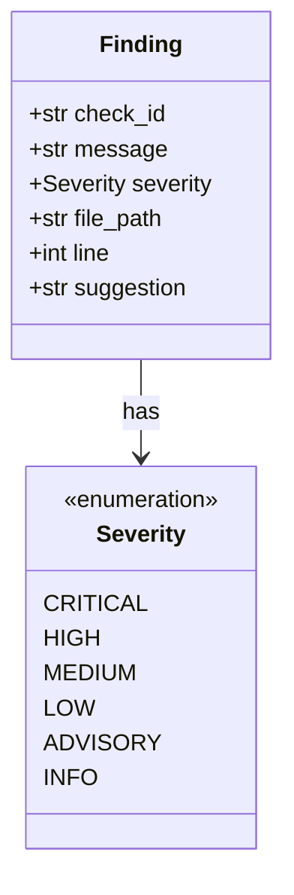
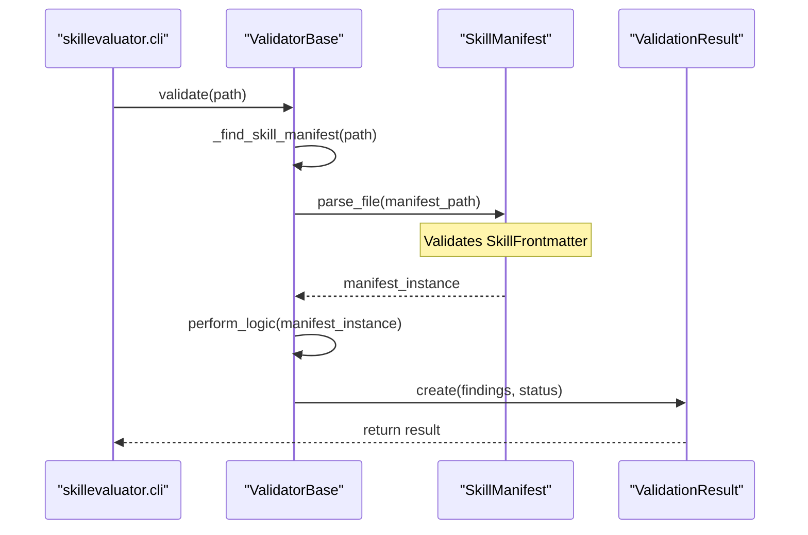

<!-- source: DeepWiki mcp.deepwiki.com · repo NVIDIA/SkillEvaluator · page 2.1 Data Models and Skill Schema · fetched 2026-10-26 -->

# Data Models and Skill Schema

Relevant source files

The following files were used as context for generating this wiki page:

- [src/skillevaluator/models/rules.py](src/skillevaluator/models/rules.py)
- [src/skillevaluator/models/skill.py](src/skillevaluator/models/skill.py)
- [src/skillevaluator/models/workflows.py](src/skillevaluator/models/workflows.py)
- [src/skillevaluator/validators/base.py](src/skillevaluator/validators/base.py)

This page provides a detailed technical reference for the Pydantic data models that define the SkillEvaluator ecosystem. These models govern how skills, rules, and workflows are structured, validated, and reported across all three tiers of the evaluation pipeline.

The schema architecture is designed to bridge the gap between human-readable Markdown documentation and machine-executable validation logic.

## Core Schema Architecture

SkillEvaluator uses Pydantic V2 to enforce strict typing and validation logic. The data flow typically begins with a file-system path, which is parsed into a `Manifest` model, validated against a `Frontmatter` model, and finally produces a `ValidationResult`.

### Entity Relationship Diagram
The following diagram illustrates how the core data models relate to one another and the file system.

"Schema Entity Mapping"

Sources: `[src/skillevaluator/models/skill.py:76-202]()`, `[src/skillevaluator/models/result.py:102-148]()`, `[src/skillevaluator/validators/base.py:140-171]()`

---

## Skill Models

The skill schema is based on the `agentskills.io` standard. It is primarily defined in `src/skillevaluator/models/skill.py`.

### SkillFrontmatter
This model validates the YAML block at the top of a `SKILL.md` file.

| Field | Type | Constraints | Description |
| :--- | :--- | :--- | :--- |
| `name` | `str` | Kebab-case, 1-64 chars | Unique identifier; must match directory name. |
| `description` | `str` | 10-1000 chars | Clear explanation of skill purpose. |
| `license` | `str | None` | - | License identifier (e.g., "Apache-2.0"). |
| `metadata` | `SkillMetadata` | - | Nested categorization and attribution. |
| `allowed-tools`| `str | None` | - | Experimental field for pre-approved tools. |

**Key Validations:**
- **Kebab-case Enforcement**: The `validate_name_format` method ensures names use only lowercase letters, numbers, and hyphens, and do not contain reserved words like "anthropic" or "claude" `[src/skillevaluator/models/skill.py:128-159]()`.
- **Forbidden Fields**: Skills are strictly prohibited from using `alwaysApply` or `globs` fields, which are reserved for Rules `[src/skillevaluator/models/skill.py:179-197]()`.

### SkillMetadata
A nested object within the frontmatter used for categorization `[src/skillevaluator/models/skill.py:33-52]()`.
- `author`: Format `Name <email@example.com>`.
- `tags`, `languages`, `frameworks`: Lists of strings (coerced from single strings if necessary via `ensure_list`).
- `domain`: High-level category (e.g., `ai-ml`, `backend`).

Sources: `[src/skillevaluator/models/skill.py:33-199]()`, `[src/skillevaluator/constants.py:16-24]()`

---

## Rules and Workflows Models

Rules and Workflows use the `.mdc` (Markdown Cursor) format. Unlike Skills, these entities are designed to be applied globally or to specific file patterns.

### Rules Schema
Defined in `src/skillevaluator/models/rules.py`, the `RulesFrontmatter` model differs from Skills in two major ways:
1. **Required Fields**: Must include `alwaysApply` (boolean) and `title` `[src/skillevaluator/models/rules.py:92-108]()`.
2. **Allowed Fields**: `globs` is permitted to define file-matching patterns `[src/skillevaluator/models/rules.py:111-114]()`.

### Workflows Schema
Workflows represent directory-based structures. The `WorkflowsFrontmatter` model (in `src/skillevaluator/models/workflows.py`) requires a `metadata.author` field, which is optional for standard rules `[src/skillevaluator/models/workflows.py:125-129]()`.

Sources: `[src/skillevaluator/models/rules.py:79-154]()`, `[src/skillevaluator/models/workflows.py:89-184]()`

---

## Validation and Reporting Models

When a validator (inheriting from `ValidatorBase`) runs, it produces structured output using the models defined in `src/skillevaluator/models/result.py`.

### ValidationResult
The container for all findings related to a single validation execution.

- `status`: A `ValidationStatus` enum (`PASSED`, `FAILED`, `SKIPPED`, `INCOMPLETE`) `[src/skillevaluator/models/result.py:102-110]()`.
- `findings`: A list of `Finding` objects.
- `metrics`: A dictionary of numerical scores (e.g., quality scores).

### Finding and Severity
A `Finding` represents a specific issue or success note discovered during validation.

"Finding Data Flow"

Sources: `[src/skillevaluator/models/result.py:44-91]()`

**Severity Levels:**
- `CRITICAL`: Causes immediate validation failure (Exit Code 1).
- `HIGH`/`MEDIUM`: Contributes to failure depending on policy.
- `ADVISORY`: Purely informational; does not affect exit codes but appears in reports.

---

## Data Flow: From File to Result

The validation lifecycle demonstrates how these models interact during a CLI execution.

"CLI Validation Sequence"

Sources: `[src/skillevaluator/validators/base.py:162-189]()`, `[src/skillevaluator/models/skill.py:200-210]()`

### Key Functions
- `iter_scannable_files`: A helper in `ValidatorBase` that walks directories while respecting `SCAN_EXCLUDED_DIRS` (like `node_modules` or `.git`) to find files matching specific extensions `[src/skillevaluator/validators/base.py:72-137]()`.
- `continue_on_failure_scope`: A context manager that allows the validator to continue gathering findings even after a `CRITICAL` error is encountered `[src/skillevaluator/validators/base.py:56-70]()`.

Sources: `[src/skillevaluator/validators/base.py:1-137]()`, `[src/skillevaluator/models/result.py:1-148]()`

---

