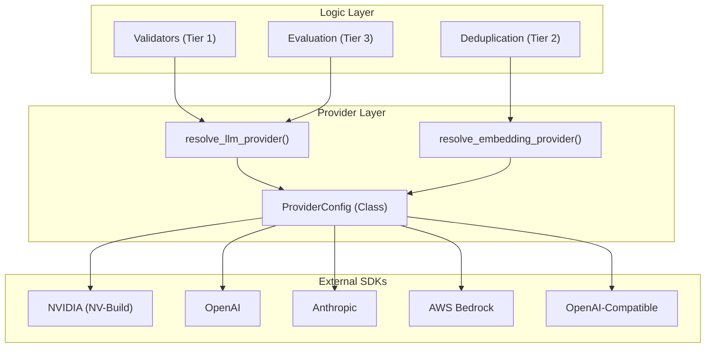
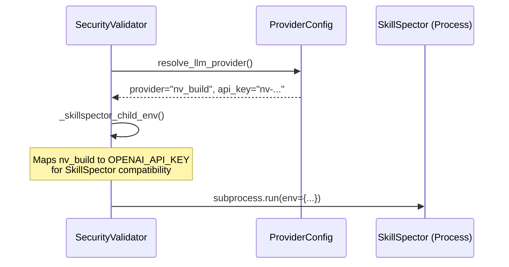

<!-- source: DeepWiki mcp.deepwiki.com · repo NVIDIA/SkillEvaluator · page 2.2 LLM and Embedding Provider Layer · fetched 2026-10-26 -->

# LLM and Embedding Provider Layer

Relevant source files

The following files were used as context for generating this wiki page:

- [pyproject.toml](pyproject.toml)
- [src/skillevaluator/cli_help.py](src/skillevaluator/cli_help.py)
- [src/skillevaluator/deduplication/utils/chunker.py](src/skillevaluator/deduplication/utils/chunker.py)
- [src/skillevaluator/evaluation/__init__.py](src/skillevaluator/evaluation/__init__.py)
- [src/skillevaluator/validators/security.py](src/skillevaluator/validators/security.py)

The LLM and Embedding Provider Layer provides a unified abstraction for interacting with various Large Language Models (LLMs) and embedding services. This layer decouples the evaluation logic (Tiers 1, 2, and 3) from specific vendor SDKs, allowing SkillEvaluator to support NVIDIA (NV-Build), OpenAI, Anthropic, Amazon Bedrock, and OpenAI-compatible endpoints through a consistent interface.

## Provider Abstraction Overview

The core of this layer is the `ProviderConfig` class, which encapsulates the necessary credentials, model identifiers, and endpoint configurations for a given provider [src/skillevaluator/provider_config.py:34-42](). The system uses resolution functions to determine which provider to use based on environment variables or explicit configuration.

### Data Flow and Resolution

The following diagram illustrates how a request for an LLM or Embedding client is resolved into a concrete provider implementation.

**Provider Resolution and Data Flow**

Sources: [src/skillevaluator/provider_config.py:34-42](), [src/skillevaluator/provider_config.py:204-211](), [src/skillevaluator/provider_config.py:270-277]()

## Key Components

### ProviderConfig Class
The `ProviderConfig` class is a Pydantic model that stores the configuration for a provider [src/skillevaluator/provider_config.py:34-42]().
- **`provider`**: The name of the provider (e.g., `nv_build`, `openai`).
- **`model`**: The specific model ID to use.
- **`api_key`**: The credential used for authentication.
- **`base_url`**: The API endpoint (essential for OpenAI-compatible providers).
- **`aws_access_key_id` / `aws_secret_access_key`**: Specific fields for AWS Bedrock [src/skillevaluator/provider_config.py:53-54]().

### Resolution Functions
- **`resolve_llm_provider`**: Inspects environment variables (primarily `SKILL_EVAL_LLM_PROVIDER`) to return a populated `ProviderConfig` [src/skillevaluator/provider_config.py:204-268]().
- **`resolve_embedding_provider`**: Similar to the LLM resolver, but uses `SKILL_EVAL_EMBEDDING_PROVIDER` [src/skillevaluator/provider_config.py:270-321]().

## Supported Providers and Credentials

SkillEvaluator maps environment variables to specific provider configurations. If a provider is requested but required credentials (like API keys) are missing, a `ProviderConfigurationError` is raised [src/skillevaluator/provider_config.py:23-25]().

| Provider | `SKILL_EVAL_LLM_PROVIDER` Value | Primary Credential Env Var |
| :--- | :--- | :--- |
| **NVIDIA** | `nv_build` | `NVIDIA_API_KEY` |
| **OpenAI** | `openai` | `OPENAI_API_KEY` |
| **Anthropic** | `anthropic` | `ANTHROPIC_API_KEY` |
| **AWS Bedrock** | `bedrock` | `AWS_ACCESS_KEY_ID`, `AWS_SECRET_ACCESS_KEY` |
| **OpenAI Compatible** | `openai-compatible` | `OPENAI_API_KEY` |

Sources: [src/skillevaluator/provider_config.py:213-268](), [src/skillevaluator/provider_config.py:34-60]()

## Integration with Security Scanning

The provider layer also handles credential handoff for external tools like `skillspector`. The function `_skillspector_child_env` translates SkillEvaluator's `ProviderConfig` into the environment variables expected by the `skillspector` CLI [src/skillevaluator/validators/security.py:148-195]().

**Credential Handoff to External Tools**

Sources: [src/skillevaluator/validators/security.py:148-195](), [src/skillevaluator/validators/security.py:58-64]()

## Embedding Client Implementation

For Tier 2 (Deduplication) and semantic analysis, the `EmbeddingClient` uses the provider configuration to generate vector representations of content chunks [src/skillevaluator/deduplication/utils/chunker.py:33-42]().

1. **Chunking**: Content is split into `ContentChunk` objects by `chunk_file` [src/skillevaluator/deduplication/utils/chunker.py:49-61]().
2. **Resolution**: `resolve_embedding_provider` is called to get the configuration [src/skillevaluator/provider_config.py:270-277]().
3. **Embedding**: The text within each chunk is sent to the provider's embedding endpoint to populate the `embedding` field [src/skillevaluator/deduplication/utils/chunker.py:42]().

Sources: [src/skillevaluator/deduplication/utils/chunker.py:33-61](), [src/skillevaluator/provider_config.py:270-277]()

---

