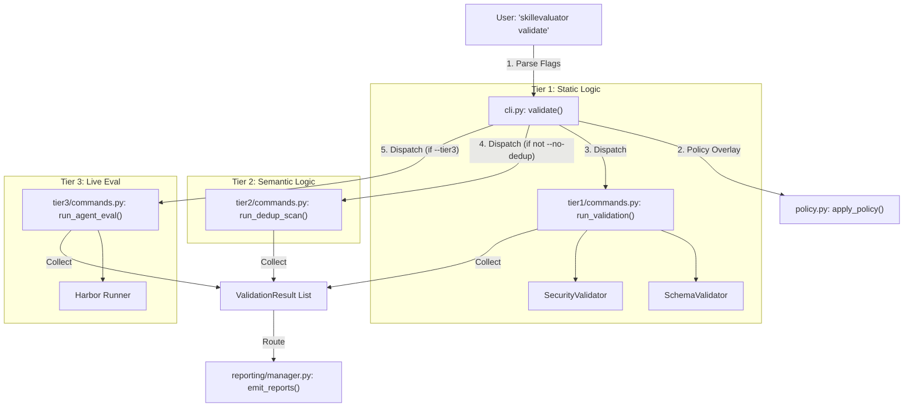
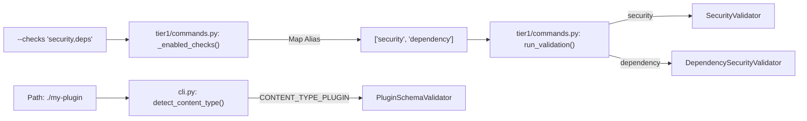

<!-- source: DeepWiki mcp.deepwiki.com · repo NVIDIA/SkillEvaluator · page 2.3 CLI Surface and Command Routing · fetched 2026-10-26 -->

# CLI Surface and Command Routing

Relevant source files

The following files were used as context for generating this wiki page:

- [docs/cli-reference.mdx](docs/cli-reference.mdx)
- [src/skillevaluator/cli.py](src/skillevaluator/cli.py)
- [src/skillevaluator/tier1/commands.py](src/skillevaluator/tier1/commands.py)
- [tests/golden/cli_surface.json](tests/golden/cli_surface.json)
- [tests/test_checks_routing.py](tests/test_checks_routing.py)
- [tests/test_cli.py](tests/test_cli.py)
- [tests/test_commands.py](tests/test_commands.py)

The `skillevaluator` CLI serves as a unified entry point for all three validation tiers. It is built using the [Click](https://click.palletsprojects.com/) library and employs a modular structure that optimizes for startup speed and dependency management through lazy loading of high-overhead modules.

## Unified CLI Architecture

The CLI is structured into a root group that routes to individual commands and specialized "expert" tier groups. This design allows for both high-level workflows (like `validate`) and deep-dive diagnostic tools (like `doctor` or `harbor-view`).

### Command Grouping and Help
To maintain clarity across a large command surface, the CLI uses a custom `RichGroup` [src/skillevaluator/cli_help.py:16-16]() class to organize `--help` output into logical sections:
*   **Core Workflows**: `validate`, `health-check`, `doctor`, `models` [src/skillevaluator/cli.py:150-150]().
*   **Tier 1 (Static/Security)**: `quality-check`, `rubric-eval`, `security-scan`, etc [src/skillevaluator/cli.py:151-154]().
*   **Tier 2 (Deduplication)**: `similarity-check`, `context-optimization-check`, `dedup-scan` [src/skillevaluator/cli.py:155-158]().
*   **Tier 3 (Live Evaluation)**: `create-eval-dataset`, `compare`, `view`, `harbor-view` [src/skillevaluator/cli.py:159-162]().

### Performance: Lazy Imports
SkillEvaluator utilizes an "extras" dependency model (e.g., `pip install skillevaluator[tier2,tier3]`). To ensure the base CLI remains functional and fast even if heavy dependencies (like Harbor or Torch) are missing, the implementation follows these rules:
1.  **Tier 1**: Eagerly imported; safe for base installs [src/skillevaluator/cli.py:32-37]().
2.  **Tier 2/3**: Lazily imported inside the command callback functions [src/skillevaluator/cli.py:33-36](). This prevents `ModuleNotFoundError` during the command discovery phase.

**Sources:** [src/skillevaluator/cli.py:32-47](), [src/skillevaluator/cli.py:149-164]()

---

## Command Surface Reference

The following table maps the primary CLI commands to their internal routing logic.

| CLI Command | Internal Callback / Logic | Tier | Purpose |
| :--- | :--- | :--- | :--- |
| `validate` | `run_validation` + `_run_agent_eval_or_skip` | 1, 2, 3 | Full pipeline execution; gates exit code on Tier 1 & 2. |
| `quality-check` | `run_quality_check` | 1 | Scores skill across 4 weighted quality dimensions. |
| `security-scan` | `run_security_scan` | 1 | Executes Semgrep, Gitleaks, and LLM-based code risk scans. |
| `similarity-check` | `run_similarity_check` | 2 | Detects duplicate content across multiple skill directories. |
| `evaluate` | `run_agent_eval` | 3 | Triggers the Harbor-based live agent evaluation. |
| `doctor` | `run_doctor` | 3 | Validates environment readiness (Docker, API keys, agents). |
| `harbor-view` | `format_harbor_view_command` | 3 | Browser-based UI for viewing Harbor job artifacts. |

**Sources:** [docs/cli-reference.mdx:18-40](), [src/skillevaluator/cli.py:149-164](), [src/skillevaluator/tier1/commands.py:135-148]()

---

## The `validate` Pipeline Routing

The `validate` command is the primary entry point for CI/CD. It routes requests through all three tiers based on flags like `--tier3` or `--no-dedup`.

### Data Flow: Natural Language Space to Code Entity Space

The following diagram illustrates how a user invocation of `skillevaluator validate` routes through the internal engine components.

**Title: Validation Pipeline Command Routing**

**Sources:** [src/skillevaluator/cli.py:180-146](), [src/skillevaluator/tier1/commands.py:135-166]()

---

## Check Routing and Alias Handling

The CLI provides flexible ways to select specific checks and handles deprecated aliases to maintain backward compatibility.

### Check Selection Logic
The `_enabled_checks` function in Tier 1 handles the mapping of short-hand strings to canonical `Validator` instances.
*   **Aliases**: `code` or `code-risk` maps to `code-integrity`; `deps` maps to `dependency` [src/skillevaluator/tier1/commands.py:89-99]().
*   **Opt-in Checks**: Some checks, like `dependency` (CVE auditing), are excluded from the default run and must be explicitly requested via `--checks` [src/skillevaluator/tier1/commands.py:62-66]().

### Content-Type Aware Routing
The CLI identifies the target type (skill, rules, workflows, or plugin) to select the correct schema validator [src/skillevaluator/tier1/commands.py:108-122]().

**Title: Internal Check Resolver and Validator Mapping**

**Sources:** [src/skillevaluator/tier1/commands.py:51-105](), [src/skillevaluator/tier1/commands.py:108-122]()

---

## Exit Code Contract

The CLI communicates results to parent processes (like GitHub Actions) through a specific set of exit codes defined in the reporting layer and enforced at the end of the `validate` command.

*   **Code 0**: All checks passed (or only advisory failures occurred).
*   **Code 1**: Validation failed (Critical or Error severity findings in gated tiers).
*   **Code 2**: Configuration error (e.g., invalid CLI flags, unreadable skill path).
*   **Code 3**: Runtime error (unhandled exception/internal failure).

**Sources:** [docs/cli-reference.mdx:52-60](), [src/skillevaluator/cli.py:131-146]()

---

