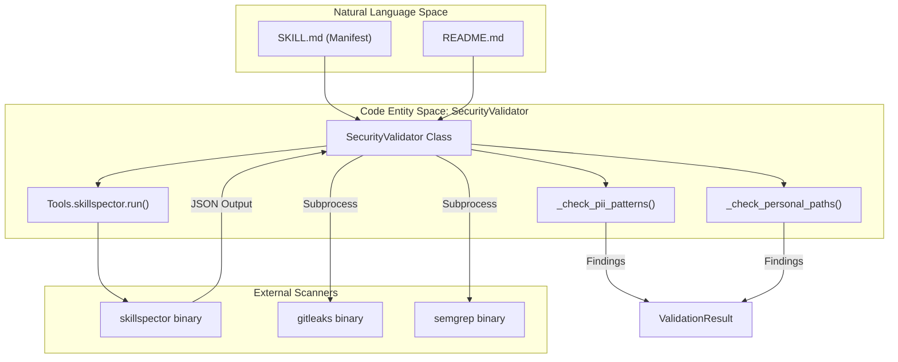
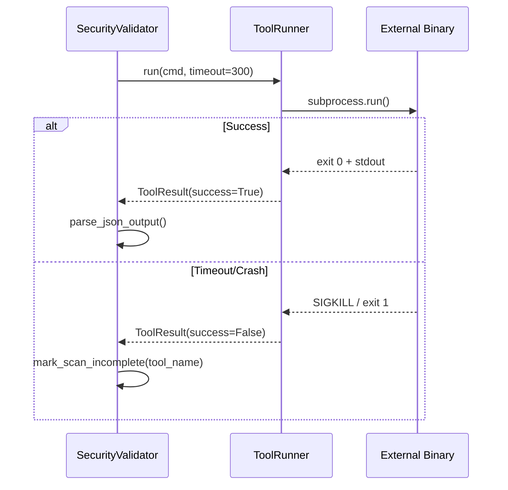

<!-- source: DeepWiki mcp.deepwiki.com · repo NVIDIA/SkillEvaluator · page 3.2 Security, PII, and Unicode Checks · fetched 2026-10-26 -->

# Security, PII, and Unicode Checks

Relevant source files

The following files were used as context for generating this wiki page:

- [src/skillevaluator/validators/security.py](src/skillevaluator/validators/security.py)
- [tests/validators/test_artifact_dir_exclusion.py](tests/validators/test_artifact_dir_exclusion.py)
- [tests/validators/test_base.py](tests/validators/test_base.py)
- [tests/validators/test_scan_incomplete.py](tests/validators/test_scan_incomplete.py)
- [tests/validators/test_security.py](tests/validators/test_security.py)

The Tier 1 validation pipeline includes a comprehensive suite of security-focused validators designed to detect vulnerabilities, exposure of sensitive information, and malicious encoding techniques. These checks are deterministic and run locally to provide immediate feedback to skill authors before any code is executed in a sandbox.

### SecurityValidator (SkillSpector Integration)

The `SecurityValidator` serves as the primary interface for detecting logic-based security risks such as prompt injection, data exfiltration, and insecure execution patterns. It primarily leverages **SkillSpector**, an external security scanner tailored for LLM skills [src/skillevaluator/validators/security.py:4-11]().

#### Implementation and Data Flow
The validator manages the lifecycle of the external scan, including environment preparation and output parsing.

1.  **Environment Mapping**: The validator maps `SkillEvaluator` provider configurations into the `SKILLSPECTOR_*` environment variables required by the child process [src/skillevaluator/validators/security.py:148-163]().
2.  **Artifact Pruning**: To prevent false positives and performance degradation, `SecurityValidator` creates a temporary filtered copy of the skill, excluding artifact directories like `evals/` or `results/` before scanning [tests/validators/test_artifact_dir_exclusion.py:121-142]().
3.  **Risk Assessment**: It parses the SkillSpector JSON output and maps its risk bands (0-100) to internal `Severity` levels [src/skillevaluator/validators/security.py:48-57]().

#### Key Functions
- `_run_skillspector(skill_path)`: Orchestrates the external tool execution [src/skillevaluator/validators/security.py:284-300]().
- `_skillspector_child_env()`: Resolves LLM credentials for SkillSpector's optional LLM-verification layer [src/skillevaluator/validators/security.py:148-178]().

**Sources:** [src/skillevaluator/validators/security.py:4-178](), [tests/validators/test_artifact_dir_exclusion.py:121-142]()

---

### Secrets and PII Detection

The `SecretsValidator` detects Personal Identifiable Information (PII) and hardcoded credentials using a combination of regex patterns and **Gitleaks** [src/skillevaluator/validators/secrets.py:4-10]().

#### Detection Mechanisms
- **Gitleaks**: Scans the skill directory for known secret patterns (API keys, tokens, certificates) [src/skillevaluator/validators/secrets.py:136-150]().
- **PII Regex**: Detects sensitive strings including emails, phone numbers, Social Security Numbers (SSNs), and IP addresses [src/skillevaluator/validators/security.py:25-30]().
- **Home-Path Detection**: Identifies hardcoded local file paths (e.g., `/Users/username/...` or `C:\Users\...`) that suggest environment-specific leaks [src/skillevaluator/validators/security.py:417-430]().

#### Secret Redaction in Reports
To prevent accidental exposure in logs or CI output, `SecretsValidator` identifies the exact location of a finding and ensures that reporting mechanisms can mask the sensitive content [src/skillevaluator/validators/security.py:470-485]().

**Sources:** [src/skillevaluator/validators/secrets.py:4-150](), [src/skillevaluator/validators/security.py:417-485]()

---

### Unicode and ASCII Smuggling

The `UnicodeSmuggleValidator` detects "Trojan Source" attacks and ASCII smuggling techniques where hidden or deceptive characters are used to alter code logic or hide malicious payloads from human reviewers [src/skillevaluator/validators/unicode_smuggle.py:4-12]().

#### Check Categories
1.  **BiDi Overrides**: Detects Unicode BiDi control characters (e.g., `U+202E`) used to reverse text direction and disguise file extensions or logic [src/skillevaluator/validators/unicode_smuggle.py:15-25]().
2.  **ASCII Smuggling**: Identifies "smuggled" content where special Unicode characters are used to embed data that is invisible in most editors but interpretable by LLMs or scripts [src/skillevaluator/validators/unicode_smuggle.py:30-45]().
3.  **Homoglyphs**: Flags characters that look identical to standard ASCII (e.g., Cyrillic 'а' vs Latin 'a') which can be used for variable shadowing [src/skillevaluator/validators/unicode_smuggle.py:50-60]().

**Sources:** [src/skillevaluator/validators/unicode_smuggle.py:4-60]()

---

### Code Risk and Dependency Security

The `CodeRiskValidator` and `DependencySecurityValidator` focus on the underlying implementation and its supply chain.

- **CodeRiskValidator**: Wraps **Semgrep**, **Bandit**, and **Gitleaks** to perform static analysis on Python, JavaScript, and shell scripts within the skill [src/skillevaluator/validators/code_risk.py:10-25](). It specifically looks for `eval()` usage, insecure temp file creation, and shell injection vulnerabilities.
- **DependencySecurityValidator**: Inspects `requirements.txt` or `pyproject.toml` files to ensure that the skill does not introduce known vulnerable packages or prohibited licenses.

**Sources:** [src/skillevaluator/validators/code_risk.py:10-25]()

---

### Security Pipeline Architecture

The following diagram illustrates how the `SecurityValidator` coordinates between the natural language space (Skill Manifests) and the code entity space (External Scanners and Parsers).

**Security Validation Data Flow**

**Sources:** [src/skillevaluator/validators/security.py:37-43](), [src/skillevaluator/validators/security.py:284-300](), [src/skillevaluator/utils/tool_runner.py:36-37]()

---

### Error Handling and Incomplete Scans

SkillEvaluator treats a failed or missing security scanner as a high-severity "Incomplete" status rather than a pass. This ensures that a skill cannot be promoted if its security checks were bypassed due to environment issues [tests/validators/test_scan_incomplete.py:31-63]().

**Scanner Status Mapping**
| Scenario | Result Status | Severity |
| :--- | :--- | :--- |
| Tool not installed | `INCOMPLETE` | `CRITICAL` |
| Tool Timeout | `INCOMPLETE` | `HIGH` |
| Malformed JSON output | `INCOMPLETE` | `MEDIUM` |
| Risk Score > 80 | `FAILED` | `CRITICAL` |

**Scanner Interaction Logic**

**Sources:** [src/skillevaluator/utils/tool_runner.py:36-37](), [tests/validators/test_scan_incomplete.py:31-63](), [src/skillevaluator/validators/security.py:127-136]()

---

