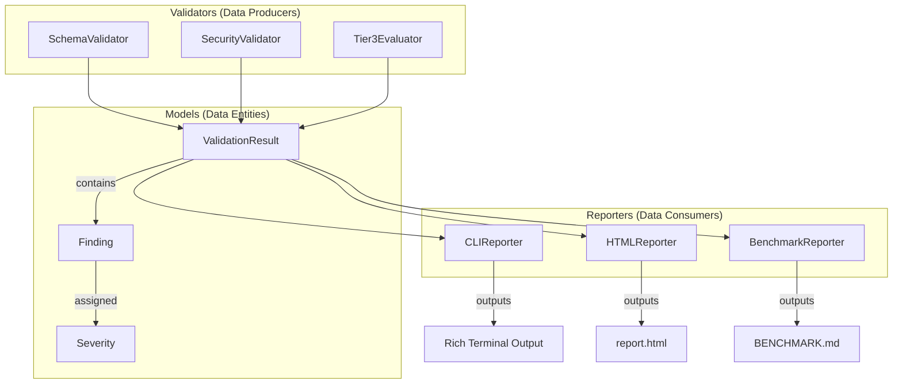
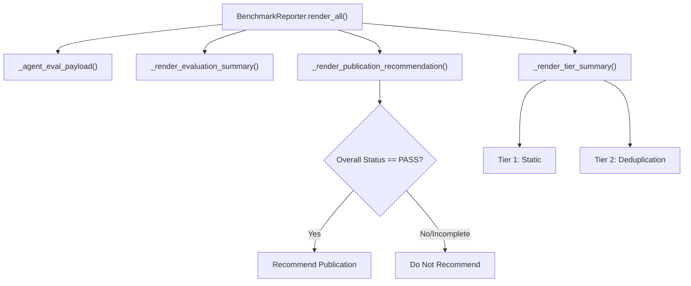

<!-- source: DeepWiki mcp.deepwiki.com · repo NVIDIA/SkillEvaluator · page 3.3 Policy, Profiles, and Validation Reporting · fetched 2026-10-26 -->

# Policy, Profiles, and Validation Reporting

Relevant source files

The following files were used as context for generating this wiki page:

- [docs/reports.mdx](docs/reports.mdx)
- [src/skillevaluator/reporting/__init__.py](src/skillevaluator/reporting/__init__.py)
- [src/skillevaluator/reporting/base.py](src/skillevaluator/reporting/base.py)
- [src/skillevaluator/reporting/benchmark.py](src/skillevaluator/reporting/benchmark.py)
- [src/skillevaluator/reporting/cli.py](src/skillevaluator/reporting/cli.py)
- [src/skillevaluator/reporting/html.py](src/skillevaluator/reporting/html.py)
- [src/skillevaluator/reporting/markdown.py](src/skillevaluator/reporting/markdown.py)
- [src/skillevaluator/reporting/naming.py](src/skillevaluator/reporting/naming.py)
- [src/skillevaluator/reporting/templates/report.html.j2](src/skillevaluator/reporting/templates/report.html.j2)
- [tests/golden/benchmark_tier1.md](tests/golden/benchmark_tier1.md)
- [tests/golden/test_benchmark_card.py](tests/golden/test_benchmark_card.py)
- [tests/reporting/test_advisory_skip_verdict.py](tests/reporting/test_advisory_skip_verdict.py)
- [tests/reporting/test_reporters.py](tests/reporting/test_reporters.py)

SkillEvaluator utilizes a multi-layered policy and profile system to govern validation strictness and severity. Findings from Tier 1, 2, and 3 validators are aggregated into a unified reporting pipeline that supports multiple formats, including a publication-ready benchmark card.

## Validation Policy and Profiles

The validation process is governed by `ValidationPolicy`, which determines how findings are treated (e.g., whether a `HIGH` severity finding triggers a `FAIL` status) and which checks are active [src/skillevaluator/models/result.py:17-100]().

### Severity and Status Flow
Findings carry a `Severity` level: `CRITICAL`, `HIGH`, `MEDIUM`, `LOW`, or `INFO` [src/skillevaluator/models/result.py:17-25](). The `ValidationResult` class aggregates these findings and determines the validator's status based on the policy [src/skillevaluator/models/result.py:234-260]().

*   **PASS**: All required checks passed, or only non-blocking findings (e.g., `LOW`) were found.
*   **FAIL**: One or more findings met or exceeded the failure threshold defined in the policy.
*   **INCOMPLETE**: A required scanner failed to run or produced untrustworthy evidence, meaning a definitive `PASS` or `FAIL` cannot be determined [docs/reports.mdx:76-85]().

### Policy Configuration (`policy.yaml`)
Users can override default severities and thresholds via a `policy.yaml` file. This allows teams to customize the validation gate without modifying the source code.

### External Profiles (`external.yaml`)
The system supports profiles to group validation settings for different environments. The `external.yaml` profile is typically used for public-facing or third-party skill validation, enforcing stricter security and schema rules.

## Reporting Architecture

SkillEvaluator separates data production (Validators) from data consumption (Reporters) using a common `ValidationResult` model [src/skillevaluator/reporting/base.py:10-15]().

### Reporter Implementation Hierarchy
All reporters inherit from `ReporterBase`, which provides secure file writing utilities, including atomic writes and path traversal protection [src/skillevaluator/reporting/base.py:55-111]().

| Reporter | Class | Purpose |
| :--- | :--- | :--- |
| **CLI** | `CLIReporter` | Rich terminal output with color-coded severities and progress spinners [src/skillevaluator/reporting/cli.py:50-79](). |
| **JSON** | `JSONReporter` | Machine-readable output for CI/CD pipeline parsing [src/skillevaluator/reporting/__init__.py:37-37](). |
| **HTML** | `HTMLReporter` | Standalone, self-contained web reports with dark mode and interactive tabs [src/skillevaluator/reporting/html.py:186-200](). |
| **Markdown** | `MarkdownReporter` | Optimized for GitHub PR comments and documentation wikis [src/skillevaluator/reporting/markdown.py:52-83](). |
| **Benchmark** | `BenchmarkReporter` | Generates the stable `BENCHMARK.md` publication card [src/skillevaluator/reporting/benchmark.py:69-90](). |

### Reporting Data Flow
The following diagram illustrates how validation data flows from the validators through the models and into the specialized reporters.

**Validation to Report Data Flow**

**Sources:** [src/skillevaluator/reporting/base.py:10-15](), [src/skillevaluator/models/result.py:17-25](), [src/skillevaluator/reporting/__init__.py:9-13]()

## The Benchmark Card (`BENCHMARK.md`)

The `BenchmarkReporter` produces a standardized `BENCHMARK.md` file. This file acts as a "publication card" that summarizes the skill's readiness across all three tiers [src/skillevaluator/reporting/benchmark.py:69-111]().

### Key Report Fields
*   **Overall Status**: `PASS`, `FAIL`, or `INCOMPLETE` [docs/reports.mdx:76-80]().
*   **Severity Counts**: Aggregated counts of Critical, High, Medium, and Low findings [src/skillevaluator/reporting/markdown.py:125-135]().
*   **Quality Summary**: 4-dimension scoring (Correctness, Discoverability, Reliability, Efficiency) [src/skillevaluator/reporting/markdown.py:150-165]().
*   **Tier 3 Dimension Rollup**: (If applicable) Security, Correctness, Discoverability, Effectiveness, and Efficiency metrics derived from live agent trials [src/skillevaluator/reporting/benchmark.py:22-31]().

### Publication Recommendation
A "Publication Recommendation" section is only rendered if the skill achieves a clean `PASS` [docs/reports.mdx:79-80](). If Tier 3 evaluation was skipped (e.g., due to missing LLM keys), the card marks Tier 3 as `SKIPPED` but does not necessarily fail the overall Tier 1/2 status [docs/reports.mdx:80-84]().

**Benchmark Card Generation Logic**

**Sources:** [src/skillevaluator/reporting/benchmark.py:94-132](), [docs/reports.mdx:76-85]()

## File Naming and Persistence

Reports are written to the `reports/` directory by default, unless overridden by `-o` [docs/reports.mdx:21-27]().

*   **Timestamped**: Full `validate` runs produce `skillevaluator-output-YYYYMMDDHHMMSS.json` to prevent overwriting history [docs/reports.mdx:52-66]().
*   **Fixed**: Individual check commands (e.g., `quality-check`) use fixed names like `skillevaluator-quality.json` [docs/reports.mdx:53-60]().
*   **Atomic Writes**: To prevent corrupted reports during interruptions, SkillEvaluator writes to a temporary file and renames it into place [src/skillevaluator/reporting/base.py:185-200](), [docs/reports.mdx:88-92]().

**Sources:** [docs/reports.mdx:21-66](), [src/skillevaluator/reporting/naming.py:15-31]()

---

