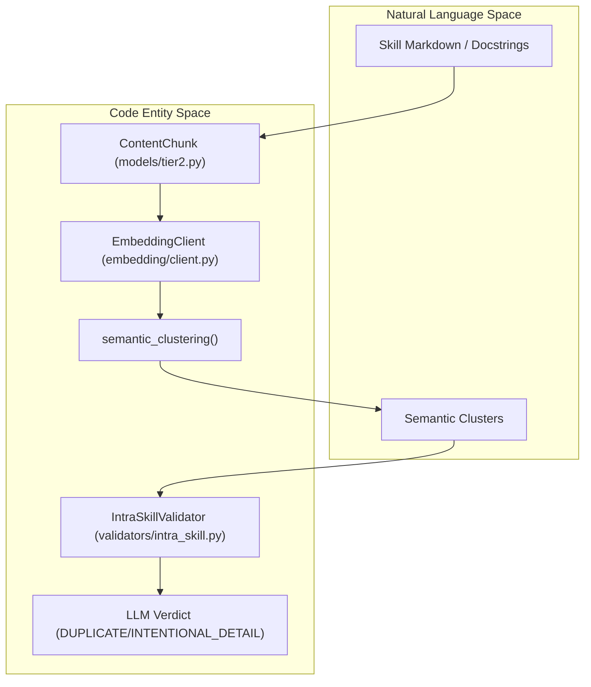
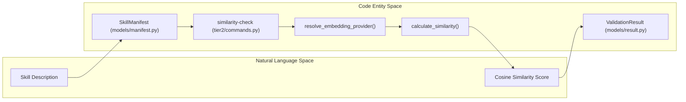

<!-- source: DeepWiki mcp.deepwiki.com · repo NVIDIA/SkillEvaluator · page 4 Tier 2: Deduplication and Semantic Analysis · fetched 2026-10-26 -->

# Tier 2: Deduplication and Semantic Analysis

Relevant source files

The following files were used as context for generating this wiki page:

- [docs/tier2-deduplication.mdx](docs/tier2-deduplication.mdx)
- [src/skillevaluator/tier1/commands.py](src/skillevaluator/tier1/commands.py)

Tier 2 provides semantic analysis to detect redundant content within a single skill and overlapping functionality across skill collections. Unlike Tier 1's deterministic checks, Tier 2 utilizes vector embeddings to identify similarity in natural language space and code documentation. [docs/tier2-deduplication.mdx:7-13]().

The analysis is split into two primary workflows: **Intra-skill** (context optimization) and **Inter-skill** (similarity check). [docs/tier2-deduplication.mdx:18-31]().

### Semantic Analysis Architecture

The Tier 2 pipeline bridges raw file content to semantic clusters using a multi-stage process. It requires a configured embedding provider and, for intra-skill checks, a chat LLM for verification. [docs/tier2-deduplication.mdx:41-47]().

**High-Level Logic Flow**
1.  **Ingestion**: Files are read locally; no external vector database is required. [docs/tier2-deduplication.mdx:15-16]().
2.  **Chunking**: Content is broken into logical units based on file type (e.g., Markdown headings or Python docstrings). [docs/tier2-deduplication.mdx:85-92]().
3.  **Embedding**: Chunks are converted into vectors via the `EmbeddingClient`. [docs/tier2-deduplication.mdx:66-66]().
4.  **Clustering/Comparison**: Pairwise cosine similarity is calculated. For intra-skill, Union-Find clustering groups related chunks. [docs/tier2-deduplication.mdx:45-45]().
5.  **LLM Verification (Intra-skill only)**: A chat LLM analyzes candidate clusters to distinguish between "Intentional Detail" and "Duplicate" content. [docs/tier2-deduplication.mdx:61-68]().

### Inter-Skill vs. Intra-Skill Comparison

| Feature | Intra-skill (`context-optimization-check`) | Inter-skill (`similarity-check`) |
| :--- | :--- | :--- |
| **Primary Goal** | Minimize token waste in agent context. | Prevent catalog fragmentation/redundancy. |
| **Scope** | Within one skill directory. | Across a collection or against a catalog. |
| **Requirements** | Embeddings + Chat LLM. | Embeddings only. |
| **Threshold** | Default `0.80` (higher similarity). | Default `0.75`. |

**Sources:** [docs/tier2-deduplication.mdx:41-47](), [docs/tier2-deduplication.mdx:81-83]()

---

### Inter-Skill Similarity Check

The `similarity-check` (and its alias `dedup-scan`) recursively discovers skill manifests within a directory and compares them to find overlapping capabilities. [docs/tier2-deduplication.mdx:119-123](). By default, it embeds the skill name and description, but can be configured with `--full-body` to analyze the entire `SKILL.md`. [docs/tier2-deduplication.mdx:146-146]().

Results are classified into five bands, ranging from `DISTINCT` to `EXACT_DUPLICATE`, with severities mapped accordingly (e.g., `CRITICAL` for scores >= 0.95). [docs/tier2-deduplication.mdx:129-138]().

For details, see [Inter-Skill Similarity Check (#4.1)](#).

**Sources:** [docs/tier2-deduplication.mdx:119-147]()

---

### Intra-Skill Context Deduplication

The `context-optimization-check` identifies redundant sections within a single skill that consume LLM context without adding information. Common targets include sections copied between `SKILL.md` and reference docs, or redundant script docstrings. [docs/tier2-deduplication.mdx:54-57]().

This check employs an **LLM-as-judge** stage to verify if similarity is functional (e.g., "Progressive Disclosure") or truly redundant. [docs/tier2-deduplication.mdx:59-62](). Findings are marked as `DUPLICATE` only if the LLM confirms the information is repeated without meaningful addition. [docs/tier2-deduplication.mdx:101-106]().

For details, see [Intra-Skill Context Deduplication (#4.2)](#).

**Sources:** [docs/tier2-deduplication.mdx:48-68](), [docs/tier2-deduplication.mdx:101-106]()

---

### Entity Mapping: Natural Language to Code Space

The following diagrams illustrate how Tier 2 logic bridges high-level semantic concepts to specific code entities and data structures.

**Semantic Clustering Pipeline**

**Sources:** [docs/tier2-deduplication.mdx:64-68](), [docs/tier2-deduplication.mdx:85-92]()

**Inter-Skill Comparison Logic**

**Sources:** [docs/tier2-deduplication.mdx:121-138](), [src/skillevaluator/tier1/commands.py:21-21]()

---

