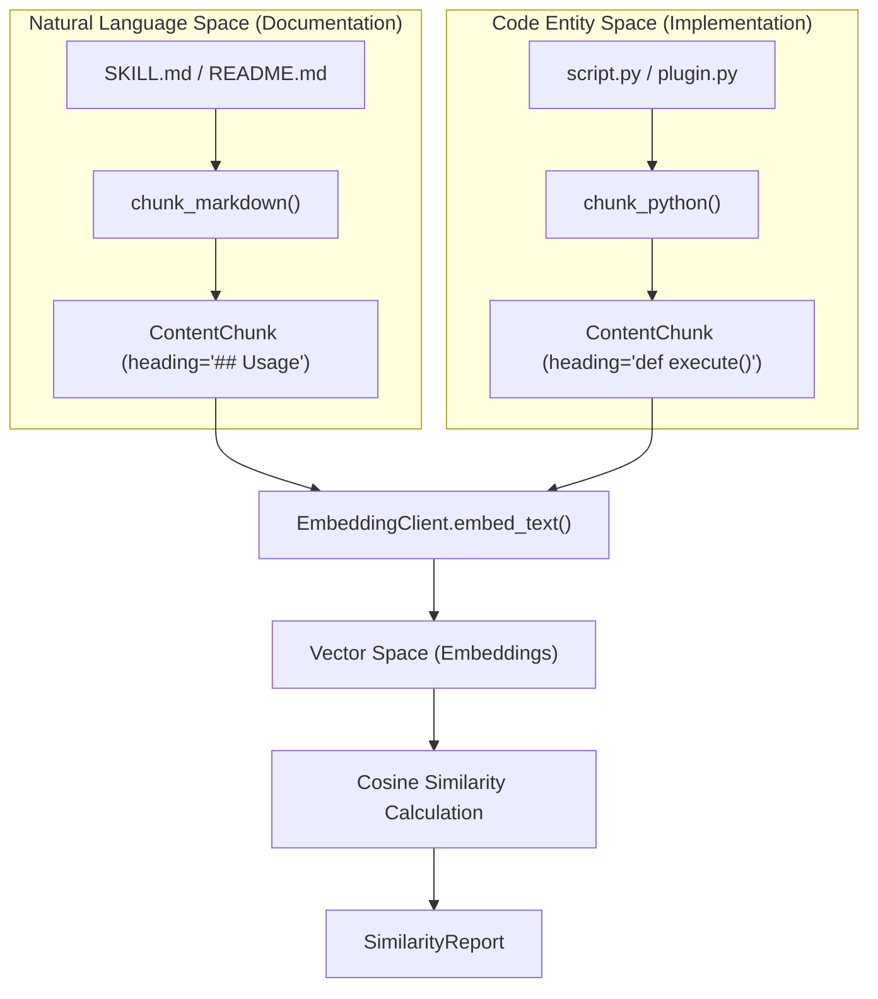
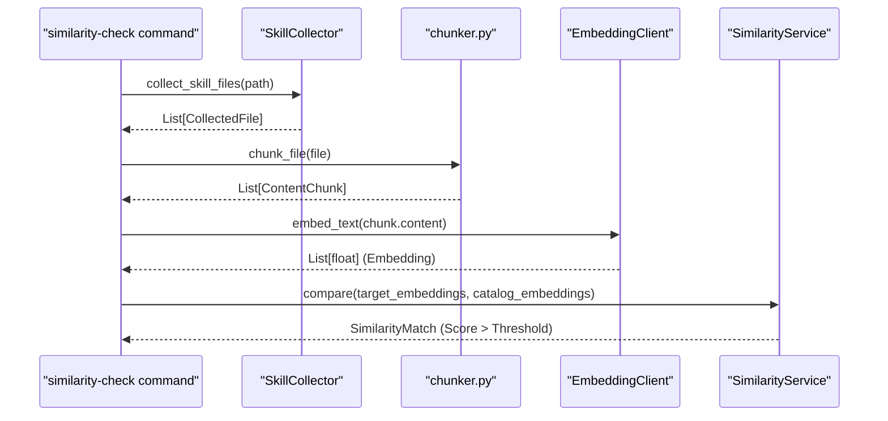

<!-- source: DeepWiki mcp.deepwiki.com · repo NVIDIA/SkillEvaluator · page 4.1 Inter-Skill Similarity Check · fetched 2026-10-26 -->

# Inter-Skill Similarity Check

Relevant source files

The following files were used as context for generating this wiki page:

- [tests/deduplication/utils/test_chunker.py](tests/deduplication/utils/test_chunker.py)

The Inter-Skill Similarity Check is a Tier 2 semantic analysis component designed to detect functional overlap and duplication across the skill catalog. By utilizing vector embeddings and cosine similarity, SkillEvaluator identifies skills that may provide redundant capabilities, ensuring the catalog remains lean and maintainable.

### Overview and Purpose

The similarity check identifies potential duplicates by comparing the semantic content of a skill's documentation and code against a catalog of existing skills. This process is triggered via the `similarity-check` and `dedup-scan` commands [skillevaluator/cli/commands/similarity.py:15-62](). It moves beyond simple keyword matching by using high-dimensional embeddings to understand the intent and implementation details of the skills.

### Key Components

The system relies on several core abstractions to handle embedding generation, data chunking, and similarity calculations.

| Component | Role | Source |
| :--- | :--- | :--- |
| `EmbeddingClient` | Manages communication with embedding models (e.g., NVIDIA, OpenAI). | [skillevaluator/providers/embedding/client.py:17-21]() |
| `ContentChunk` | Data model representing a specific segment of a skill (e.g., a Python function or Markdown section). | [skillevaluator/deduplication/utils/chunker.py:21-34]() |
| `SkillCollector` | Traverses skill directories to gather files for analysis. | [skillevaluator/deduplication/utils/skill_collector.py:44-55]() |
| `SimilarityService` | Coordinates the embedding of chunks and calculation of cosine similarity scores. | [skillevaluator/deduplication/similarity_service.py:18-25]() |

**Sources:** [skillevaluator/providers/embedding/client.py:17-21](), [skillevaluator/deduplication/utils/chunker.py:21-34](), [skillevaluator/deduplication/utils/skill_collector.py:44-55](), [skillevaluator/deduplication/similarity_service.py:18-25]()

---

### Data Flow: From Code to Similarity Scores

The following diagram illustrates how natural language documentation and code entities are transformed into embeddings for similarity comparison.

**Natural Language to Code Entity Mapping**

**Sources:** [skillevaluator/deduplication/utils/chunker.py:84-136](), [skillevaluator/deduplication/utils/chunker.py:167-200](), [skillevaluator/providers/embedding/client.py:55-70]()

---

### Chunking Strategy

To maintain high precision, SkillEvaluator does not embed entire files. Instead, it employs a language-aware chunking strategy to break files into semantically meaningful units.

*   **Markdown:** Chunks are split by headers (e.g., `## Description`). If a section is too large, it is further split into paragraphs [skillevaluator/deduplication/utils/chunker.py:84-159]().
*   **Python:** The system uses the `ast` module to identify module docstrings, class definitions, and function definitions as distinct chunks [skillevaluator/deduplication/utils/chunker.py:167-210]().
*   **Shell:** Identifies function definitions and script headers [skillevaluator/deduplication/utils/chunker.py:220-250]().

#### Configuration Constants
The chunking behavior is governed by specific thresholds to avoid noise from very short snippets:
*   `SIMILARITY_CHUNK_SIZE`: Target size for text segments.
*   `SIMILARITY_CHUNK_OVERLAP`: Overlap between segments to preserve context.
*   `min_chars`: Minimum character count (default 80) for a chunk to be considered for embedding [skillevaluator/deduplication/utils/chunker.py:83-84]().

**Sources:** [skillevaluator/deduplication/utils/chunker.py:83-250]()

---

### Implementation Detail: Embedding and Similarity

The `SimilarityService` orchestrates the comparison between a target skill and the existing catalog.

1.  **Collection**: `SkillCollector` gathers all relevant files, respecting `.gitignore` and exclusion patterns [skillevaluator/deduplication/utils/skill_collector.py:80-110]().
2.  **Embedding**: The `EmbeddingClient` sends text batches to the configured provider (e.g., `NVEmbeddingProvider`) [skillevaluator/providers/embedding/nv_build.py:20-45]().
3.  **Registry**: SkillEvaluator maintains an internal registry of known skills and their pre-computed embeddings to speed up scans.
4.  **Scoring**: The system calculates the cosine similarity between the vector representation of chunks.

**System Entity Interaction**

**Sources:** [skillevaluator/cli/commands/similarity.py:15-62](), [skillevaluator/deduplication/similarity_service.py:40-80](), [skillevaluator/providers/embedding/client.py:55-70]()

### Thresholds and Verdicts

The tool categorizes findings based on the similarity score:
*   **High Similarity (> 0.90)**: Likely a direct duplicate or near-duplicate. Triggers a `CRITICAL` or `HIGH` finding.
*   **Medium Similarity (> 0.75)**: Significant functional overlap. Requires manual review to determine if skills should be merged.
*   **Low Similarity (< 0.75)**: Unique functionality; no deduplication required.

**Sources:** [skillevaluator/deduplication/similarity_service.py:100-125]()

---

