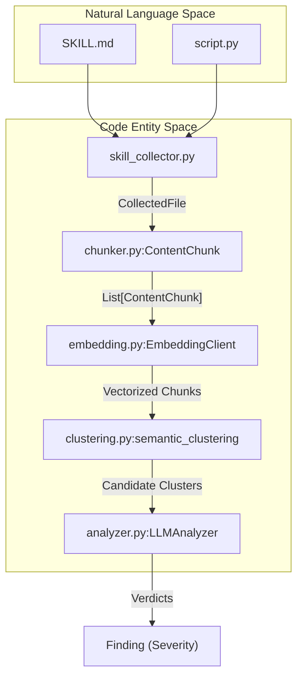
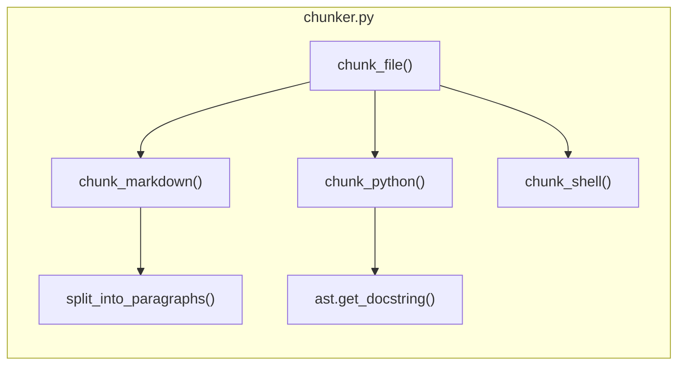

<!-- source: DeepWiki mcp.deepwiki.com · repo NVIDIA/SkillEvaluator · page 4.2 Intra-Skill Context Deduplication · fetched 2026-10-26 -->

# Intra-Skill Context Deduplication

Relevant source files

The following files were used as context for generating this wiki page:

- [docs/tier2-deduplication.mdx](docs/tier2-deduplication.mdx)
- [pyproject.toml](pyproject.toml)
- [src/skillevaluator/cli_help.py](src/skillevaluator/cli_help.py)
- [src/skillevaluator/deduplication/utils/chunker.py](src/skillevaluator/deduplication/utils/chunker.py)
- [src/skillevaluator/evaluation/__init__.py](src/skillevaluator/evaluation/__init__.py)

The **Intra-Skill Context Deduplication** system (invoked via `context-optimization-check` or its alias `dedup-scan`) is a Tier 2 validation pipeline designed to identify redundant information within a single skill's directory [docs/tier2-deduplication.mdx:21-25](). As skills grow, they often accumulate repeated guidance across `SKILL.md`, reference documents, and script docstrings, which unnecessarily consumes the LLM's context window [docs/tier2-deduplication.mdx:54-57]().

This system uses a hybrid approach: **Embedding-based clustering** identifies potential overlaps, and a **Chat-LLM verification** stage classifies the intent of the similarity to filter out intentional repetitions like progressive disclosure [docs/tier2-deduplication.mdx:59-62]().

## Pipeline Overview

The analysis follows a linear data flow from raw files to verified findings:

1.  **Collect**: Gathers relevant files (`.md`, `.py`, `.sh`, etc.) while stripping valid frontmatter and excluding boilerplate like SPDX headers [docs/tier2-deduplication.mdx:50-51, 87-94]().
2.  **Chunk**: Decomposes files into `ContentChunk` objects using strategy-specific logic for Markdown, Python, and Shell scripts [src/skillevaluator/deduplication/utils/chunker.py:33-41]().
3.  **Embed**: Generates high-dimensional vectors for each chunk using the configured embedding provider [docs/tier2-deduplication.mdx:66-66]().
4.  **Cluster**: Uses Union-Find clustering to group chunks with a cosine similarity above the threshold (default `0.8`) [docs/tier2-deduplication.mdx:77-77, 45-45]().
5.  **LLM Analyze**: Sends candidate clusters to a Chat-LLM to determine if the overlap is a `DUPLICATE`, `INTENTIONAL_DETAIL`, or `RELATED_BUT_DISTINCT` [docs/tier2-deduplication.mdx:101-105]().

### Data Flow and Code Entity Mapping

The following diagram illustrates how the natural language content transitions through code entities within the `skillevaluator.deduplication` namespace.

**System Architecture: Content to Finding**

**Sources:** [src/skillevaluator/deduplication/utils/chunker.py:33-41](), [docs/tier2-deduplication.mdx:64-68]().

## Chunking Strategies

The `chunk_file` function routes files to specific chunkers based on extension [src/skillevaluator/deduplication/utils/chunker.py:49-61]().

| Strategy | File Types | Logic |
| :--- | :--- | :--- |
| **Markdown** | `.md`, `.mdc` | Heading-based sections. Sections > 3000 chars are split at paragraphs [docs/tier2-deduplication.mdx:89-89](). |
| **Python** | `.py` | AST-based extraction of module docstrings and function/class signatures with their docstrings [docs/tier2-deduplication.mdx:90-90](). |
| **Shell** | `.sh` | Function bodies and comment blocks of 3+ consecutive lines [docs/tier2-deduplication.mdx:91-91](). |

**Code Entity Detail: Chunker Logic**

**Sources:** [src/skillevaluator/deduplication/utils/chunker.py:49-165]().

## Semantic Clustering and LLM Verification

After embedding, chunks are processed by the `semantic_clustering` utility. It uses a Union-Find algorithm to group all chunks that meet the cosine similarity threshold [docs/tier2-deduplication.mdx:45-45]().

### LLM Verdicts
The LLM verification stage is critical to prevent false positives. It produces one of the following verdicts [docs/tier2-deduplication.mdx:101-105]():

*   **`DUPLICATE`**: Redundant information. Action: Consolidate.
*   **`INTENTIONAL_DETAIL`**: Summary vs. Deep-dive. Action: Keep.
*   **`RELATED_BUT_DISTINCT`**: Different angles on the same topic. Action: Keep.

### Severity Mapping
If a `DUPLICATE` is found, the `IntraSkillValidator` assigns severity based on the LLM's confidence score [docs/tier2-deduplication.mdx:109-113]():

| Condition | Severity |
| :--- | :--- |
| `DUPLICATE` + Confidence ≥ 0.70 | **HIGH** (Blocking) |
| `DUPLICATE` + Confidence < 0.70 | **MEDIUM** (Advisory) |
| Short, same-file duplicate (comments/config) | **LOW** (Advisory) |

## Implementation Details

### Key Classes
*   **`ContentChunk`**: A dataclass storing the source file, heading, line ranges, text, and its embedding vector [src/skillevaluator/deduplication/utils/chunker.py:33-42]().
*   **`IntraSkillValidator`**: The primary Tier 2 validator that orchestrates the collection and analysis [docs/tier2-deduplication.mdx:22-25]().

### Configuration
The check respects the following CLI flags [docs/tier2-deduplication.mdx:75-80]():
*   `--threshold`: Minimum cosine score for clustering (default: `0.8`).
*   `--llm-model`: The Chat-LLM used for the verification stage.
*   `--model`: The embedding model used for initial similarity detection.

**Sources:**
* [docs/tier2-deduplication.mdx:1-118]()
* [src/skillevaluator/deduplication/utils/chunker.py:1-210]()
* [src/skillevaluator/constants.py:1-20]() (implied by min_chars)

---

