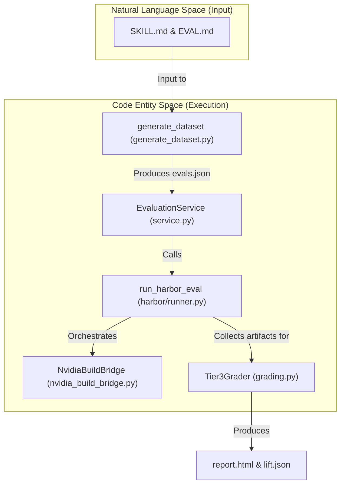
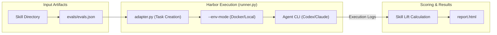

<!-- source: DeepWiki mcp.deepwiki.com · repo NVIDIA/SkillEvaluator · page 5 Tier 3: Live Agent Evaluation · fetched 2026-10-26 -->

# Tier 3: Live Agent Evaluation

Relevant source files

The following files were used as context for generating this wiki page:

- [docs/agents-and-sandboxes.mdx](docs/agents-and-sandboxes.mdx)
- [docs/tier3-live-evaluation.mdx](docs/tier3-live-evaluation.mdx)
- [src/skillevaluator/evaluation/service.py](src/skillevaluator/evaluation/service.py)
- [src/skillevaluator/tier3/commands.py](src/skillevaluator/tier3/commands.py)

Tier 3 is the most rigorous stage of the SkillEvaluator pipeline. It answers the critical question: **does a skill actually improve an agent's performance on a real-world task?** While Tier 1 and Tier 2 focus on static validation and semantic optimization, Tier 3 executes live agents within sandboxed environments to measure "Skill Lift"—the quantitative improvement in agent performance when the skill is present versus when it is absent.

## Overview and Integration
Tier 3 is integrated into the `skillevaluator` CLI via the `tier3 evaluate` command group [src/skillevaluator/evaluation/service.py:30-41](). It is also triggered as an advisory check during the `validate` command if the `--tier3` flag is provided.

The Tier 3 lifecycle follows a structured path:
1.  **Dataset Generation**: Creating synthetic test cases based on the skill's documentation.
2.  **Environment Preparation**: Setting up isolated sandboxes (Docker, Local, or Harbor-native).
3.  **Execution**: Running the agent (e.g., `codex`, `claude-code`) in two arms: **with-skill** and **baseline**.
4.  **Grading**: Evaluating the resulting agent trajectories using LLM-as-a-judge and deterministic metrics.
5.  **Reporting**: Aggregating results into a unified Skill Lift report.

### System Architecture: Tier 3 Lifecycle
The following diagram bridges the high-level evaluation concepts to the specific code entities that manage the lifecycle.

Sources: [src/skillevaluator/evaluation/service.py:27-41](), [src/skillevaluator/tier3/harbor/runner.py:43-49](), [docs/tier3-live-evaluation.mdx:137-149]()

---

## Subsystem Overviews

### 1. Eval Dataset Generation
The evaluation begins with `create-eval-dataset`. This subsystem uses a 4-layer LLM context strategy to transform a skill's `SKILL.md` and `EVAL.md` files into a structured `evals.json` dataset. It generates four types of cases: explicit, implicit, and contextual positives, plus negative cases to test for false triggers.

For details, see [Eval Dataset Generation](#5.1).

Sources: [docs/tier3-live-evaluation.mdx:72-83](), [src/skillevaluator/evaluation/service.py:73-78]()

### 2. Harbor Runner and Sandboxes
SkillEvaluator leverages the **Harbor** framework to execute agent trials. The `harbor/runner.py` module converts the `evals.json` dataset into Harbor-compatible task directories. It supports multiple `--env-mode` backends, with `docker` being the default. It also manages `SkillEvaluatorSecureDockerEnvironment` for safe credential handoff.

For details, see [Harbor Runner and Sandbox Environments](#5.2).

Sources: [docs/agents-and-sandboxes.mdx:13-15](), [src/skillevaluator/tier3/harbor/runner.py:127-143]()

### 3. NVIDIA Build Bridge and Agent Compatibility
To ensure compatibility between different agent CLIs and LLM providers, SkillEvaluator includes a loopback bridge (`nvidia_build_bridge.py`). This allows agents like `codex` (which expects OpenAI APIs) and `claude-code` (which expects Anthropic APIs) to run against NVIDIA Build endpoints. It handles multi-turn tool-call continuation and credential isolation via capability tokens.

For details, see [NVIDIA Build Bridge and Agent Compatibility](#5.3).

Sources: [docs/agents-and-sandboxes.mdx:57-75](), [docs/agents-and-sandboxes.mdx:92-99]()

### 4. Grading, Metrics, and Reporting
After execution, transcripts are graded across five dimensions: **Security, Correctness, Discoverability, Effectiveness, and Efficiency**. The `Skill Lift` is calculated as the delta between the with-skill and baseline arms. Results are rendered into a `report.html` and a `BENCHMARK.md` summary.

For details, see [Grading, Metrics, and Tier 3 Reporting](#5.4).

Sources: [docs/tier3-live-evaluation.mdx:27-36](), [src/skillevaluator/evaluation/tier3_report.py:27-27]()

### 5. Reference Skills
SkillEvaluator bundles five reference skills (e.g., `api-caller`, `calculator`) that serve as both templates for developers and integration test fixtures for the Tier 3 pipeline.

For details, see [Reference Skills](#5.5).

Sources: [docs/tier3-live-evaluation.mdx:15-16]()

---

## Tier 3 Data Flow
The following diagram illustrates how data flows from the skill definition through the Harbor execution environment and into the final report.

Sources: [src/skillevaluator/tier3/harbor/runner.py:48-49](), [docs/tier3-live-evaluation.mdx:108-122](), [src/skillevaluator/tier3/commands.py:108-122]()

## Command Summary

| Command | Role | Key File |
| :--- | :--- | :--- |
| `create-eval-dataset` | Generates `evals.json` using LLM synthesis | `generate_dataset.py` |
| `tier3 evaluate` | Executes the A/B test in a sandbox | `harbor/runner.py` |
| `compare` | Summarizes results across multiple agents/runs | `commands.py` |
| `view` | Opens the timestamped HTML report | `commands.py` |

Sources: [src/skillevaluator/tier3/commands.py:1-49](), [docs/tier3-live-evaluation.mdx:126-133]()

---

