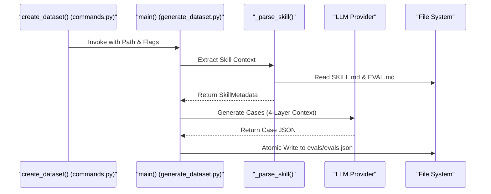

<!-- source: DeepWiki mcp.deepwiki.com · repo NVIDIA/SkillEvaluator · page 5.1 Eval Dataset Generation · fetched 2026-10-26 -->

# Eval Dataset Generation

<details>
<summary>Relevant source files</summary>

The following files were used as context for generating this wiki page:

- [docs/eval-datasets.mdx](docs/eval-datasets.mdx)
- [src/skillevaluator/tier3/generate_dataset.py](src/skillevaluator/tier3/generate_dataset.py)
- [tests/tier3/test_generate_dataset_results.py](tests/tier3/test_generate_dataset_results.py)

</details>


The `create-eval-dataset` command is responsible for bootstrapping the `evals/evals.json` file, which serves as the primary data source for Tier 3 live agent evaluations [docs/eval-datasets.mdx:6-9](). It utilizes a multi-layered context strategy to ground generated test cases in the skill's actual implementation and developer-provided guidance [src/skillevaluator/tier3/generate_dataset.py:19-24]().

## 4-Layer LLM Context Strategy

The generator builds context cumulatively. Each layer adds more grounding to ensure the LLM produces relevant, executable, and challenging evaluation cases [src/skillevaluator/tier3/generate_dataset.py:19-24]().

| Layer | Source | Description |
| :--- | :--- | :--- |
| **Layer 1** | `SKILL.md` Frontmatter | Metadata: Name, description, and detected script filenames [src/skillevaluator/tier3/generate_dataset.py:20](). |
| **Layer 2** | `SKILL.md` Body | Full content (up to 4000 chars) to understand implementation details [src/skillevaluator/tier3/generate_dataset.py:21](). |
| **Layer 3** | `evals/EVAL.md` | Developer guidance containing sample questions and behaviors [src/skillevaluator/tier3/generate_dataset.py:22](). |
| **Layer 4** | Agent Trajectory | Real execution logs from Harbor used to refine ground truth (requires `--refine`) [src/skillevaluator/tier3/generate_dataset.py:23](). |

### Data Flow: From Source to Dataset

The following diagram illustrates how the `generate_dataset.py` logic transforms source files into the final `evals.json` structure.

**Figure 1: Context Aggregation and Dataset Output**
```mermaid
graph TD
    subgraph "Natural Language Space"
        SKILL["SKILL.md"]
        EVAL_MD["evals/EVAL.md"]
    end

    subgraph "Code Entity Space"
        SCRIPTS["scripts/*.py"]
        TRAJ["trajectory.json"]
    end

    SKILL -->|[_parse_skill]| PARSER["_parse_skill()"]
    SCRIPTS -->|[_parse_skill]| PARSER
    EVAL_MD -->|[_extract_eval_hints]| PARSER
    TRAJ -->|[_discover_trajectories]| REFINE["_run_agent_collect_trajectories()"]

    PARSER -->|Context Layers 1-3| LLM["LLM Generator"]
    REFINE -->|Context Layer 4| LLM

    LLM -->|Internal Case Shape| CONV["_to_agentskills_dataset()"]
    CONV -->|JSON Output| OUT["evals/evals.json"]
```
Sources: [src/skillevaluator/tier3/generate_dataset.py:19-40](), [src/skillevaluator/tier3/generate_dataset.py:90-156](), [src/skillevaluator/tier3/generate_dataset.py:62-87]().

## Generation Modes

The generator supports several modes to balance speed, cost, and quality [src/skillevaluator/tier3/generate_dataset.py:12-17]():

*   **Standard (Default)**: Generates 1 case using the configured LLM provider [src/skillevaluator/tier3/generate_dataset.py:13]().
*   **Full (`--full`)**: Generates a 4-bucket dataset (Explicit, Implicit, Contextual, and Negative cases) [docs/eval-datasets.mdx:152-160]().
*   **Local (`--no-llm`)**: Uses local deterministic templates. No API key required [docs/eval-datasets.mdx:124]().
*   **Refine (`--refine`)**: Reads existing agent trajectories from `evals/results/` to improve `expected_output` and `assertions` based on real tool-call behavior [src/skillevaluator/tier3/generate_dataset.py:34-39]().

## The `evals/` Directory Structure

The `evals/` directory acts as the contract for Tier 3 evaluations [docs/eval-datasets.mdx:7-9]().

| File | Role |
| :--- | :--- |
| `evals.json` | **Required.** The dataset in `agentskills.io` format [docs/eval-datasets.mdx:47](). |
| `config.yml` | Run policy: attempts, agent models, and environment modes [docs/eval-datasets.mdx:48](). |
| `EVAL.md` | Developer guidance for the LLM generator [docs/eval-datasets.mdx:49](). |
| `files/` | Fixtures staged into `/workspace/input/` during evaluation [docs/eval-datasets.mdx:50](). |

Sources: [docs/eval-datasets.mdx:19-54]().

## Output Format: `evals.json`

The output follows the `agentskills.io` schema to ensure compatibility with broader agent evaluation tooling [docs/eval-datasets.mdx:61-62]().

### Mapping Internal Models to agentskills.io
The `_to_agentskills_dataset` function maps internal runtime shapes to the persistent JSON format [src/skillevaluator/tier3/generate_dataset.py:62-63]().

| agentskills.io Field | Internal Field | Description |
| :--- | :--- | :--- |
| `prompt` | `question` | The request sent to the agent [docs/eval-datasets.mdx:104](). |
| `expected_output` | `ground_truth` | Description of successful outcome [docs/eval-datasets.mdx:105](). |
| `assertions` | `expected_behavior` | List of observable behaviors to verify [docs/eval-datasets.mdx:106](). |

Sources: [src/skillevaluator/tier3/generate_dataset.py:65-87](), [docs/eval-datasets.mdx:97-110]().

## Implementation Detail: `_parse_skill`

The `_parse_skill` function in `generate_dataset.py` is the primary engine for gathering context [src/skillevaluator/tier3/generate_dataset.py:90]().

1.  **Frontmatter Extraction**: Parses `SKILL.md` for `name` and `description` [src/skillevaluator/tier3/generate_dataset.py:108-115]().
2.  **Script Discovery**: Scans the `scripts/` directory for Python files [src/skillevaluator/tier3/generate_dataset.py:117-119]().
3.  **Interactivity Detection**: Scans `SKILL.md` for keywords (e.g., "browser", "device code") associated with script names to mark them as `interactive_scripts` [src/skillevaluator/tier3/generate_dataset.py:121-130]().
4.  **Guidance Loading**: Prioritizes CLI `--prompt` files over the default `evals/EVAL.md` [src/skillevaluator/tier3/generate_dataset.py:132-147]().

**Figure 2: Component Interaction for Dataset Generation**

Sources: [src/skillevaluator/tier3/generate_dataset.py:79-112](), [tests/tier3/test_generate_dataset_results.py:183-196]().

## Dataset Options and Results

The generation process is managed via the `DatasetOptions` model and returns a `DatasetGenerationResult` [src/skillevaluator/tier3/generate_dataset.py:54]().

*   **Status Codes**: The result status can be `created` (new file), `unchanged` (matches existing), or `preview` (dry-run) [tests/tier3/test_generate_dataset_results.py:114-177]().
*   **Error Handling**: If a write fails (e.g., disk full), the generator ensures the original `evals.json` is preserved via atomic operations or permission checks [tests/tier3/test_generate_dataset_results.py:120-143]().

Sources: [src/skillevaluator/tier3/generate_dataset.py:54](), [tests/tier3/test_generate_dataset_results.py:104-182]().

---

