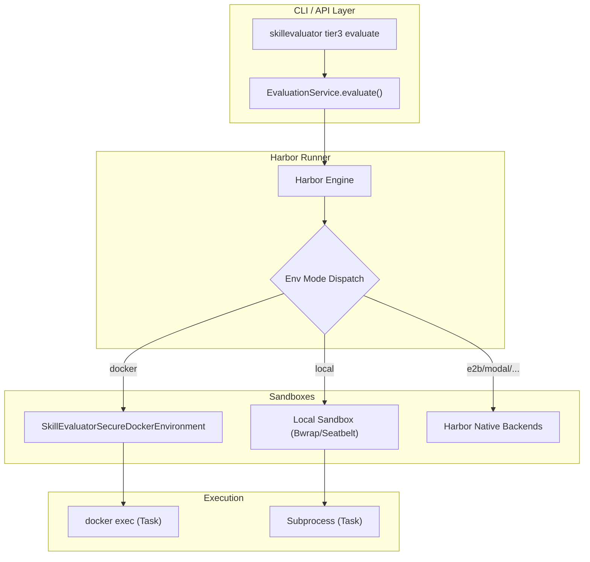
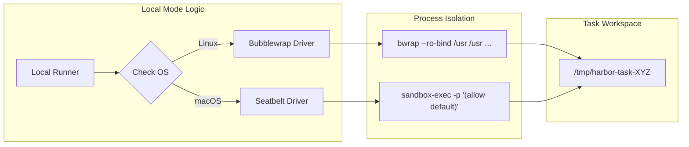

<!-- source: DeepWiki mcp.deepwiki.com · repo NVIDIA/SkillEvaluator · page 5.2 Harbor Runner and Sandbox Environments · fetched 2026-10-26 -->

# Harbor Runner and Sandbox Environments

Relevant source files

The following files were used as context for generating this wiki page:

- [docs/agents-and-sandboxes.mdx](docs/agents-and-sandboxes.mdx)
- [tests/reporting/test_unified_tier3_report.py](tests/reporting/test_unified_tier3_report.py)
- [tests/test_evaluation_service.py](tests/test_evaluation_service.py)
- [tests/test_harbor_input_staging.py](tests/test_harbor_input_staging.py)

The Harbor runner is the execution engine for SkillEvaluator Tier 3 live evaluations. It bridges the gap between static skill definitions and dynamic agent trajectories by orchestrating sandboxed environments where agents attempt tasks. It utilizes the [Harbor framework](https://github.com/harbor-framework/harbor) to provide a consistent interface across local, containerized, and cloud-native backends.

## Harbor Adapter and Task Staging

The conversion from a skill's `evals/evals.json` to executable Harbor tasks is handled by the Harbor adapter. This component is responsible for environment discovery, task directory preparation, and input file staging.

### Data Flow: evals.json to Harbor Tasks

When a Tier 3 evaluation starts, the `evaluate` command invokes the Harbor adapter to transform the dataset into a set of Harbor `Task` objects.

1.  **Entry Processing**: Each evaluation case in `evals.json` is treated as a unique task [skillevaluator/tier3/harbor/adapter.py:18-22]().
2.  **Input Staging**: The adapter stages both global files (from `evals/files/`) and entry-specific files (referenced in the `files` field of an eval case) into a temporary `input/` directory within the Harbor task workspace [tests/test_harbor_input_staging.py:4-10]().
3.  **Traversal Protection**: During staging, the adapter enforces strict path resolution to prevent directory traversal attacks, ensuring all staged files remain within the skill's `evals/` boundary [tests/test_harbor_input_staging.py:78-84]().

### Baseline vs. With-Skill Pairs
To calculate "Skill Lift," the runner typically executes two variants of every task:
*   **Baseline**: The agent is provided with the task prompt but no access to the skill's tools or documentation.
*   **With-Skill**: The agent is provided with the full skill context, including `SKILL.md` and any associated tools [skillevaluator/evaluation/tier3_report.py:37-38]().

### System Entity Mapping: Harbor Adapter

| Logical Concept | Code Entity | File |
| :--- | :--- | :--- |
| Task Staging Logic | `_stage_task_inputs` | [skillevaluator/tier3/harbor/adapter.py:21]() |
| File Reference Resolver | `_resolve_entry_file_ref` | [skillevaluator/tier3/harbor/adapter.py:20]() |
| Metric Definitions | `DEFAULT_METRICS` | [skillevaluator/tier3/harbor/metrics.py:27]() |

**Sources:** [skillevaluator/tier3/harbor/adapter.py:1-22](), [tests/test_harbor_input_staging.py:1-95](), [skillevaluator/evaluation/tier3_report.py:30-54]()

---

## Supported Environment Modes

SkillEvaluator supports 16 different `--env-mode` backends through Harbor. These backends determine where the agent CLI and the task code actually execute.

| Mode | Backend Type | Description |
| :--- | :--- | :--- |
| `docker` | Container | **Default.** Runs tasks in a local Docker container using a secure environment wrapper [docs/agents-and-sandboxes.mdx:134](). |
| `local` | OS Sandbox | Runs tasks directly on the host OS using Bubblewrap (Linux) or Seatbelt (macOS) [docs/agents-and-sandboxes.mdx:127-128](). |
| `e2b` / `modal` | Cloud | Remote serverless sandboxes for agent execution [docs/agents-and-sandboxes.mdx:136-137](). |
| `gke` | Kubernetes | Orchestrates trials across a Google Kubernetes Engine cluster [docs/agents-and-sandboxes.mdx:140](). |

### Environment Dispatch Architecture

The `EvaluationService` receives the `--env-mode` flag and passes it to the Harbor engine, which selects the appropriate driver [skillevaluator/evaluation/results.py:25-30]().

**Sources:** [docs/agents-and-sandboxes.mdx:127-148](), [skillevaluator/evaluation/results.py:25-31](), [tests/test_evaluation_service.py:104-110]()

---

## Secure Docker Environment

The `SkillEvaluatorSecureDockerEnvironment` is a specialized wrapper around the standard Docker backend. It is designed to handle sensitive credential handoff without exposing secrets to the container's command-line arguments or environment variables in a way that could be leaked via `docker inspect` or `ps`.

### Credential Handoff Mechanism
1.  **File-Backed Credentials**: Instead of passing `NVIDIA_API_KEY` via `-e` (environment variable), the runner writes the key to a temporary file on the host [docs/agents-and-sandboxes.mdx:94-95]().
2.  **Volume Mounting**: This file is mounted into the container at a restricted path.
3.  **Agent Access**: The agent CLI is configured to read the key from this file path, ensuring the secret never appears in the process tree [docs/agents-and-sandboxes.mdx:92-95]().

**Sources:** [docs/agents-and-sandboxes.mdx:59-101](), [tests/test_evaluation_service.py:104-110]()

---

## OS-Level Local Sandboxes

When `--env-mode local` is used, SkillEvaluator executes the agent and task directly on the host operating system. To prevent the agent from causing accidental damage or accessing sensitive user files, it employs OS-native sandboxing technologies.

### Implementation by OS
*   **Linux (Bubblewrap)**: Uses `bwrap` to create unprivileged containers. It utilizes namespaces (mount, IPC, UTS, network, PID) to isolate the process. By default, it provides a read-only view of the filesystem, except for the specific task workspace.
*   **macOS (Seatbelt)**: Uses the `sandbox-exec` (Seatbelt) profile system to restrict the process's ability to read/write files outside of the task directory and limits network access.

### Network Isolation
Local mode respects the `SKILLEVALUATOR_LOCAL_ALLOW_NET` variable. If disabled (default), the sandbox is configured without a network interface (Linux) or with a "no-network" Seatbelt profile (macOS). However, if an agent requires NVIDIA Build models, network access must be explicitly enabled [docs/agents-and-sandboxes.mdx:103-106]().

### Code Entity Space: Local Execution

**Sources:** [docs/agents-and-sandboxes.mdx:127-148](), [docs/agents-and-sandboxes.mdx:103-107]()

---

