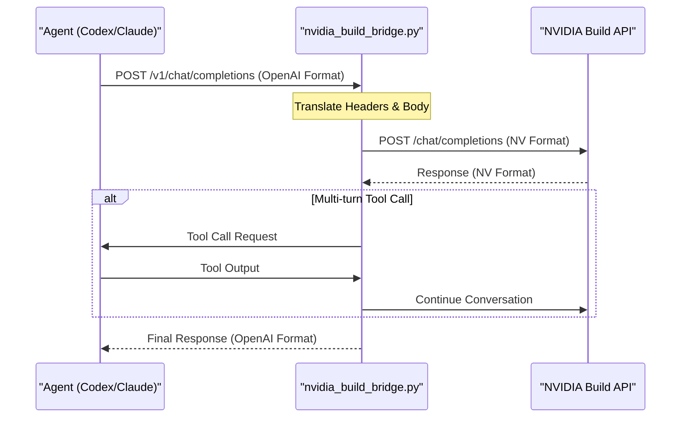
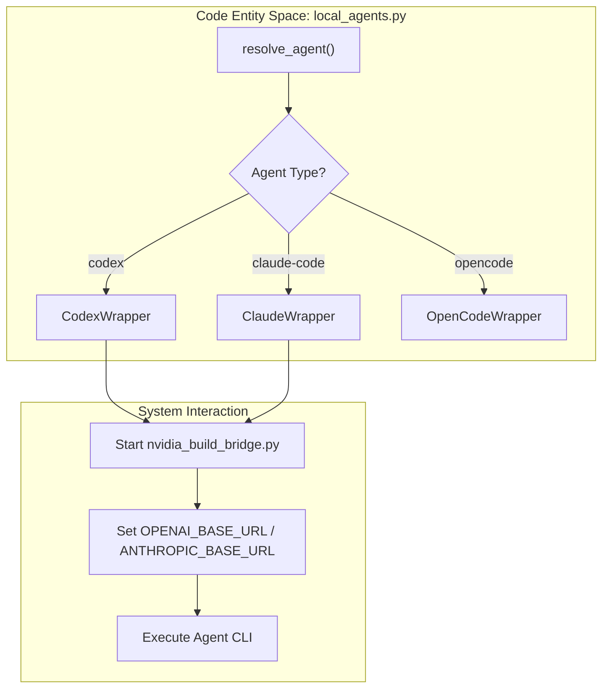

<!-- source: DeepWiki mcp.deepwiki.com · repo NVIDIA/SkillEvaluator · page 5.3 NVIDIA Build Bridge and Agent Compatibility · fetched 2026-10-26 -->

# NVIDIA Build Bridge and Agent Compatibility

Relevant source files

The following files were used as context for generating this wiki page:

- [.github/CODEOWNERS](.github/CODEOWNERS)
- [CHANGELOG.md](CHANGELOG.md)
- [tests/test_oss_packaging.py](tests/test_oss_packaging.py)

This section details the loopback compatibility bridge and the agent wrappers that enable external agent frameworks—such as Codex, Claude Code, and OpenCode—to operate within the SkillEvaluator Tier 3 evaluation pipeline using NVIDIA Build endpoints.

## Purpose and Scope

The Tier 3 evaluation pipeline requires agents to interact with LLMs to perform tasks. While SkillEvaluator supports direct NVIDIA Build integration, many third-party agent frameworks are hardcoded to use OpenAI or Anthropic API schemas. The `nvidia_build_bridge.py` acts as a local proxy that intercepts these calls, translates them into NVIDIA Build Chat Completions, and manages complex behaviors like multi-turn tool-call continuation and credential isolation [CHANGELOG.md:15-17]().

## The NVIDIA Build Bridge (`nvidia_build_bridge.py`)

The bridge is a local loopback service that provides a compatibility layer for agents expecting standard vendor APIs. It translates incoming requests into the NVIDIA Build format, ensuring that agents can function without modification to their core networking logic.

### Key Capabilities
*   **API Translation**: Converts OpenAI `v1/chat/completions` and Anthropic `v1/messages` requests into NVIDIA Build-compatible payloads [CHANGELOG.md:15-17]().
*   **Multi-turn Tool Continuation**: Handles the iterative loop of tool calls and responses required by sophisticated agents [CHANGELOG.md:15-17]().
*   **Dynamic Loopback**: Starts on a dynamic port to avoid collisions and uses authenticated readiness checks for secure startup [CHANGELOG.md:33-34]().

### Credential Isolation and Security
To prevent agent processes from accessing sensitive NVIDIA API keys directly, the bridge implements a "capability token" pattern:
1.  **Transient Key Handoff**: NVIDIA Build credentials are isolated from vendor CLI processes using a root-managed, container-only key handoff [CHANGELOG.md:28-29]().
2.  **Process Binding**: The bridge is bound to the specific evaluation process, and keys are cleaned up immediately on failure [CHANGELOG.md:28-29]().
3.  **Host-Only Secrets**: Secrets are removed from Harbor and Docker execution arguments. Instead, a host-only key file and a non-secret subprocess sentinel are used [CHANGELOG.md:30-32]().

### Data Flow: Agent to NVIDIA Build
The following diagram illustrates how an agent's request is intercepted and transformed.

**Bridge Translation Sequence**

Sources: [CHANGELOG.md:15-17](), [CHANGELOG.md:33-34](), [tests/test_oss_packaging.py:43-47]()

## Local Agent Wrappers (`local_agents.py`)

The `local_agents.py` module provides thin wrappers for specific agent implementations. These wrappers configure the environment so that the agents point their base URLs to the local `nvidia_build_bridge.py` instance.

### Supported Agents
| Agent | Wrapper Class / Entity | Description |
| :--- | :--- | :--- |
| **OpenCode** | `opencode` | Direct support for NVIDIA's OpenCode models [CHANGELOG.md:15-17](). |
| **Codex** | `codex` | Integration via the compatibility bridge [CHANGELOG.md:15-17](). |
| **Claude Code** | `claude-code` | Experimental support for Anthropic's Claude Code via the bridge [CHANGELOG.md:15-17](). |

### Model Resolution
The wrappers automatically resolve default models if specific flags are omitted:
*   **NVIDIA Build Default**: `nvidia/nemotron-3-nano-30b-a3b` [CHANGELOG.md:61-63]().
*   **OpenAI Default**: `gpt-5.4-mini` [CHANGELOG.md:61-63]().

### Agent Initialization Logic

Sources: [CHANGELOG.md:15-17](), [CHANGELOG.md:61-63](), [tests/test_oss_packaging.py:43-47]()

## Implementation Details

### Bridge Lifecycle
The bridge is managed as a subprocess during the Tier 3 evaluation. It is responsible for:
1.  **Startup**: Finding an available port and initializing the HTTP server.
2.  **Authentication**: Verifying the capability token provided by the Harbor runner.
3.  **Shutdown**: Cleaning up transient credential files upon receiving a SIGTERM or when the parent process exits [CHANGELOG.md:28-34]().

### File Locations
The following files implement the bridge and agent compatibility logic:
*   `skillevaluator/tier3/harbor/nvidia_build_bridge.py`: The core proxy logic [tests/test_oss_packaging.py:45]().
*   `skillevaluator/tier3/harbor/local_agents.py`: Agent-specific configuration and CLI execution [tests/test_oss_packaging.py:44]().
*   `skillevaluator/tier3/harbor/secure_docker_environment.py`: Manages the secure handoff of credentials to the bridge within Docker containers [tests/test_oss_packaging.py:46]().

### Error Handling
The bridge reports structured failures back to the Tier 3 runner. For example, if NVIDIA Build capacity is exhausted, the bridge ensures this is reported as a provider failure rather than a generic agent crash, preventing the agent from being unfairly penalized in the final report [CHANGELOG.md:66-68]().

Sources: [CHANGELOG.md:28-34](), [CHANGELOG.md:66-68](), [tests/test_oss_packaging.py:43-47]()

---

