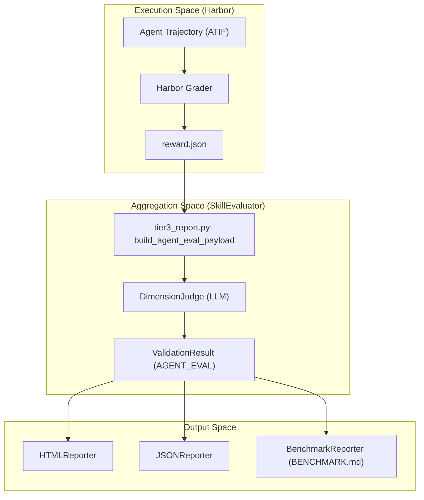

<!-- source: DeepWiki mcp.deepwiki.com · repo NVIDIA/SkillEvaluator · page 5.4 Grading, Metrics, and Tier 3 Reporting · fetched 2026-10-26 -->

# Grading, Metrics, and Tier 3 Reporting

Relevant source files

The following files were used as context for generating this wiki page:

- [docs/custom-graders.mdx](docs/custom-graders.mdx)
- [src/skillevaluator/evaluation/dimension_judge.py](src/skillevaluator/evaluation/dimension_judge.py)
- [src/skillevaluator/evaluation/results.py](src/skillevaluator/evaluation/results.py)
- [src/skillevaluator/evaluation/tier3_report.py](src/skillevaluator/evaluation/tier3_report.py)
- [src/skillevaluator/tier3/result_display.py](src/skillevaluator/tier3/result_display.py)
- [tests/reporting/test_unified_tier3_report.py](tests/reporting/test_unified_tier3_report.py)
- [tests/test_tier3_result_display.py](tests/test_tier3_result_display.py)

The SkillEvaluator Tier 3 pipeline transforms raw agent execution logs into structured quality dimensions. This process involves executing agent trajectories through the Harbor framework, applying deterministic and LLM-based graders, and aggregating the results into a stakeholder-facing report.

## The Six Default Metrics

Every Tier 3 evaluation attempt is scored against six core metrics by default. These metrics are calculated per trial (eval case) and then averaged across the dataset to produce a `with_skill` and `baseline` score.

| Metric | Code Symbol | Description |
| :--- | :--- | :--- |
| **Security** | `security` | Detects unsafe operations (secrets leakage, destructive commands). |
| **Skill Execution** | `skill_execution` | Validates if the agent correctly loaded and invoked the skill. |
| **Skill Efficiency** | `skill_efficiency` | Measures if the agent used the skill optimally without redundant tool calls. |
| **Accuracy** | `accuracy` | Matches the agent's final answer against the `expected_output`. |
| **Goal Accuracy** | `goal_accuracy` | Assesses if the high-level objective defined in the case was met. |
| **Behavior Check** | `behavior_check` | Validates agent adherence to `expected_behavior` constraints. |

**Sources:** [src/skillevaluator/evaluation/dimension_judge.py:49-75](), [src/skillevaluator/tier3/harbor/metrics.py:27-27]()

## Dimension Aggregation and LLM Judge

To make technical metrics readable for stakeholders, SkillEvaluator maps the six raw metrics into five **Quality Dimensions**. This mapping is performed by the `DimensionJudge` class, which uses an LLM (defaulting to `gpt-4o`) to provide natural language reasoning for each score [src/skillevaluator/evaluation/dimension_judge.py:138-144]().

### Mapping Logic

The `DimensionJudge` follows a specific mapping schema defined in `DIMENSION_MAPPING`:

*   **Security**: Maps to `security` (fallback to `behavior_check`) [src/skillevaluator/evaluation/dimension_judge.py:51-55]().
*   **Correctness**: Maps to `skill_execution` + `accuracy` [src/skillevaluator/evaluation/dimension_judge.py:57-61]().
*   **Discoverability**: Maps to `skill_execution` + `skill_efficiency` [src/skillevaluator/evaluation/dimension_judge.py:62-66]().
*   **Effectiveness**: Maps to `goal_accuracy` + `behavior_check` + `accuracy` [src/skillevaluator/evaluation/dimension_judge.py:68-71]().
*   **Efficiency**: Maps to `skill_efficiency` + `token_efficiency` [src/skillevaluator/evaluation/dimension_judge.py:72-75]().

### Scoring and Verdicts
The judge produces a score (0.0-1.0) and a verdict based on fixed thresholds:
*   **PASS**: Score $\ge$ 0.70 [src/skillevaluator/evaluation/dimension_judge.py:79-79]().
*   **NEUTRAL**: Score 0.40 - 0.70 [src/skillevaluator/evaluation/dimension_judge.py:79-79]().
*   **FAIL**: Score $<$ 0.40 [src/skillevaluator/evaluation/dimension_judge.py:79-79]().

**Sources:** [src/skillevaluator/evaluation/dimension_judge.py:39-104](), [src/skillevaluator/evaluation/tier3_report.py:30-34]()

## Skill Lift Calculation

**Skill Lift** is the primary delta metric used to justify a skill's existence. It is calculated by comparing the agent's performance with the skill enabled (`with_skill`) against its performance using only its base knowledge (`baseline`).

*   **Formula**: $Lift = Score_{with\_skill} - Score_{baseline}$
*   **Pass Threshold**: $+0.05$ (Improvement) [src/skillevaluator/evaluation/tier3_report.py:44-44]().
*   **Fail Threshold**: $-0.05$ (Regression) [src/skillevaluator/evaluation/tier3_report.py:45-45]().

If `--skip-baseline` is used, the system cannot compute lift, and the report will reflect "N/A" for these fields [docs/custom-graders.mdx:38-42]().

**Sources:** [src/skillevaluator/evaluation/tier3_report.py:39-46](), [src/skillevaluator/tier3/result_display.py:144-148]()

## Custom Graders (BYOG)

When standard metrics are insufficient, users can implement a custom grader in `evals/grader.py` [docs/custom-graders.mdx:44-49]().

### Grading Modes
Grading behavior is controlled via the `--grading-mode` flag or `evals/config.yml` [docs/custom-graders.mdx:25-32]():
1.  `default`: Standard 5 dimensions + Skill Lift.
2.  `default_plus_custom`: Standard metrics run first, then custom metrics are appended.
3.  `custom_only`: Only the custom grader defines the score.

### The Reward Contract
The custom grader must interface with Harbor using the following environment variables:
*   `HARBOR_ATIF_PATH`: Path to the agent's trajectory JSON [docs/custom-graders.mdx:128-128]().
*   `HARBOR_REWARD_JSON`: Where the grader writes its results [docs/custom-graders.mdx:130-130]().

**Sources:** [docs/custom-graders.mdx:15-37](), [docs/custom-graders.mdx:86-135]()

## Reporting Architecture

SkillEvaluator generates a unified report that combines Tier 1, Tier 2, and Tier 3 results.

### Data Flow: From Harbor to Report

### Report Outputs
1.  **HTML Report**: A self-contained interactive file (`report.html`) containing trial-by-trial traces, dimension breakdowns, and diagnostic logs [src/skillevaluator/evaluation/tier3_report.py:173-181](), [tests/reporting/test_unified_tier3_report.py:110-126]().
2.  **BENCHMARK.md**: A markdown summary suitable for CI comments or documentation, highlighting the Overall Score and Skill Lift.
3.  **JSON**: The raw `ValidationResult` payload used for programmatic integration [src/skillevaluator/evaluation/tier3_report.py:4-9]().

**Sources:** [src/skillevaluator/evaluation/tier3_report.py:4-16](), [tests/reporting/test_unified_tier3_report.py:56-61](), [src/skillevaluator/tier3/result_display.py:36-66]()

---

