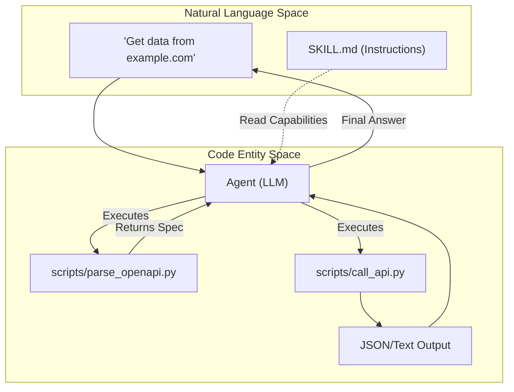
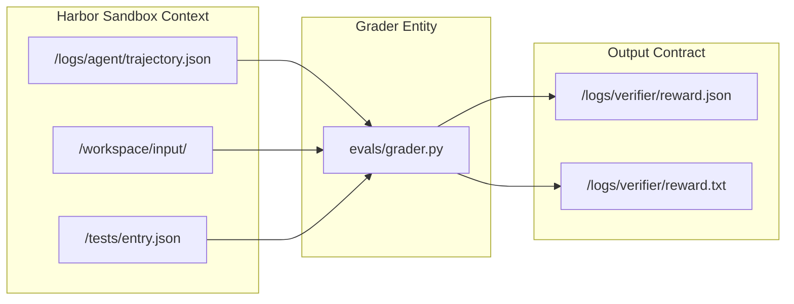

<!-- source: DeepWiki mcp.deepwiki.com · repo NVIDIA/SkillEvaluator · page 5.5 Reference Skills · fetched 2026-10-26 -->

# Reference Skills

Relevant source files

The following files were used as context for generating this wiki page:

- [src/skillevaluator/tier3/reference_skills/api-caller/SKILL.md](src/skillevaluator/tier3/reference_skills/api-caller/SKILL.md)
- [src/skillevaluator/tier3/reference_skills/calculator/SKILL.md](src/skillevaluator/tier3/reference_skills/calculator/SKILL.md)
- [src/skillevaluator/tier3/reference_skills/create-custom-grader/SKILL.md](src/skillevaluator/tier3/reference_skills/create-custom-grader/SKILL.md)
- [src/skillevaluator/tier3/reference_skills/task-list/SKILL.md](src/skillevaluator/tier3/reference_skills/task-list/SKILL.md)
- [src/skillevaluator/tier3/reference_skills/text-analyzer/SKILL.md](src/skillevaluator/tier3/reference_skills/text-analyzer/SKILL.md)

The **Reference Skills** are a collection of five bundled skills located within the `src/skillevaluator/tier3/reference_skills/` directory. They serve as the canonical examples for skill authors, demonstrating proper `SKILL.md` structure, script organization, and evaluation dataset design. Additionally, these skills act as stable integration test fixtures for the Tier 3 evaluation pipeline.

### Core Reference Skills

| Skill Name | Purpose | Key Components |
| :--- | :--- | :--- |
| `api-caller` | Dynamic REST API interaction and OpenAPI spec parsing. | `parse_openapi.py`, `call_api.py` |
| `calculator` | Safe, sandboxed arithmetic and unit conversions. | `calc.py` |
| `create-custom-grader` | Tooling for BYOG (Bring Your Own Grader) workflows. | `init-custom-grader` CLI bridge |
| `task-list` | State management for multi-step (4+) agent requests. | `tasks` tool interface |
| `text-analyzer` | Statistical analysis of plain text and files. | `analyze_text.py` |

**Sources:** [src/skillevaluator/tier3/reference_skills/api-caller/SKILL.md:1-6](), [src/skillevaluator/tier3/reference_skills/calculator/SKILL.md:1-7](), [src/skillevaluator/tier3/reference_skills/create-custom-grader/SKILL.md:1-6](), [src/skillevaluator/tier3/reference_skills/task-list/SKILL.md:1-6](), [src/skillevaluator/tier3/reference_skills/text-analyzer/SKILL.md:1-7]()

---

### Implementation and Data Flow

Reference skills follow a strict directory structure that separates instructions (Natural Language Space) from implementation (Code Entity Space). The agent reads the `SKILL.md` to understand which scripts to invoke via shell commands.

#### Logic Execution Flow
The following diagram illustrates how an agent interacts with a reference skill (e.g., `api-caller`) to perform a task.

**Diagram: Agent-to-Skill Execution Loop**

**Sources:** [src/skillevaluator/tier3/reference_skills/api-caller/SKILL.md:19-25](), [src/skillevaluator/tier3/reference_skills/api-caller/SKILL.md:110-122]()

---

### Skill Details

#### 1. API Caller (`api-caller`)
This skill enables agents to interact with external services without writing custom Python code for every endpoint. It supports two primary workflows:
*   **Direct Call:** Using `scripts/call_api.py` with `--url`, `--method`, and `--data` [src/skillevaluator/tier3/reference_skills/api-caller/SKILL.md:48-65]().
*   **Discovery:** Using `scripts/parse_openapi.py` to ingest a Swagger/OpenAPI spec URL and identify available operations [src/skillevaluator/tier3/reference_skills/api-caller/SKILL.md:28-46]().

#### 2. Calculator (`calculator`)
A dependency-free skill for arithmetic and unit conversion. It avoids `eval()` for safety and supports specific units like `celsius`, `fahrenheit`, `miles`, `km`, `kg`, `lbs`, `meters`, and `feet` [src/skillevaluator/tier3/reference_skills/calculator/SKILL.md:55-60]().
*   **Entry Point:** `scripts/calc.py` [src/skillevaluator/tier3/reference_skills/calculator/SKILL.md:21]().

#### 3. Create Custom Grader (`create-custom-grader`)
This skill facilitates the "Bring Your Own Grader" (BYOG) workflow. It guides the agent to convert existing benchmarks or rubrics into `evals/grader.py` or `evals/grader.sh` [src/skillevaluator/tier3/reference_skills/create-custom-grader/SKILL.md:8-16]().
*   **Modes:** Supports `default_plus_custom` (adds metrics to standard evaluator) and `custom_only` (grader owns pass/fail) [src/skillevaluator/tier3/reference_skills/create-custom-grader/SKILL.md:57-63]().
*   **Contract:** Graders must read from `/logs/agent/trajectory.json` and write to `/logs/verifier/reward.json` [src/skillevaluator/tier3/reference_skills/create-custom-grader/SKILL.md:113-126]().

#### 4. Task List (`task-list`)
Designed for complex, multi-step operations. It enforces a state machine where only one task can be `in_progress` at a time [src/skillevaluator/tier3/reference_skills/task-list/SKILL.md:68-73]().
*   **Operations:** `add_multiple`, `start`, `complete`, `cancel`, `list`, `next` [src/skillevaluator/tier3/reference_skills/task-list/SKILL.md:57-67]().

#### 5. Text Analyzer (`text-analyzer`)
Provides structured statistics for plain text.
*   **Metrics:** Word count, line count, character count, sentence count, average word length, and top 5 most frequent words [src/skillevaluator/tier3/reference_skills/text-analyzer/SKILL.md:40-49]().
*   **Entry Point:** `scripts/analyze_text.py` [src/skillevaluator/tier3/reference_skills/text-analyzer/SKILL.md:22]().

---

### Tier 3 Integration and Harbor Contract

Reference skills are used to test the Tier 3 `Harbor` framework. The `create-custom-grader` skill specifically defines the contract between the evaluation environment and the grading logic.

**Diagram: Harbor Grader Contract**

**Sources:** [src/skillevaluator/tier3/reference_skills/create-custom-grader/SKILL.md:111-126]()

### Summary Table: Reference Skill Constraints

| Skill | Compatibility | External Dependencies | Primary Script |
| :--- | :--- | :--- | :--- |
| `api-caller` | REST/OpenAPI | `requests` (implied) | `scripts/call_api.py` |
| `calculator` | Python 3.10+ | None | `scripts/calc.py` |
| `create-custom-grader` | Harbor Sandbox | `skillevaluator` CLI | `evals/grader.py` |
| `task-list` | Tool-based | Internal state | `tasks()` tool |
| `text-analyzer` | Python 3.10+ | None | `scripts/analyze_text.py` |

**Sources:** [src/skillevaluator/tier3/reference_skills/calculator/SKILL.md:4](), [src/skillevaluator/tier3/reference_skills/text-analyzer/SKILL.md:4](), [src/skillevaluator/tier3/reference_skills/create-custom-grader/SKILL.md:49-51]()

---

